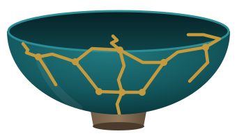
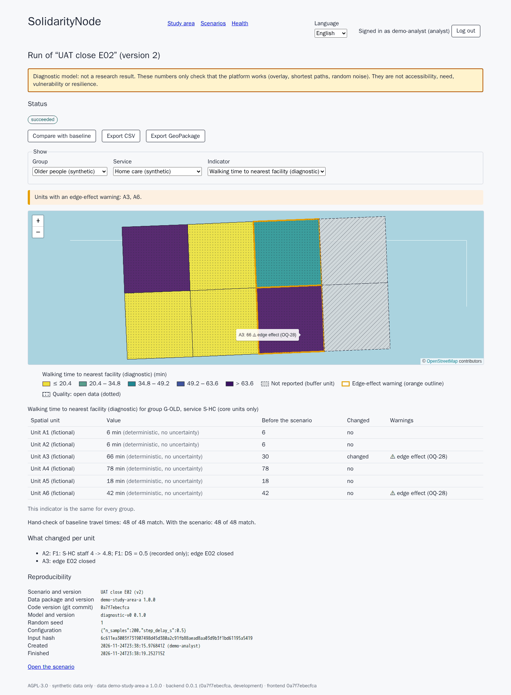

<p align="center">
  <br>
  <!-- BEGIN GENERATED: platform-version (from VERSION; scripts/docs_indexes.py) -->
  <strong>SN Kintsugi</strong> · version 0.1.0
  <!-- END GENERATED: platform-version -->
</p>

# SolidarityNode

**Open-source spatial probabilistic framework for social service accessibility, hidden need, vulnerability and resilience.**

SolidarityNode helps **municipalities** see how well social services (healthcare, social care and other public services) cover the needs of each area and population group, who is left out, what a disruption would cost each group, and how quickly the system recovers. **Researchers** get an open, reproducible implementation of a four-paper method built on Bayesian networks, Monte Carlo simulation and network analysis, where every result carries its uncertainty. **Contributors** find a typed Python core, a FastAPI backend and a React frontend, developed in the open under AGPL-3.0.



*A run on synthetic data (UAT checklist 01). The banner says what every result says today: diagnostic model, not a research result.*

## Status

- **Early development.** Current version: **0.1.0** (from [`VERSION`](VERSION); see the [changelog](CHANGELOG.md)).
- The platform foundation works end to end on synthetic data: data packages, scenarios, background runs, results with uncertainty, comparison, export, users and roles.
- **Diagnostic model only, no research results yet.** The only model, `diagnostic-v0`, checks that the platform works. The research methods arrive paper by paper ([roadmap](docs/roadmap.md)).
- Synthetic data only. Nothing here is validated for operational decisions.

## Quick start

Requirements: `git`, `make`, [`uv`](https://docs.astral.sh/uv/), Node.js 26 with `pnpm` 12, and Podman (default) or Docker.

```bash
make setup   # check the tools, create .env, install locked dependencies
make uat     # fresh database, synthetic demo package, baseline run (asks you to type yes)
```

Open <http://127.0.0.1:8080> (everything listens on `127.0.0.1` only) and sign in with a demo account. These accounts exist **only with `APP_ENV=development`** (the default) and their passwords are public: never use them anywhere else.

| Username | Password | Role |
| --- | --- | --- |
| `demo-admin` | `demo-admin-pass` | administrator: users and data packages |
| `demo-analyst` | `demo-analyst-pass` | analyst: scenarios and runs |

Then follow the [UAT guide](docs/uat/README.md) (setup on Windows with WSL2, Docker instead of Podman, logs, database). For a real installation create the first administrator with `make create-admin`.

## Where to go next

**Use the platform**
- [User guide](docs/user-guide/index.md): one page per screen, roles, FAQ
- [Concepts](docs/concepts.md): data package, scenario, run and data version in plain language
- [UAT checklists](docs/uat/README.md): step-by-step tests with expected results

**Understand the method**
- [Domain model](docs/specs/00-domain-model.md) and the [specifications index](docs/specs/README.md)
- [Open questions](docs/specs/open-questions.md):
  <!-- BEGIN GENERATED: oq-counts (scripts/docs_indexes.py) -->
  30 questions: **10 decided**, 2 partly decided, 1 proposed, **17 open**.
  <!-- END GENERATED: oq-counts -->
- [Paper revisions](docs/specs/paper-revisions.md): what the decisions change in the papers

**Develop**
- [Architecture](docs/architecture.md) and [components](docs/architecture/components.md)
- [Decisions (ADR index)](docs/adr/README.md)
- [Contributing](CONTRIBUTING.md) and the rules for every contributor, human or AI: [AGENTS.md](AGENTS.md)

## Project status (live)

Work is planned in GitHub, not in these files:

- Project board: [Kintsugi](https://github.com/orgs/SolidarityNode/projects/6), with the views [In progress](https://github.com/orgs/SolidarityNode/projects/6/views/1?filterQuery=status%3A%22In+progress%22) and [Todo](https://github.com/orgs/SolidarityNode/projects/6/views/1?filterQuery=status%3ATodo)
- Per paper (milestones): [v0.3 Paper 1](https://github.com/SolidarityNode/snode/milestone/3) · [v0.4 Paper 2](https://github.com/SolidarityNode/snode/milestone/4) · [v0.5 Paper 3](https://github.com/SolidarityNode/snode/milestone/5) · [v0.6 Paper 4](https://github.com/SolidarityNode/snode/milestone/6)
- [All milestones](https://github.com/SolidarityNode/snode/milestones) · [`good first issue`](https://github.com/SolidarityNode/snode/issues?q=is%3Aopen+label%3A%22good+first+issue%22) · [Roadmap](docs/roadmap.md)

## More

- **Documentation site:** <https://solidaritynode.github.io/snode/> (versioned: `dev` follows `main`, one version per release)
- [Changelog](CHANGELOG.md) · [Releases](https://github.com/SolidarityNode/snode/releases) · [How releases are made](docs/releasing.md)
- **Licence:** [AGPL-3.0-or-later](LICENSE). Modified versions, including those offered as a network service, must stay open under the same licence. The name is covered by the [trademark policy](TRADEMARK.md), not by the licence.
- **Data and privacy:** no real personal or operational data is ever committed, only synthetic data. Operational data is anonymous by design and stays in the municipality; rules for small areas are decided before any real data is collected (OQ-21, [ADR 0010](docs/adr/0010-ticket-privacy.md)). Details: [AGENTS.md, "Data and privacy rules"](AGENTS.md#data-and-privacy-rules) and [data sources](docs/data-sources.md).
- **How to cite:** see [`CITATION.cff`](CITATION.cff) (GitHub shows "Cite this repository").
- [Code of conduct](CODE_OF_CONDUCT.md) · [Security policy](SECURITY.md)

## Περίληψη στα ελληνικά

Το **SolidarityNode** είναι ανοιχτό χωρικό πιθανοτικό πλαίσιο για την εκτίμηση της προσβασιμότητας, της κρυφής ανάγκης, της τρωτότητας και της ανθεκτικότητας δικτύων κοινωνικών υπηρεσιών. Βρίσκεται σε πρώιμο στάδιο (έκδοση 0.1.0): η πλατφόρμα λειτουργεί με συνθετικά δεδομένα και ένα διαγνωστικό μοντέλο, χωρίς ακόμη ερευνητικά αποτελέσματα. Ο κώδικας είναι ανοιχτός (AGPL-3.0) και δεν περιλαμβάνει ποτέ πραγματικά δεδομένα.
