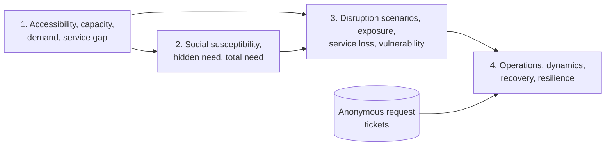

# SolidarityNode

**Open-source spatial probabilistic framework for social service accessibility, latent need, vulnerability and resilience.**

> **Status: early-stage research software.** SolidarityNode is under active design and development. APIs, data models and methods will change. Nothing here is validated for operational decision-making yet.

---

## What is SolidarityNode?

SolidarityNode is an open-source platform that moves the analysis of social infrastructure (healthcare facilities, social care and other public services) from a static map of spatial adequacy to a **dynamic, probabilistic view**.

It combines in a single framework:

- spatial **accessibility** and **capacity** of service facilities,
- estimation of **hidden social need**: need that is never expressed as a request,
- **vulnerability** of population groups: how a service disruption turns into consequences for each group,
- **real operational data** from the services themselves (anonymous request tickets),
- the **dynamics of impact and recovery** over time, leading to estimates of system **resilience**.

A degraded facility is not automatically treated as lost service. The platform estimates what the population of each area actually loses, given the alternative facilities and routes available in the network, and how the system recovers after a disruption.

## How it fits together

The framework is developed in four connected parts (see [`docs/specs/00-domain-model.md`](docs/specs/00-domain-model.md)):



1. **Baseline**: group-specific accessibility, facility capacity shared among the areas that reach it (two-step floating catchment area), estimated demand and the **service gap**.
2. **Hidden need**: total need is the share of a group that needs a service; a latent non-take-up level, informed by social susceptibility, the shortfall of supply against total need, access deterrence and alternatives outside the network, splits it into visible and **hidden need**.
3. **Vulnerability**: simulated disruption scenarios give group exposure and service loss; together with social susceptibility they feed the **vulnerability relationship** of each group.
4. **Resilience**: operational data, the functional state of facilities and areas, and a Dynamic Bayesian Network describe loss and recovery over time; the vulnerability relationship is updated from real observations and **resilience** is derived from recovery trajectories.

## Core ideas

**Unit of analysis.** Everything is modelled at the level of:

> spatial unit × social group × service × time

**Vulnerability is not resilience.** The vulnerability of a group is the relationship that turns a disruption into consequences for that group, given its exposure, the service loss and its social susceptibility. A vulnerability value is that relationship evaluated at a given scenario, and maps compare areas at the same standardised reference scenarios (minor, moderate, severe). Resilience is a dynamic property that emerges from the trajectory of loss and recovery. They are modelled separately, and neither is the same as risk.

**Facility state is not population-level service loss.** A facility can be degraded without any loss of coverage for an area, if alternative facilities and routes still serve it. Coverage is therefore computed at the level of the service network, not the individual facility.

**Observed demand is not need.** Need is split into three kinds that never overlap: **hidden need** (never expressed as a request, because people do not seek the service, cannot reach it, are discouraged or use alternatives), **unmet expressed need** (requests not fulfilled within the service's maximum acceptable waiting time) and **met need**. Hidden need is estimated explicitly, as a share of the group with an interval.

**Social group is not social susceptibility.** The group says who is examined; social susceptibility is how prone that group is to unmet provision of a service, from its social characteristics and independently of the service system.

**Need is measured in service units.** Need, capacity, supply, gap and loss are measured in service units (visits, appointments or hours) per reference period, defined per service. Quantities of different services are never added together.

**Uncertainty is first-class.** Methods are probabilistic (Bayesian Networks, Dynamic Bayesian Networks and Monte Carlo simulation) so that results carry uncertainty instead of single deterministic numbers. Expert-elicited relationships act as priors, and their parameters are learned as real operational observations accumulate.

**Operational support is a system response.** Mobilising extra resources (including approved volunteers) is part of how the system responds to a disruption, not an independent measure of resilience.

## Planned capabilities

Modules of the `core` library, following the module map in [`docs/specs/00-domain-model.md`](docs/specs/00-domain-model.md) §6:

| Module | Papers | Purpose |
| --- | --- | --- |
| `model` | all | Entities and the typed container for `spatial unit × social group × service × time` |
| `bayes` | 1–4 | Discrete variables, CPTs, expert elicitation, inference and parameter-learning interfaces |
| `accessibility` | 1 §5 | Travel times, access weights, group- and mode-specific accessibility |
| `demand` | 1 §6 | Estimated demand (visible use, not need) |
| `capacity` | 1 §7 | Physical, functional and effective capacity, supply (2SFCA allocation) |
| `service_gap` | 1 §8–9 | Service gap and its Bayesian network |
| `latent_need` | 2 | Social susceptibility, hidden need, estimated total need |
| `scenarios` | 1 §13, 3 §7–10 | Counterfactual and disruption scenarios |
| `vulnerability` | 3 §11–21 | Group exposure, service loss, the vulnerability relationship |
| `operations` | 4 §4–5 | Anonymous request tickets, operational indicators, facility functional state |
| `dynamics` | 4 §7–9, 12 | Territorial state, expected and observed consequence, Dynamic Bayesian Network |
| `resilience` | 4 §10–13 | Bayesian parameter learning of the vulnerability relationship, recovery trajectories, resilience |
| `uncertainty` | 1 §11, 2 §14, 3 §22 | Monte Carlo propagation |
| `sensitivity` | 1 §12, 2 §16, 3 §23 | Sensitivity analysis |
| `validation` | 1 §14, 2 §18, 3 §24 | Validation tools |

At this stage the modules expose typed interfaces only; methods are implemented once their open questions are decided (see [`docs/specs/open-questions.md`](docs/specs/open-questions.md)).

A **Digital Twin** is a possible long-term direction, not a starting assumption. The architecture aims not to rule it out, while the framework first investigates whether a probabilistic, dynamic model can serve as its foundation.

## Planned architecture

```
solidaritynode/
├── core/        # simulation and modelling library (Python), no web or database dependencies
├── backend/     # API, scenario and run management, anonymous request-logging mechanism
├── frontend/    # web interface: maps, scenarios, results
├── docs/        # architecture, specifications, decision records
├── data/        # synthetic data only (real data is never committed)
└── .github/     # CI, issue and PR templates
```

Dependency direction: `backend` depends on `core`; `core` never imports from `backend` or `frontend`. This keeps the modelling library testable and reusable on its own.

## Data and privacy

Social service data can be sensitive.

- **No real personal or operational data is ever committed to this repository.** Only synthetic data is used for tests and demos.
- The operational data mechanism is designed to be **anonymous** (for example QR codes or an appointment system) and to record only what is needed: spatial origin of the request, social group, service type, timestamps (request, scheduled, fulfilled, expiry) and a yes/no flag "first request in this period", which lets people be counted without being identified.
- Even anonymous records can identify people in small areas. Minimum cell sizes, retention and aggregation rules will be decided before any real data is collected (open question OQ-21).
- Deployments are responsible for complying with applicable data protection law (for example the GDPR in the EU).

## Getting started

Requirements: `git`, `make`, [`uv`](https://docs.astral.sh/uv/), Node.js 26 with `pnpm` 12, and Podman (default) or Docker.

```bash
make setup        # check tools, create .env, install dependencies
make lint test    # lint, type check and test everything
make up           # start database, backend and frontend (Podman by default)
make uat          # or: clean database + synthetic demo data, then print the URLs
```

Then open http://127.0.0.1:8080 (services listen on `127.0.0.1` only). Manual testing: [docs/uat/](docs/uat/README.md). With Docker: `CONTAINER_ENGINE=docker COMPOSE="docker compose" make up`. See [CONTRIBUTING.md](CONTRIBUTING.md) and [docs/architecture.md](docs/architecture.md).

# SolidarityNode: Platform features
 
SolidarityNode is an open-source platform (AGPL-3.0) that shows municipalities and researchers how well social services cover the needs of the population, who is left out, what happens when something breaks down, and how quickly the system recovers. Every result comes with its uncertainty, never as a single number.
 
The platform foundation (A) is built first. The analytical tools (B) are added through the tickets of the four papers.
 
## A. Platform foundation
 
The foundation provides the map, scenarios, runs and data management that the analytical tools later plug into.
 
### Users and roles
 
- Sign-in with an account.
- Roles: **admin** (users, data), **analyst** (scenarios, runs), **viewer** (sees shared work).
### Study area on a map
 
- Spatial units, facilities and the road network of one or more municipalities, plus a **buffer** of neighbouring areas, so that people served across the boundary are counted correctly.
- A **quality** flag on every feature (open data, estimate, verified by the municipality) and an **edge-effect warning** where data on neighbours is missing.
### "What if…" scenarios
 
- Built by clicking on the map: increase or reduce capacity, add a facility, degrade or close a facility, close a road.
- Every change is kept as a **version**. Scenarios are private or shared.
### Runs
 
- Run in the background, with progress and cancellation.
- Every run is **fully reproducible**: it records the data version, code, model, parameters and random seed.
### Results
 
- Maps and tables by spatial unit, social group and service, with uncertainty always visible.
- **Comparison** with the current situation (side by side or a difference map).
- **Export** to CSV and GeoPackage, together with the reproducibility details.
### Data and updates
 
- Import of **data packages** with integrity checks and a **preview of changes** before they are applied.
- Past results never change. Scenarios can be rerun on new data and compared.
### Central hub
 
- Registration of national sources (boundaries, network, population) without processing the whole country.
- Step-by-step **onboarding** of a municipality, with a coverage matrix showing what is available and what is missing.
- Import and extension of facilities from Excel, CSV or GeoPackage, with an error report and change history.
- Publication of packages per municipality, and a notice when onboarding a neighbour improves another municipality's data.
## B. Analytical tools
 
Each paper adds an analytical tool on top of the foundation, in the order 1 → 2 → 3 → 4.
 
### Accessibility and adequacy (Paper 1)
 
- Travel times by group and transport mode (walking, car, public transport).
- Actual service supply per area, taking into account that several areas share the same facilities.
- **Service gap** by group, with an explanation of why (low capacity, poor access or high demand).
### Hidden need (Paper 2)
 
- Estimate of the **share of each group with need that is not visible**, for example "7–17 % of older people in local community X".
- A map of areas where recorded demand most likely underestimates reality.
### Vulnerability (Paper 3)
 
- What each group loses when a facility is degraded or closed, or a road is cut, taking alternatives into account.
- Maps at standard reference scenarios (minor, moderate, severe disruption), so that areas are compared fairly.
- How many people are affected and how deeply, not only how much service is lost overall.
### Real operation and resilience (Paper 4)
 
- **Anonymous request logging** (QR code or appointments) at facilities, with no personal data.
- Operational indicators: waiting time, delay, unmet requests, coverage.
- **State of each facility** (normal, under pressure, degraded, critical, recovering) and an **operational view**: "which facility needs help now, and of what kind".
- Monitoring of **recovery** after a disruption and estimation of **resilience** by spatial unit, group and service.
- Estimates **learn** from real operation over time.
### Shared tools
 
- Uncertainty analysis (Monte Carlo) and sensitivity analysis ("which factor matters most").
- Expert elicitation tools that feed the probabilistic models.
## C. Principles that apply everywhere
 
- **Open source**, with no closed editions.
- **Privacy by design:** no personal data. Operational data stays with the municipality; only anonymous aggregates are shared upwards, and only if the municipality chooses to.
- **One installation per municipality**, or group of municipalities, with a shared hub for open data.
- **Reproducibility:** every result can be reproduced exactly.
- **Transparency:** every dataset has a source and a processing note, and every method decision is recorded.
 

## Roadmap

- [ ] **v0.1**: `core` with a minimal model on synthetic data; `docs/architecture.md`
- [ ] **v0.2**: accessibility and capacity module, backend API
- [ ] **v0.3**: latent need and vulnerability models, first frontend
- [ ] **v0.4**: operational data ingestion, dynamics and resilience indicators
- [ ] **v0.5**: validation tools, sensitivity and uncertainty analysis

The roadmap is tracked in GitHub Issues and Projects.

## Contributing

Contributions of all kinds are welcome: code, documentation, methodological review, test data, translations.

- Read [CONTRIBUTING.md](CONTRIBUTING.md) before opening a pull request.
- Look for issues labelled `good first issue`.
- Be respectful: see [CODE_OF_CONDUCT.md](CODE_OF_CONDUCT.md).

## License

SolidarityNode is licensed under the **GNU Affero General Public License v3.0** (AGPL-3.0). See [LICENSE](LICENSE).

In short: you may use, study, modify and share the software, including offering services around it, but modified versions (including those run as a network service) must remain open under the same license.

The name "SolidarityNode" is not covered by the license. See the draft [trademark policy](TRADEMARK.md).

## Background

The framework draws on the literature on accessibility (Geurs & van Wee, 2004), social vulnerability (Cutter et al., 2003; Adger, 2006), community and system resilience (Holling, 1973; Bruneau et al., 2003; Norris et al., 2008), critical infrastructure interdependencies (Rinaldi et al., 2001), probabilistic graphical models (Pearl, 1988; Koller & Friedman, 2009; Murphy, 2002) and Digital Twins (Grieves & Vickers, 2017). A full reference list will be maintained in `docs/`.

---

## Περίληψη στα ελληνικά

Το **SolidarityNode** είναι ανοιχτό χωρικό πιθανοτικό πλαίσιο για την εκτίμηση της προσβασιμότητας, της λανθάνουσας κοινωνικής ανάγκης, της τρωτότητας και της ανθεκτικότητας δικτύων κοινωνικών υπηρεσιών (δομές υγείας, κοινωνικής φροντίδας κ.ά.). Χρησιμοποιεί Bayesian και Dynamic Bayesian Networks και ενημερώνει τις εκτιμήσεις του με πραγματικά δεδομένα λειτουργίας.

Η βασική μονάδα ανάλυσης είναι: **χωρική μονάδα × κοινωνική ομάδα × υπηρεσία × χρόνος**. Η δυσλειτουργία μιας δομής δεν ταυτίζεται με απώλεια υπηρεσίας για τον πληθυσμό. Η καταγεγραμμένη ζήτηση δεν ταυτίζεται με την ανάγκη: η κρυφή ανάγκη (ανάγκη που δεν εκφράζεται ποτέ ως αίτημα) εκτιμάται ρητά. Η τρωτότητα μιας ομάδας είναι η σχέση που μετατρέπει μια διαταραχή σε συνέπειες για την ομάδα, και διαχωρίζεται από την ανθεκτικότητα, που προκύπτει από την πορεία απώλειας και ανάκαμψης.

Το project βρίσκεται σε πρώιμο ερευνητικό στάδιο. Ο κώδικας είναι πάντα ανοιχτός (AGPL-3.0) και δεν περιλαμβάνει ποτέ πραγματικά δεδομένα, μόνο συνθετικά.
