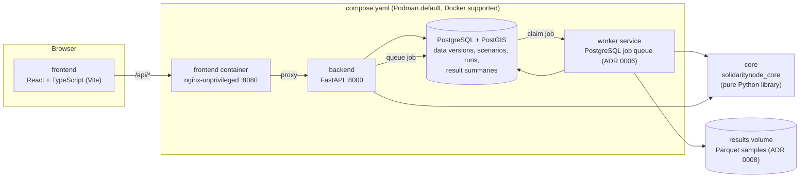
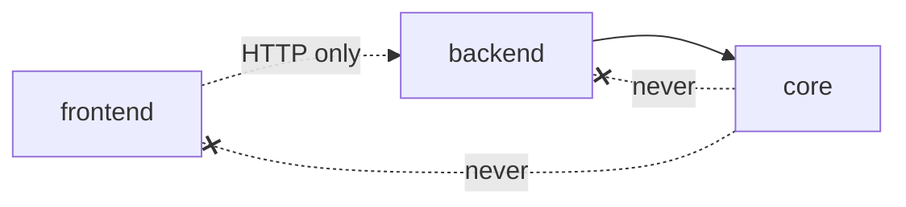
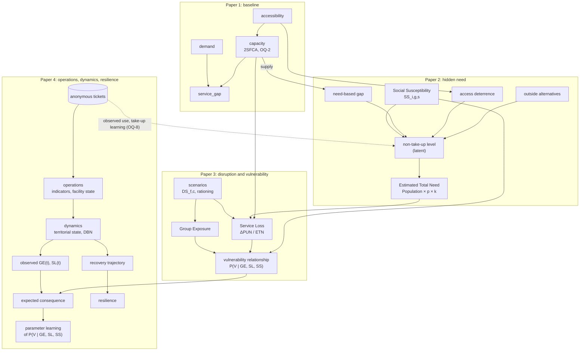
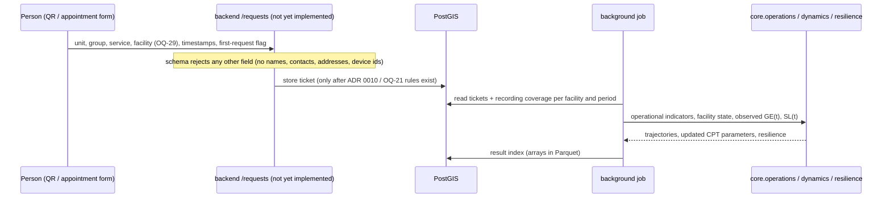
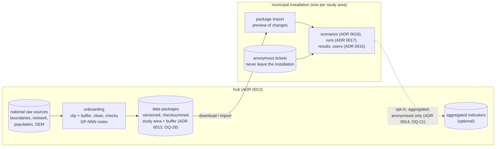

# Architecture

> Status: v0.1 platform mechanics (no scientific method yet: the only model is the diagnostic model `diagnostic-v0`). It will grow with each module. The science is specified in [`docs/specs/`](specs/README.md); decisions are recorded in [`docs/adr/`](adr/README.md).

## 1. Components



| Component | Path | Responsibility | Depends on |
| --- | --- | --- | --- |
| `core` | `core/` | Domain model and modelling methods (accessibility, need, vulnerability, dynamics, resilience). No web framework, no database driver. | NumPy, xarray |
| `backend` | `backend/` | HTTP API: data package import, users and roles, scenarios, runs, results, comparison, export; the worker process; persistence. | `core`, FastAPI, SQLAlchemy, Alembic, argon2-cffi, PyArrow |
| `worker` | `backend/` (same image) | Runs queued jobs (model runs) outside the request cycle. | `core`, PostgreSQL |
| `frontend` | `frontend/` | Web UI: study area, scenarios, runs, comparison, admin; maps with Leaflet (ADR 0007). | backend API over HTTP |
| database | `compose.yaml` | Data versions, scenarios, runs and result summaries in PostgreSQL/PostGIS. | — |
| files | `results` volume | Per-sample results in Parquet, package uploads. | — |

## 2. Dependency direction



- `backend → core`, never the reverse. `core` must not import `backend`, `frontend`, any web framework or any database layer.
- Enforced by `core/tests/test_package.py` (AST scan of imports and of declared dependencies) and by the ruff `banned-api` rule in `core/pyproject.toml`.
- The frontend talks to the backend only through the HTTP API (`frontend/src/api/client.ts`).

## 3. The paper pipeline

The four papers form a pipeline; each `core` module implements parts of one or more papers (module map: [`specs/00-domain-model.md` §6](specs/00-domain-model.md)).



Cross-cutting modules used by all papers: `model`, `bayes`, `uncertainty` (Monte Carlo), `sensitivity`, `validation`.

Key separations (AGENTS.md invariants): vulnerability (a relationship, Paper 3) is not resilience (a trajectory property, Paper 4); a facility's state is not a unit's service loss; estimated demand is not need; a social group is not its susceptibility.

## 4. Ticket data flow

Anonymous request tickets (Paper 4 §4.1) are the only operational data the platform collects.



- Privacy rules (minimum cell sizes, retention, aggregation) are **open (OQ-21)** and must be decided in ADR 0010 before any ticket is stored.
- Only facilities with full or known recording coverage feed learning (OQ-8).
- Tickets record the facility where the request is made or scheduled (OQ-29, decided), so indicators, functional state and recording coverage can be computed per facility. The facility field follows the OQ-21 rules.

## 5. Background jobs and runs

Model runs never execute inside a request handler.

```mermaid
sequenceDiagram
    participant UI as frontend
    participant API as backend
    participant DB as PostgreSQL
    participant W as worker
    participant C as core (model registry)
    UI->>API: POST /runs (scenario, version, seed, config)
    API->>DB: input hash; reuse a succeeded run, or insert run + queued job
    W->>DB: claim job (FOR UPDATE SKIP LOCKED)
    W->>C: diagnostic-v0(study area, scenario, config, seed, progress)
    C-->>W: progress callbacks (cancel checked here)
    W->>DB: run_results, run_tables; job succeeded
    W->>W: samples.parquet in the results volume
    UI->>API: GET /runs/{id} (poll status and progress)
```

- Interface: `JobRunner` (`submit(kind, payload)`, `info`, `cancel`) in `backend/.../jobs/`;
  implementation `PostgresJobRunner`; worker `python -m solidaritynode_backend.worker` (ADR 0006).
- A stopped worker marks its running job failed; a restarted worker fails jobs it left running.
- Runs record every reproducibility field and an input hash (ADR 0017); models come from the core
  registry (`solidaritynode_core.model.get_registry`), which holds only `diagnostic-v0`.

## 6. Containers and local development

- `make up` builds and starts `db`, `backend`, `worker` and `frontend` with `$(COMPOSE)` (default `podman compose`). Docker: `CONTAINER_ENGINE=docker COMPOSE="docker compose" make up`. ADR 0011.
- Ports (non-privileged, bound to 127.0.0.1): frontend 8080, backend 8000, database 5432; configurable in `.env`.
- The backend container runs `alembic upgrade head` before starting the API.
- Database data lives in the named volume `db-data`, run samples and package uploads in `results`; there are no bind mounts, so the stack behaves the same under WSL2.
- `make up` passes `GIT_COMMIT` to both image builds; `/version` and the frontend footer show it with `APP_ENV`, so a tester knows which build is running. Outside `development` and `test`, the backend refuses `change-me` secrets.
- `make uat` resets the database, starts the stack, imports demo package 1.0.0 (which queues the baseline run), seeds the development demo users and prints URLs and credentials; see [`docs/uat/`](uat/README.md).

## 7. Deployment and data packages

Spec 00 §3 describes one codebase running in two roles. v0.1 implements the municipal installation (`DEPLOYMENT_MODE=municipality`) with manual package import; hub onboarding comes next (ADR 0012). ADRs 0012, 0013 and 0015–0017 are accepted for v0.1; ADR 0014 (upward flow) stays open and nothing is sent upwards.



- The same images run as `municipality` or `hub`, chosen by `DEPLOYMENT_MODE` (ADR 0012).
- Data packages carry a `manifest.json` listing files with checksums, layer coverage, changelog and the `DP-NNN` processing notes behind the data (format in ADR 0013; demo packages in `data/synthetic/packages/`, DP-002). Import validates, previews changes and imports in one transaction; every version is kept and runs point to theirs.
- Core units next to a buffer municipality without facility data carry an edge-effect warning (OQ-28, warning only); results are reported for core units only.
- Runs record scenario version, package version, git commit, model and parameter version, seed and configuration (ADR 0017).

