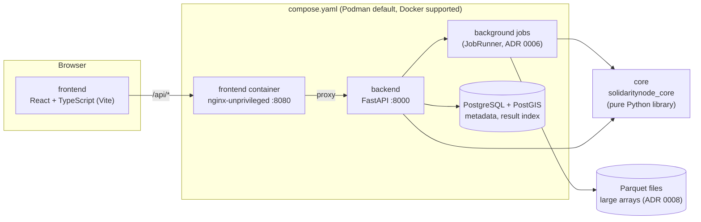
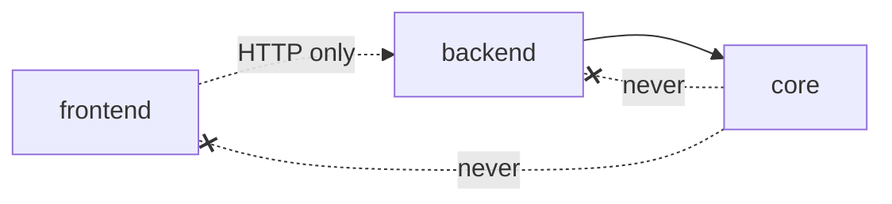
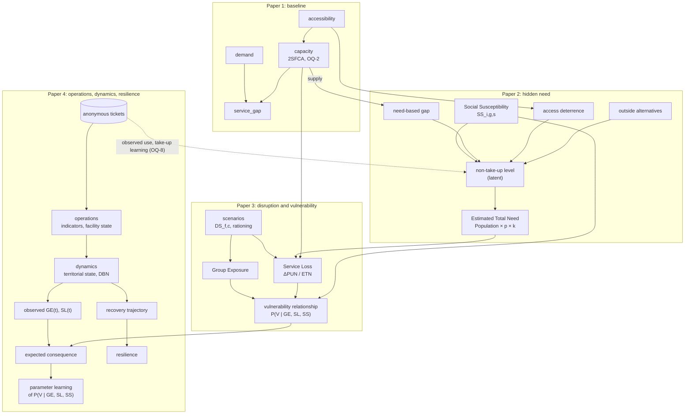
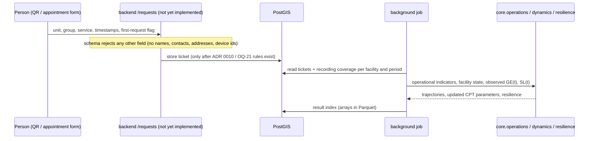

# Architecture

> Status: v0 skeleton. Describes the structure set up by the bootstrap; it will grow with each module. The science is specified in [`docs/specs/`](specs/README.md); decisions are recorded in [`docs/adr/`](adr/README.md).

## 1. Components

| Component | Path | Responsibility | Depends on |
| --- | --- | --- | --- |
| `core` | `core/` | Domain model and modelling methods (accessibility, need, vulnerability, dynamics, resilience). No web framework, no database driver. | NumPy, xarray |
| `backend` | `backend/` | HTTP API, scenario and run management, anonymous request logging, background jobs, persistence. | `core`, FastAPI, SQLAlchemy, Alembic |
| `frontend` | `frontend/` | Web UI: scenarios, results, maps (map library: ADR 0007). | backend API over HTTP |
| database | `compose.yaml` | Metadata and result indexes in PostgreSQL/PostGIS. | — |
| files | `data/` (not in git) | Large datasets and result arrays in Parquet. | — |

## 2. Dependency direction

- `backend → core`, never the reverse. `core` must not import `backend`, `frontend`, any web framework or any database layer.
- Enforced by `core/tests/test_package.py` (AST scan of imports and of declared dependencies) and by the ruff `banned-api` rule in `core/pyproject.toml`.
- The frontend talks to the backend only through the HTTP API (`frontend/src/api/client.ts`).

## 3. The paper pipeline

The four papers form a pipeline; each `core` module implements parts of one or more papers (module map: [`specs/00-domain-model.md` §6](specs/00-domain-model.md)).

Cross-cutting modules used by all papers: `model`, `bayes`, `uncertainty` (Monte Carlo), `sensitivity`, `validation`.

Key separations (CLAUDE.md invariants): vulnerability (a relationship, Paper 3) is not resilience (a trajectory property, Paper 4); a facility's state is not a unit's service loss; estimated demand is not need; a social group is not its susceptibility.

## 4. Ticket data flow

Anonymous request tickets (Paper 4 §4.1) are the only operational data the platform collects.

- Privacy rules (minimum cell sizes, retention, aggregation) are **open (OQ-21)** and must be decided in ADR 0010 before any ticket is stored.
- Only facilities with full or known recording coverage feed learning (OQ-8).
- Spec gap to raise: tickets carry no facility, but indicators, functional state and recording coverage are per facility (see `core/src/solidaritynode_core/operations/__init__.py`).

## 5. Background jobs

Long-running simulations (Monte Carlo, scenario sweeps, DBN runs) never run inside a request handler.

- `backend/src/solidaritynode_backend/jobs/` defines a `JobRunner` protocol (`submit`, `info`, `shutdown`) and an `InProcessJobRunner` (thread pool) for development and tests.
- The production queue is open (ADR 0006). Routers depend only on `JobRunner`, so the queue can change without touching them.
- Jobs call `core` directly and write large outputs to Parquet; the database stores the index (ADR 0008).

## 6. Containers and local development

- `make up` builds and starts `db`, `backend` and `frontend` with `$(COMPOSE)` (default `podman compose`). Docker: `CONTAINER_ENGINE=docker COMPOSE="docker compose" make up`. ADR 0011.
- Ports (non-privileged, bound to 127.0.0.1): frontend 8080, backend 8000, database 5432; configurable in `.env`.
- The backend container runs `alembic upgrade head` before starting the API.
- Database data lives in the named volume `db-data`; there are no bind mounts, so the stack behaves the same under WSL2.
