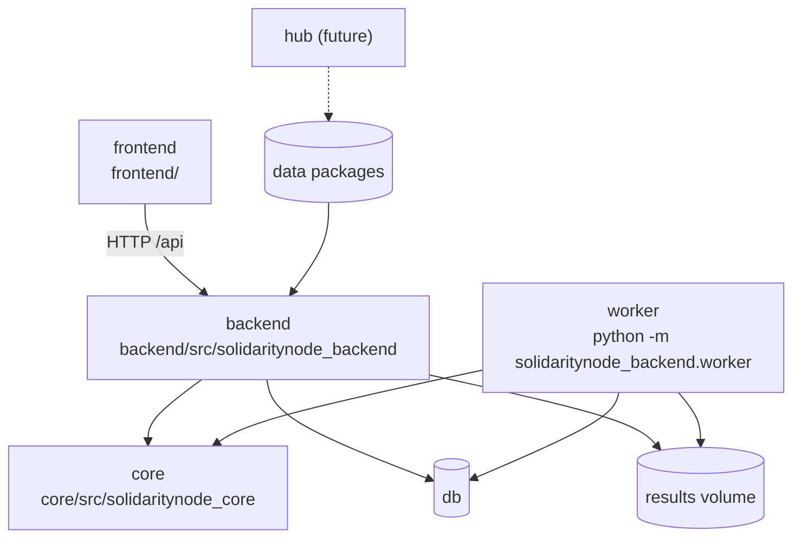

# Components

> Describes platform version **0.1.0**. Overview and trust boundaries: [Architecture](../architecture.md). Settings are described once, in the configuration table of [CONTRIBUTING](../../CONTRIBUTING.md#configuration); this page only names which settings each component reads.

## core

**Responsibility.** The domain model and the modelling methods, as a pure Python library: entities indexed by `spatial unit × social group × service × time`, uncertain values, the variable catalogue, scenario overlays, the model registry and, later, the methods of the four papers. No web framework, no database driver, no file-system side effects in model code (AGENTS.md, [core rules](../conventions/core.md)).

**Main entry points and folders** (`core/src/solidaritynode_core/`):

| Module | Papers | State in 0.1.0 |
| --- | --- | --- |
| `model` | all | **implemented**: entities, identifiers, `IndexedValues`, uncertain values, ordinal states, service-unit quantities, variable catalogue, tickets, trajectories, study area, message catalogue, model registry (`get_registry`) |
| `scenarios` | 1 §13, 3 §7–10 | **implemented** (platform part): scenario overlay `apply_overlay`, placeholders, order of application (OQ-30, proposed) |
| `uncertainty` | 1 §11, 2 §14, 3 §22 | **partly**: summary statistics of samples (mean, median, interval quantiles); Monte Carlo propagation not yet |
| `validation` | 1 §14, 2 §18, 3 §24 | **partly**: the diagnostic model `diagnostic-v0` (`validation/diagnostic.py`), not a method; validation tools not yet |
| `bayes` | 1–4 | interfaces only (engine: ADR 0004, proposed) |
| `accessibility`, `demand`, `capacity`, `service_gap` | 1 | typed interfaces only, no method |
| `latent_need` | 2 | typed interfaces only, no method |
| `vulnerability` | 3 | typed interfaces only, no method |
| `operations`, `dynamics`, `resilience` | 4 | typed interfaces only, no method |
| `sensitivity` | 1 §12, 2 §16, 3 §23 | empty interface |

The module map and what each module will compute: [domain model §6](../specs/00-domain-model.md#6-module-map-for-core).

**Configuration.** None: `core` reads no environment variables. Randomness only through an explicit seed or `numpy.random.Generator`.

**Tests.** `core/tests/` with pytest (`make test-core`); `make lint-core` runs ruff and mypy in strict mode. `test_package.py` enforces the dependency direction (no web or database imports); `test_demo_dataset.py` and `test_diagnostic.py` check known answers on the synthetic demo data.

**Related.** ADR [0003](../adr/0003-core-data-model.md), [0004](../adr/0004-bn-dbn-library.md), [0005](../adr/0005-inference-and-discretisation.md), [0016](../adr/0016-scenario-schema-and-versioning.md); Spec 00 §2–6.

## backend

**Responsibility.** The HTTP API and persistence: sign-in and roles, data package validation and import, study area, scenarios and their versions, runs (creating jobs, never computing in a request), results, comparison and export. The same code runs as a municipal installation or a hub (`DEPLOYMENT_MODE`, ADR 0012); only the municipal role is complete.

**Main entry points and folders** (`backend/src/solidaritynode_backend/`):

| Path | What |
| --- | --- |
| `main.py` | FastAPI application; mounts only the routes of the deployment role |
| `routers/` | `auth`, `users`, `data` (study area, packages), `scenarios`, `runs`, `health` (`/health`, `/health/ready`, `/version`); `requests` (tickets, municipality only, stores nothing yet) and `hub` (hub only, placeholder) |
| `services/` | packages, study area, runs, samples, export, throttling, installation role |
| `schemas/` | Pydantic models of the API, the scenario schema (`docs/schemas/scenario.schema.json`) and tickets |
| `orm.py`, `db.py`, `../../migrations/` | SQLAlchemy models; Alembic migrations (the only way the schema changes) |
| `jobs/` | `JobRunner` protocol and `PostgresJobRunner` (ADR 0006) |
| `cli.py` | `import-package`, `activate-version`, `create-admin`, `seed-demo-users`, `wait-runs`, `export-schemas`, `check-config`, `clear-login-locks` (called by `make` targets) |
| `messages.py` | server message catalogue with stable codes (translated by the frontend) |

**Configuration.** `APP_ENV`, `DEPLOYMENT_MODE`, `POSTGRES_*` or `SOLIDARITYNODE_DATABASE_URL`, `SOLIDARITYNODE_CORS_ORIGINS`, `SOLIDARITYNODE_LOG_LEVEL`, `SOLIDARITYNODE_SESSION_*`, `SOLIDARITYNODE_LOGIN_*`, `SOLIDARITYNODE_TRUSTED_PROXIES`, `SOLIDARITYNODE_BASEMAP`, `SOLIDARITYNODE_RESULTS_DIR`, `SOLIDARITYNODE_PACKAGES_DIR`, `SOLIDARITYNODE_RESULT_INTERVAL_QUANTILES`, `SOLIDARITYNODE_SAMPLES_WARN_MB`, `GIT_COMMIT`. `make check-config APP_ENV=production` validates them.

**Tests.** `backend/tests/` with pytest against a throw-away PostGIS database (`make test-db`, then `make test-backend`): authentication and roles, packages and the update flow, scenarios, runs, provenance, samples, the worker, settings, messages, the ticket schema.

**Related.** ADR [0006](../adr/0006-job-queue.md), [0008](../adr/0008-large-array-storage.md), [0012](../adr/0012-deployment-model.md), [0013](../adr/0013-data-packages.md), [0015](../adr/0015-authentication-and-roles.md), [0016](../adr/0016-scenario-schema-and-versioning.md), [0017](../adr/0017-run-reproducibility-and-result-storage.md); [backend rules](../conventions/backend.md).

## worker

**Responsibility.** Claims queued jobs from PostgreSQL (`FOR UPDATE SKIP LOCKED`), runs the model from the `core` registry, reports progress, honours cancel requests, writes result summaries to the database and samples to the results volume. A running job holds a lease (`jobs.heartbeat_at`); any worker fails a job whose lease expired.

**Entry point.** `python -m solidaritynode_backend.worker` (`worker.py`), the `worker` service in `compose.yaml`, same image as the backend.

**Configuration.** `SOLIDARITYNODE_WORKER_NAME`, `SOLIDARITYNODE_JOB_HEARTBEAT_SECONDS`, `SOLIDARITYNODE_JOB_STALE_SECONDS`, `SOLIDARITYNODE_JOB_MAX_RUNTIME_SECONDS`, `SOLIDARITYNODE_DIAGNOSTIC_STEP_DELAY_S`, plus the database, results and `GIT_COMMIT` settings of the backend.

**Tests.** `backend/tests/test_worker.py`, `test_runs.py`, `test_run_provenance.py`; UAT steps on cancel and a stopped worker ([UAT 01](../uat/01-platform.md), sections G and I).

**Related.** ADR [0006](../adr/0006-job-queue.md), [0017](../adr/0017-run-reproducibility-and-result-storage.md). Lifecycle: [run lifecycle](lifecycles.md#run-lifecycle).

## frontend

**Responsibility.** Displays; never computes. Screens: login, study area, scenarios, scenario editor, run, compare, admin, health ([user guide](../user-guide/index.md)). Maps with Leaflet; uncertainty always shown; English and Greek.

**Main entry points and folders** (`frontend/src/`): `main.tsx`, `App.tsx` (routes), `pages/` (one component per screen), `map/` (map view, patterns, colour scales), `api/` (`client.ts` and `schema.d.ts` generated from `docs/schemas/openapi.json` by `make schemas`), `i18n/` (`en.json`, `el.json`, server message translations), `app/` (session). In the container, nginx (`frontend/nginx/default.conf.template`) serves the build and proxies `/api/*` to the backend.

**Configuration.** Build argument `GIT_COMMIT` (shown in the footer); the basemap comes from the backend (`SOLIDARITYNODE_BASEMAP`). Ports: `FRONTEND_HOST_PORT`.

**Tests.** Vitest and Testing Library next to the components (`*.test.tsx`, `make test-frontend`); a test fails when a server message code has no translation. Playwright end-to-end tests in `frontend/e2e/` (`make test-e2e`, CI job `e2e`). `make lint-frontend`: ESLint, Prettier, `tsc`.

**Related.** ADR [0007](../adr/0007-map-library.md); [frontend rules](../conventions/frontend.md); [glossary](../i18n/glossary.md).

## db

**Responsibility.** PostgreSQL with PostGIS (`docker.io/postgis/postgis`), in the named volume `db-data`. Holds users and sessions, sign-in throttling, the installation role, data versions with their features, records, coverage and warnings, scenarios and versions, jobs, runs, result summaries and tables. Data model: [Lifecycles and data model](lifecycles.md#main-entities).

**Configuration.** `POSTGRES_DB`, `POSTGRES_USER`, `POSTGRES_PASSWORD`, `DB_HOST_PORT`. The backend container runs `alembic upgrade head` on start.

**Tests.** Every backend test runs against a throw-away database on a real PostGIS server. `make db-shell` opens `psql` ([UAT guide](../uat/README.md#3-looking-inside-the-database)).

**Related.** ADR [0008](../adr/0008-large-array-storage.md), [0013](../adr/0013-data-packages.md).

## Results storage

**Responsibility.** Full Monte Carlo samples of every run in Parquet (`runs/<run id>/samples.parquet`, sorted, zstd, with run metadata and a SHA-256 checked on read and export), and uploaded package archives. The database keeps only summaries (mean, median, interval quantiles) for maps and tables. Nothing is deleted automatically; the Admin screen shows disk usage.

**Configuration.** `SOLIDARITYNODE_RESULTS_DIR` (`/data/results`, the `results` volume, in compose), `SOLIDARITYNODE_SAMPLES_WARN_MB`.

**Tests.** `backend/tests/test_samples.py`, `test_run_provenance.py`.

**Related.** ADR [0008](../adr/0008-large-array-storage.md), [0017](../adr/0017-run-reproducibility-and-result-storage.md). Backups: the database and the results volume must be backed up together; a backup guide is not written yet.

## Data packages

**Responsibility.** The only way data enters an installation: a versioned, checksummed bundle for one study area plus a buffer, with `manifest.json` (files, checksums, layer coverage and licences, changelog, `DP-NNN` processing notes), `layers.gpkg` (GeoPackage in the projected CRS of the manifest), `tables/` (strict CSV) and `checks/` (hand-checked values). Imported after validation and a preview of changes, in one transaction; every version is kept.

**Where.** Demo packages 1.0.0 and 1.1.0 in `data/synthetic/packages/` (built by `scripts/build_demo_packages.py`, [DP-002](../data-processing/DP-002-synthetic-demo-packages.md)); import code in `backend/.../services/packages.py`; `make import-package`, `make activate-version`.

**Configuration.** `SOLIDARITYNODE_PACKAGES_DIR` (packages offered on the Admin screen).

**Tests.** `backend/tests/test_packages.py`, `test_update_flow.py`; UAT 01 sections J and K.

**Related.** ADR [0013](../adr/0013-data-packages.md); OQ-28 (buffer); [Data packages and updates](../user-guide/data-updates.md).

## Hub (future)

**Responsibility.** Keeps national raw sources, onboards municipalities step by step (clip with buffer, clean, check, `DP-NNN` notes), keeps a coverage matrix per municipality and publishes data packages. When a municipality is onboarded or corrected, it publishes new packages for every study area whose buffer includes it. Optionally receives aggregated, anonymised indicators from municipalities (ADR 0014, open).

**State in 0.1.0.** `DEPLOYMENT_MODE=hub` exists and mounts only placeholder hub routes (`routers/hub.py`); onboarding is the next step on the [roadmap](../roadmap.md) (milestone [v0.2 Hub onboarding](https://github.com/SolidarityNode/snode/milestone/2)).

**Related.** ADR [0009](../adr/0009-geospatial-data-sources.md), [0012](../adr/0012-deployment-model.md), [0013](../adr/0013-data-packages.md), [0014](../adr/0014-upward-data-flow.md); Spec 00 §3 (Onboarding, Deployment).
