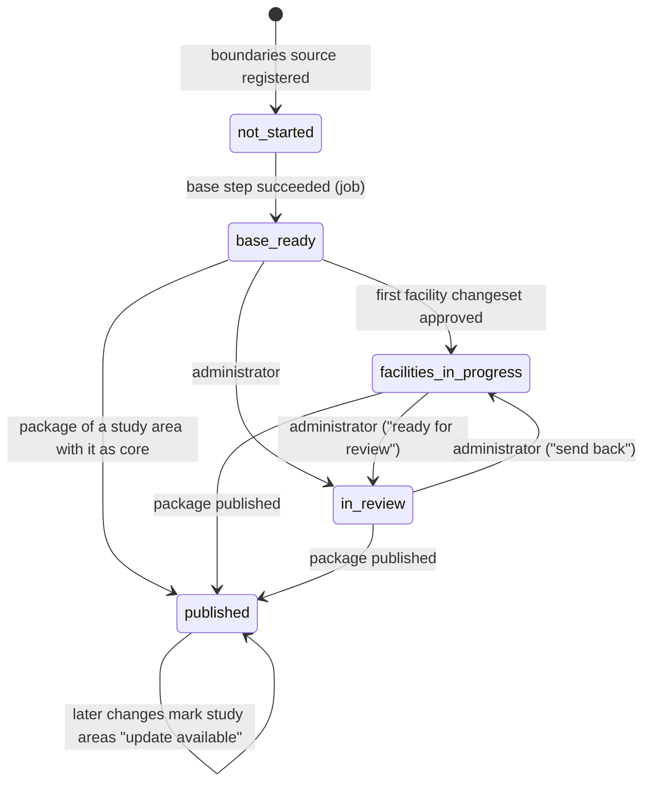
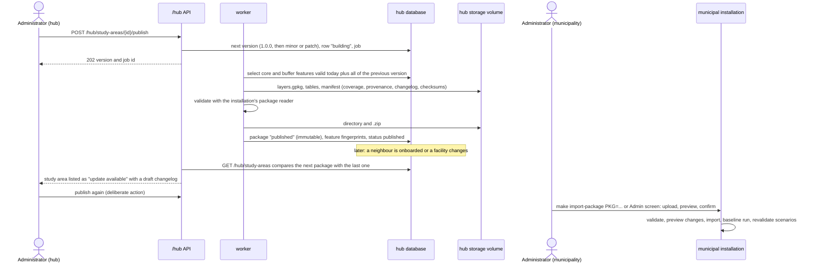
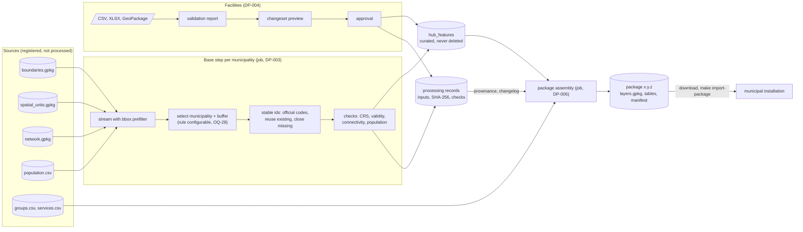

# Hub onboarding

The hub (`DEPLOYMENT_MODE=hub`, ADR 0012) keeps national raw sources, onboards municipalities
one by one, curates their facilities and publishes data packages (ADR 0013) that municipal
installations import. Code: `backend/src/solidaritynode_backend/services/hub/`, router
`routers/hub.py`; tables of migration 0011 (they exist only in a hub database). User guide:
[Hub](../user-guide/hub.md); processing notes DP-003 to DP-006.

## Onboarding states

Each municipality has one status. Transitions are stored with who and when
(`hub_onboarding_events`).



A municipality onboarded only as **buffer** of a neighbour has base data but stays
`not_started` until it is onboarded itself.

## Facility import and changesets

```mermaid
sequenceDiagram
    actor E as Analyst or administrator
    actor A as Administrator
    participant UI as Hub UI
    participant API as /hub API
    participant DB as hub database
    E->>UI: choose municipality, upload CSV / XLSX / GeoPackage
    UI->>API: POST /hub/facility-imports (file streamed, size and type limits)
    API->>API: parse; drop personal-data columns and values
    API->>DB: read municipality, units, nodes, existing facilities
    API->>API: validate rows, locate points, match by id then external id, find duplicates
    API->>DB: store pending changeset (report, items with field-level diff)
    API-->>UI: validation report and preview (added, updated, closed)
    A->>UI: approve (complete list: type the number of closures) or reject
    UI->>API: POST /hub/changesets/{id}/approve
    API->>DB: check facilities did not change since the preview
    API->>DB: new ids HF-nnnnnn, update, close with valid_to (never delete)
    API->>DB: processing record (DP-004), status facilities_in_progress
    API-->>UI: approved changeset (history of every facility)
```

A manual edit (`POST /hub/facilities/edits`) is turned into template rows and follows the same
path, as changeset kind `manual`.

## Publishing and propagation



The installation always opens the connection (ADR 0012): packages are downloaded from the hub
and imported by hand; nothing is pushed to an installation.

## From raw source to package



## Notes

- Long work (base step, package assembly) runs in the worker (ADR 0006) with progress and
  cancellation; a cancelled or failed job stores nothing (one transaction).
- Sources are copied and hashed in 1 MiB chunks; GeoPackages are read row by row with a
  bounding-box prefilter; CSV sources are streamed. Nothing loads a national file whole.
- Geoprocessing uses PostGIS in the hub database (no new Python dependency); QGIS stays a
  manual alternative in `data-processing/qgis/`.
- Roles: viewers read; analysts upload facility files and propose edits; administrators
  register sources, run the base step, approve changesets, create study areas and publish.
