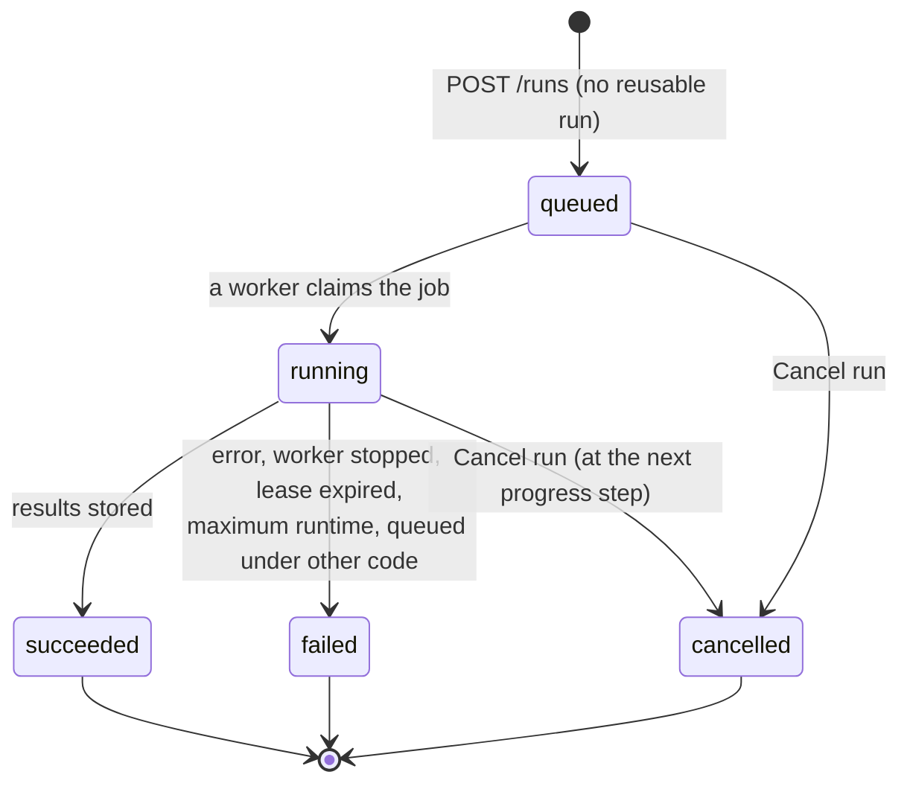
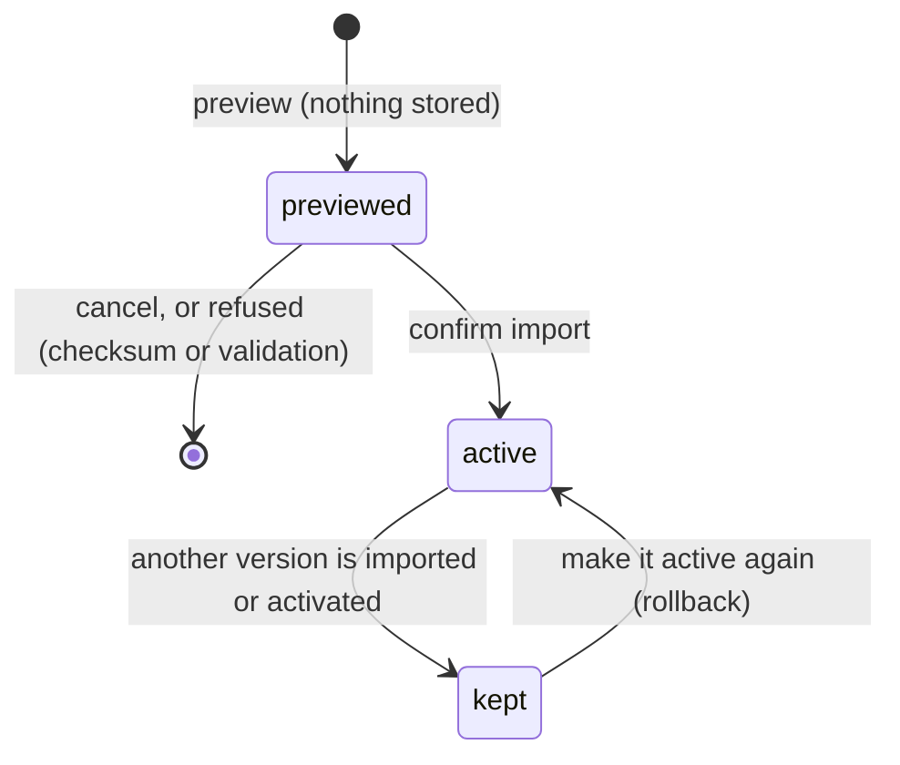
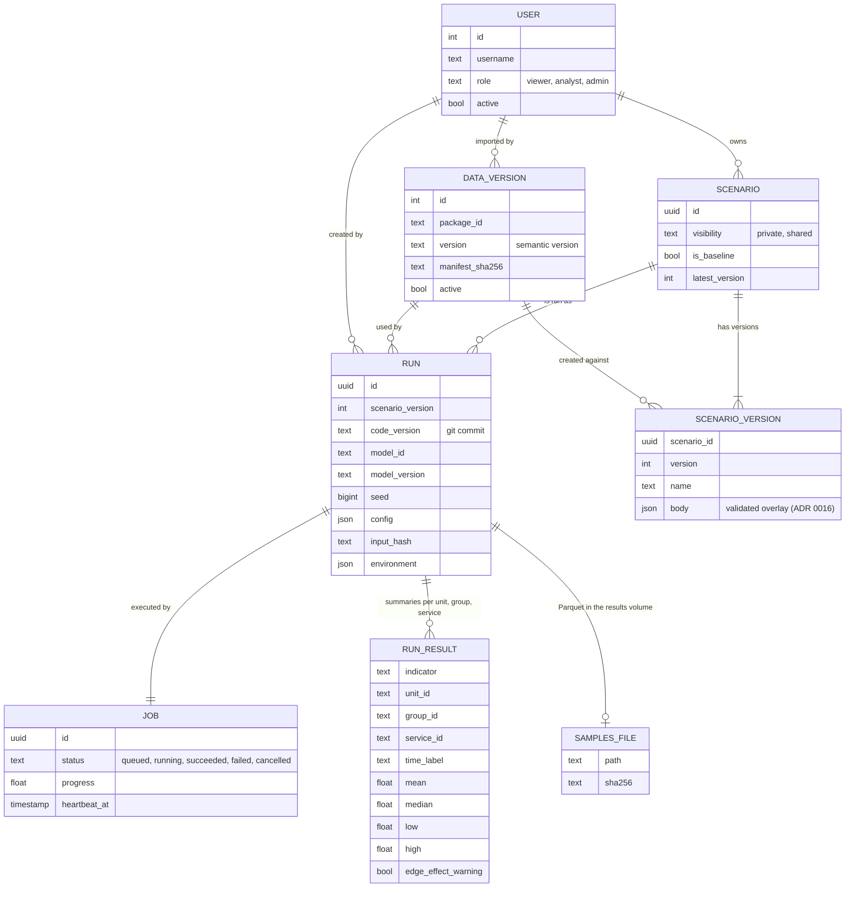
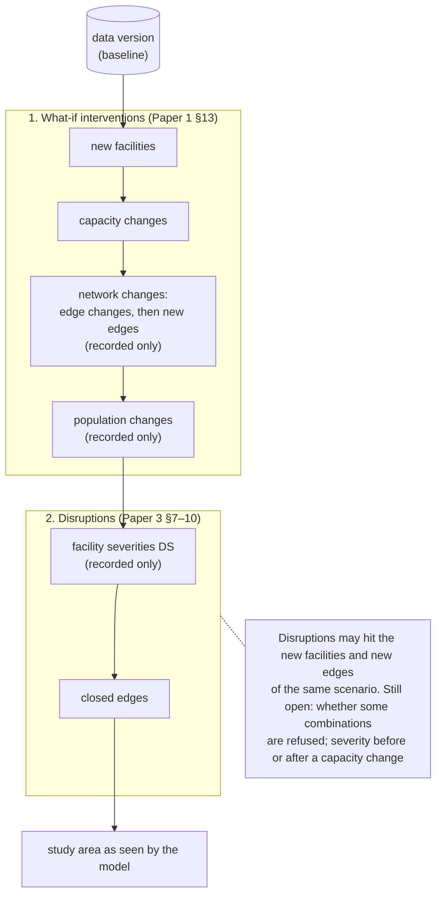

# Lifecycles and data model

> Describes platform version **0.1.0**. Diagrams are Mermaid and change in the same pull request as the behaviour they describe (AGENTS.md). Components: [Components](components.md).

## Run lifecycle

A run is created by the backend and executed by the worker; the request handler never computes (ADR 0006, 0017).

```mermaid
sequenceDiagram
    actor U as Analyst
    participant FE as frontend
    participant API as backend
    participant DB as PostgreSQL
    participant W as worker
    participant C as core (model registry)
    participant R as results volume

    U->>FE: Run this version (seed optional)
    FE->>API: POST /runs {scenario, version, seed, config}
    API->>API: draw a seed if none; input hash of scenario version,<br/>data version, code, model, seed, configuration
    alt a succeeded run has the same hash and its samples file passes SHA-256
        API-->>FE: existing run (reused, nothing computed)
    else no reusable run
        API->>DB: insert run + job (status queued), samples size estimate
        API-->>FE: new run (queued)
        W->>DB: claim job (FOR UPDATE SKIP LOCKED), status running
        W->>C: model(study area, scenario overlay, config, seed, progress)
        loop every progress step
            C-->>W: progress
            W->>DB: progress, heartbeat; read cancel flag
        end
        W->>R: samples.parquet (+ SHA-256)
        W->>DB: result summaries (mean, median, interval), tables,<br/>environment; job succeeded
    end
    loop until finished
        FE->>API: GET /runs/{id}
        API-->>FE: status, progress, results when succeeded
    end
```

## Run statuses



Finished runs never change. Only a **succeeded** run is reused; after **failed** or **cancelled**, starting again creates a new run.

## Data update flow

```mermaid
sequenceDiagram
    actor A as Administrator
    participant API as backend
    participant DB as PostgreSQL
    participant W as worker

    A->>API: preview package (server directory or uploaded archive)
    API->>API: verify checksums, validate schema 2.0,<br/>compare with the active version
    API-->>A: status (new, update, already imported), changes per layer,<br/>coverage changes, changelog, problems
    A->>API: confirm import
    API->>DB: one transaction: new data version with features, records,<br/>coverage and warnings; it becomes active, earlier ones are kept
    API->>DB: queue a baseline run on the new version
    API->>DB: revalidate every scenario against the new version
    API-->>A: imported; scenarios that need attention
    W->>DB: run the baseline (run lifecycle above)
    Note over A,API: Rollback: "Make 1.0.0 active again" (or make activate-version)<br/>does the same three steps for an earlier version; nothing is deleted
```

## Data version states



Runs always point to the data version they used, whatever its state.

## Main entities

The persistent model in PostgreSQL (`backend/src/solidaritynode_backend/orm.py` and `backend/migrations/`). Feature-level tables of a data version (`data_features`, `data_records`, `data_coverage`, `data_warnings`), sessions, sign-in throttling and the installation role are left out for clarity.



A **result** belongs to exactly one run. A run stores the scenario **version** it used, so later versions of the scenario never change it. Full Monte Carlo samples live in the Parquet file; the database keeps the summaries used by maps and tables (ADR 0008, 0017).

## Scenario application order (OQ-30, proposed)

How `core.scenarios.apply_overlay` applies one scenario to the data. This order is a **proposed default**, not a decided method: it must be confirmed when the Paper 3 spec is written ([OQ-30](../specs/open-questions.md), ADR 0016).


