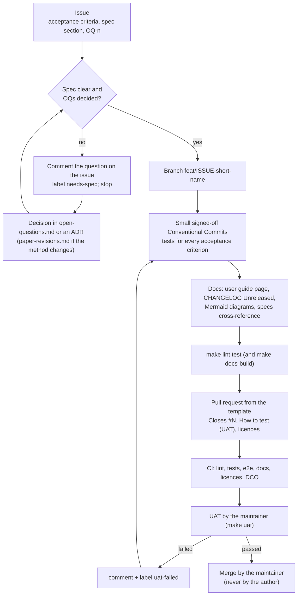

# Ticket workflow

> The rules are in [AGENTS.md](../../AGENTS.md#workflow-for-tickets) and the [contributing guide](../../CONTRIBUTING.md#workflow); this page shows how a ticket moves. Live state: the [Kintsugi board](https://github.com/orgs/SolidarityNode/projects/6).

## Board columns

| Column | Meaning |
| --- | --- |
| Todo | ready: spec clear, no blocking open question |
| In progress | someone has a branch for it |
| Done | merged; listed under **Unreleased** in the changelog until the next release |

Tickets that wait for a decision carry `needs-spec` or `blocked`; per-paper work carries `paper:1` … `paper:4` and the paper's milestone ([roadmap](../roadmap.md)).

## Releases

After merges accumulate, the maintainer cuts a release: [Releasing](../releasing.md).
