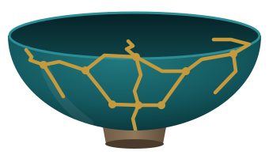
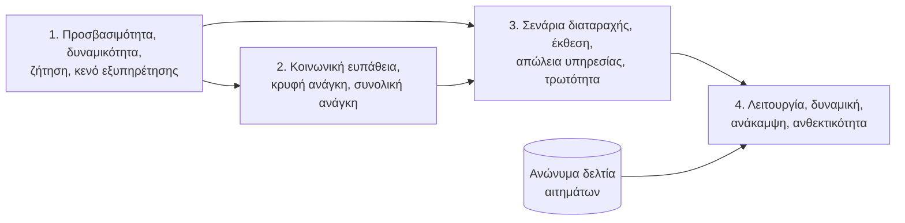

{ width="280" }

**SN Kintsugi** · έκδοση {{ platform_version }}

# SolidarityNode { #solidaritynode }

**Ανοιχτό χωρικό πιθανοτικό πλαίσιο για την προσβασιμότητα των κοινωνικών υπηρεσιών, την κρυφή ανάγκη, την τρωτότητα και την ανθεκτικότητα.**

!!! warning "Πρώιμο στάδιο ανάπτυξης: μόνο διαγνωστικό μοντέλο"
    Έκδοση πλατφόρμας **{{ platform_version }}**. Η πλατφόρμα λειτουργεί από άκρη σε άκρη με **συνθετικά δεδομένα**, αλλά το μόνο μοντέλο είναι το *διαγνωστικό μοντέλο* `diagnostic-v0`, που ελέγχει τη λειτουργία της πλατφόρμας. **Δεν υπάρχουν ακόμη ερευνητικά αποτελέσματα.** Οι μέθοδοι των τεσσάρων άρθρων προστίθενται με τη σειρά ([πορεία ανάπτυξης](roadmap.md)).

## Σε ποιους απευθύνεται { #who-it-is-for }

| Είστε | Ξεκινήστε από |
| --- | --- |
| **Υπάλληλοι δήμων** (αναλυτές, θεατές, διαχειριστές) | [Οδηγός χρήσης](user-guide/index.md) και [Βασικές έννοιες](concepts.md) |
| **Δοκιμαστές** μιας αλλαγής ή μιας έκδοσης | [Δοκιμές αποδοχής (UAT)](uat/README.md) (στα αγγλικά) |
| **Ερευνητές** που εξετάζουν τη μέθοδο | [Μοντέλο πεδίου](specs/00-domain-model.md), [ανοιχτά ζητήματα](specs/open-questions.md), [αναθεωρήσεις των άρθρων](specs/paper-revisions.md) (στα αγγλικά) |
| **Προγραμματιστές** | [Αρχιτεκτονική](architecture.md), [δομικά μέρη](architecture/components.md), [αποφάσεις](adr/README.md), [συνεισφορά](../CONTRIBUTING.md) (στα αγγλικά) |

## Τι είναι το SolidarityNode { #what-solidaritynode-is }

Το SolidarityNode είναι μια πλατφόρμα ανοιχτού κώδικα. Μεταφέρει την ανάλυση της κοινωνικής υποδομής (δομές υγείας, κοινωνικής φροντίδας και άλλες δημόσιες υπηρεσίες) από έναν στατικό χάρτη χωρικής επάρκειας σε μια **δυναμική, πιθανοτική εικόνα**.

Συνδυάζει σε ένα πλαίσιο:

- τη χωρική **προσβασιμότητα** και τη **δυναμικότητα** των δομών,
- την εκτίμηση της **κρυφής κοινωνικής ανάγκης**: της ανάγκης που δεν εκφράζεται ποτέ ως αίτημα,
- την **τρωτότητα** των ομάδων πληθυσμού: πώς μια διαταραχή μιας υπηρεσίας γίνεται συνέπειες για κάθε ομάδα,
- **πραγματικά επιχειρησιακά δεδομένα** από τις ίδιες τις υπηρεσίες (ανώνυμα δελτία αιτημάτων),
- τη **δυναμική της επίπτωσης και της ανάκαμψης** στον χρόνο, που οδηγεί σε εκτιμήσεις της **ανθεκτικότητας** του συστήματος.

Μια υποβαθμισμένη δομή δεν σημαίνει αυτόματα χαμένη υπηρεσία. Η πλατφόρμα εκτιμά τι χάνει πραγματικά ο πληθυσμός κάθε περιοχής, λαμβάνοντας υπόψη τις εναλλακτικές δομές και διαδρομές του δικτύου, και πώς ανακάμπτει το σύστημα μετά από μια διαταραχή.

## Πώς δένουν τα κομμάτια { #how-it-fits-together }

Το πλαίσιο αναπτύσσεται σε τέσσερα συνδεδεμένα μέρη (δείτε το [μοντέλο πεδίου](specs/00-domain-model.md), στα αγγλικά):

1. **Βάση**: προσβασιμότητα ανά ομάδα, δυναμικότητα των δομών που μοιράζεται στις περιοχές που φτάνουν σε αυτές (μέθοδος κινητής περιοχής εξυπηρέτησης δύο βημάτων, 2SFCA), εκτιμώμενη ζήτηση και το **κενό εξυπηρέτησης**.
2. **Κρυφή ανάγκη**: η συνολική ανάγκη είναι το ποσοστό μιας ομάδας που χρειάζεται μια υπηρεσία. Ένα λανθάνον επίπεδο μη αξιοποίησης της υπηρεσίας τη χωρίζει σε ορατή και **κρυφή ανάγκη**. Το επίπεδο αυτό εξαρτάται από την κοινωνική ευπάθεια, το έλλειμμα της προσφοράς σε σχέση με τη συνολική ανάγκη, τα εμπόδια στην πρόσβαση και τις εναλλακτικές εκτός δικτύου.
3. **Τρωτότητα**: προσομοιωμένα σενάρια διαταραχής δίνουν την έκθεση κάθε ομάδας και την απώλεια υπηρεσίας. Μαζί με την κοινωνική ευπάθεια τροφοδοτούν τη **σχέση τρωτότητας** κάθε ομάδας.
4. **Ανθεκτικότητα**: τα επιχειρησιακά δεδομένα, η λειτουργική κατάσταση δομών και περιοχών και ένα δυναμικό μπεϋζιανό δίκτυο περιγράφουν την απώλεια και την ανάκαμψη στον χρόνο. Η σχέση τρωτότητας ενημερώνεται από πραγματικές παρατηρήσεις, και η **ανθεκτικότητα** προκύπτει από τις πορείες ανάκαμψης.

## Βασικές ιδέες { #core-ideas }

**Μονάδα ανάλυσης.** Όλα μοντελοποιούνται στο επίπεδο:

> χωρική μονάδα × κοινωνική ομάδα × υπηρεσία × χρόνος

**Η τρωτότητα δεν είναι ανθεκτικότητα.** Η τρωτότητα μιας ομάδας είναι η σχέση που μετατρέπει μια διαταραχή σε συνέπειες για την ομάδα, ανάλογα με την έκθεσή της, την απώλεια υπηρεσίας και την κοινωνική της ευπάθεια. Μια τιμή τρωτότητας είναι αυτή η σχέση υπολογισμένη σε ένα συγκεκριμένο σενάριο, και οι χάρτες συγκρίνουν τις περιοχές στα ίδια τυποποιημένα σενάρια αναφοράς (μικρή, μέτρια, σοβαρή διαταραχή). Η ανθεκτικότητα είναι δυναμική ιδιότητα που προκύπτει από την πορεία της απώλειας και της ανάκαμψης. Μοντελοποιούνται χωριστά, και καμία από τις δύο δεν είναι το ίδιο με τον κίνδυνο.

**Η κατάσταση μιας δομής δεν είναι απώλεια υπηρεσίας για τον πληθυσμό.** Μια δομή μπορεί να υποβαθμιστεί χωρίς καμία απώλεια κάλυψης για μια περιοχή, αν εναλλακτικές δομές και διαδρομές την εξυπηρετούν ακόμη. Γι' αυτό η κάλυψη υπολογίζεται στο επίπεδο του δικτύου υπηρεσιών και όχι της μεμονωμένης δομής.

**Η καταγεγραμμένη ζήτηση δεν είναι ανάγκη.** Η ανάγκη χωρίζεται σε τρία είδη που δεν επικαλύπτονται ποτέ: την **κρυφή ανάγκη** (δεν εκφράζεται ποτέ ως αίτημα, επειδή οι άνθρωποι δεν ζητούν την υπηρεσία, δεν μπορούν να φτάσουν σε αυτήν, αποθαρρύνονται ή χρησιμοποιούν εναλλακτικές), την **ανικανοποίητη εκφρασμένη ανάγκη** (αιτήματα που δεν ικανοποιούνται μέσα στον μέγιστο αποδεκτό χρόνο αναμονής της υπηρεσίας) και την **ικανοποιημένη ανάγκη**. Η κρυφή ανάγκη εκτιμάται ρητά, ως ποσοστό της ομάδας με ένα διάστημα.

**Η κοινωνική ομάδα δεν είναι κοινωνική ευπάθεια.** Η ομάδα λέει ποιον εξετάζουμε· η κοινωνική ευπάθεια λέει πόσο επιρρεπής είναι η ομάδα σε ανεπαρκή παροχή μιας υπηρεσίας, ανάλογα με τα κοινωνικά της χαρακτηριστικά και ανεξάρτητα από το σύστημα υπηρεσιών.

**Η ανάγκη μετριέται σε μονάδες υπηρεσίας.** Η ανάγκη, η δυναμικότητα, η προσφορά, το κενό και η απώλεια μετριούνται σε μονάδες υπηρεσίας (επισκέψεις, ραντεβού ή ώρες) ανά περίοδο αναφοράς, που ορίζονται για κάθε υπηρεσία. Ποσότητες διαφορετικών υπηρεσιών δεν προστίθενται ποτέ μεταξύ τους.

**Η αβεβαιότητα έχει πρώτη θέση.** Οι μέθοδοι είναι πιθανοτικές (μπεϋζιανά δίκτυα, δυναμικά μπεϋζιανά δίκτυα και προσομοίωση Monte Carlo), ώστε τα αποτελέσματα να έχουν αβεβαιότητα αντί για έναν μόνο, ντετερμινιστικό αριθμό. Οι σχέσεις που προέρχονται από τη γνώμη ειδικών λειτουργούν ως αρχικές εκτιμήσεις, και οι παράμετροί τους μαθαίνονται καθώς συγκεντρώνονται πραγματικές επιχειρησιακές παρατηρήσεις.

**Η επιχειρησιακή υποστήριξη είναι απόκριση του συστήματος.** Η κινητοποίηση επιπλέον πόρων (και εγκεκριμένων εθελοντών) είναι μέρος του τρόπου με τον οποίο το σύστημα απαντά σε μια διαταραχή, όχι ανεξάρτητο μέτρο ανθεκτικότητας.

## Τι προσφέρει η πλατφόρμα { #what-the-platform-offers }

Η έκδοση 0.1 δίνει τα θεμέλια της πλατφόρμας (Α) με συνθετικά δεδομένα, χωρίς την κεντρική εγκατάσταση (hub). Τα αναλυτικά εργαλεία (Β) προστίθενται με τις εργασίες των τεσσάρων άρθρων· η [πορεία ανάπτυξης](roadmap.md) δίνει τη σειρά και ο [πίνακας Kintsugi](https://github.com/orgs/SolidarityNode/projects/6) (στα αγγλικά) την τρέχουσα κατάσταση.

### Α. Θεμέλια της πλατφόρμας { #a-platform-foundation }

Τα θεμέλια δίνουν τον χάρτη, τα σενάρια, τις εκτελέσεις και τη διαχείριση δεδομένων, πάνω στα οποία συνδέονται αργότερα τα αναλυτικά εργαλεία.

#### Χρήστες και ρόλοι { #users-and-roles }

- Σύνδεση με λογαριασμό.
- Ρόλοι: **διαχειριστής** (χρήστες, δεδομένα), **αναλυτής** (σενάρια, εκτελέσεις), **θεατής** (βλέπει την κοινόχρηστη δουλειά).

#### Η περιοχή μελέτης σε χάρτη { #study-area-on-a-map }

- Χωρικές μονάδες, δομές και οδικό δίκτυο ενός ή περισσότερων δήμων, μαζί με μια **ζώνη** γειτονικών περιοχών, ώστε να μετριούνται σωστά όσοι εξυπηρετούνται πέρα από το όριο.
- Μια ένδειξη **ποιότητας** σε κάθε στοιχείο (ανοιχτά δεδομένα, εκτίμηση, επαληθευμένο από τον δήμο) και μια **προειδοποίηση φαινομένου ορίου** όπου λείπουν δεδομένα για τους γείτονες.

#### Σενάρια «τι θα γινόταν αν…» { #what-if-scenarios }

- Δημιουργούνται με κλικ στον χάρτη: αύξηση ή μείωση δυναμικότητας, προσθήκη δομής, υποβάθμιση ή κλείσιμο δομής, κλείσιμο δρόμου.
- Κάθε αλλαγή κρατιέται ως **έκδοση**. Τα σενάρια είναι ιδιωτικά ή κοινόχρηστα.

#### Εκτελέσεις { #runs }

- Γίνονται στο παρασκήνιο, με ένδειξη προόδου και δυνατότητα ακύρωσης.
- Κάθε εκτέλεση είναι **πλήρως αναπαραγώγιμη**: καταγράφει την έκδοση δεδομένων, τον κώδικα, το μοντέλο, τις παραμέτρους και τον σπόρο τυχαιότητας.

#### Αποτελέσματα { #results }

- Χάρτες και πίνακες ανά χωρική μονάδα, κοινωνική ομάδα και υπηρεσία, με την αβεβαιότητα πάντα ορατή.
- **Σύγκριση** με την τρέχουσα κατάσταση (δίπλα δίπλα ή χάρτης διαφοράς).
- **Εξαγωγή** σε CSV και GeoPackage, μαζί με τα στοιχεία αναπαραγωγιμότητας.

#### Δεδομένα και ενημερώσεις { #data-and-updates }

- Εισαγωγή **πακέτων δεδομένων** με ελέγχους ακεραιότητας και **προεπισκόπηση των αλλαγών** πριν εφαρμοστούν.
- Τα προηγούμενα αποτελέσματα δεν αλλάζουν ποτέ. Τα σενάρια μπορούν να εκτελεστούν ξανά με τα νέα δεδομένα και να συγκριθούν.

#### Κεντρική εγκατάσταση (προγραμματίζεται: v0.2, ένταξη δήμων) { #central-hub-planned-v02-hub-onboarding }

- Καταχώριση εθνικών πηγών (όρια, δίκτυο, πληθυσμός) χωρίς επεξεργασία ολόκληρης της χώρας.
- **Ένταξη** ενός δήμου βήμα βήμα, με πίνακα κάλυψης που δείχνει τι υπάρχει και τι λείπει.
- Εισαγωγή και συμπλήρωση δομών από Excel, CSV ή GeoPackage, με αναφορά σφαλμάτων και ιστορικό αλλαγών.
- Δημοσίευση πακέτων ανά δήμο, και ειδοποίηση όταν η ένταξη ενός γείτονα βελτιώνει τα δεδομένα ενός άλλου δήμου.

### Β. Αναλυτικά εργαλεία { #b-analytical-tools }

Κάθε άρθρο προσθέτει ένα αναλυτικό εργαλείο πάνω στα θεμέλια, με τη σειρά 1 → 2 → 3 → 4.

#### Προσβασιμότητα και επάρκεια (Άρθρο 1) { #accessibility-and-adequacy-paper-1 }

- Χρόνοι διαδρομής ανά ομάδα και τρόπο μετακίνησης (πεζή, αυτοκίνητο, δημόσιες συγκοινωνίες).
- Η πραγματική προσφορά υπηρεσιών ανά περιοχή, λαμβάνοντας υπόψη ότι πολλές περιοχές μοιράζονται τις ίδιες δομές.
- **Κενό εξυπηρέτησης** ανά ομάδα, με εξήγηση της αιτίας (χαμηλή δυναμικότητα, κακή πρόσβαση ή υψηλή ζήτηση).

#### Κρυφή ανάγκη (Άρθρο 2) { #hidden-need-paper-2 }

- Εκτίμηση του **ποσοστού κάθε ομάδας με ανάγκη που δεν φαίνεται**, για παράδειγμα «7–17 % των ηλικιωμένων στην τοπική κοινότητα Χ».
- Χάρτης των περιοχών όπου η καταγεγραμμένη ζήτηση πιθανότατα υποεκτιμά την πραγματικότητα.

#### Τρωτότητα (Άρθρο 3) { #vulnerability-paper-3 }

- Τι χάνει κάθε ομάδα όταν μια δομή υποβαθμίζεται ή κλείνει, ή όταν κόβεται ένας δρόμος, λαμβάνοντας υπόψη τις εναλλακτικές.
- Χάρτες σε τυποποιημένα σενάρια αναφοράς (μικρή, μέτρια, σοβαρή διαταραχή), ώστε οι περιοχές να συγκρίνονται δίκαια.
- Πόσοι άνθρωποι επηρεάζονται και πόσο βαθιά, όχι μόνο πόση υπηρεσία χάνεται συνολικά.

#### Πραγματική λειτουργία και ανθεκτικότητα (Άρθρο 4) { #real-operation-and-resilience-paper-4 }

- **Ανώνυμη καταγραφή αιτημάτων** (κωδικός QR ή ραντεβού) στις δομές, χωρίς προσωπικά δεδομένα.
- Επιχειρησιακοί δείκτες: χρόνος αναμονής, καθυστέρηση, αιτήματα που δεν ικανοποιήθηκαν, κάλυψη.
- **Κατάσταση κάθε δομής** (κανονική, υπό πίεση, υποβαθμισμένη, κρίσιμη, σε ανάκαμψη) και μια **επιχειρησιακή εικόνα**: «ποια δομή χρειάζεται βοήθεια τώρα, και τι είδους».
- Παρακολούθηση της **ανάκαμψης** μετά από μια διαταραχή και εκτίμηση της **ανθεκτικότητας** ανά χωρική μονάδα, ομάδα και υπηρεσία.
- Οι εκτιμήσεις **μαθαίνουν** από την πραγματική λειτουργία με τον καιρό.

#### Κοινά εργαλεία { #shared-tools }

- Ανάλυση αβεβαιότητας (Monte Carlo) και ανάλυση ευαισθησίας («ποιος παράγοντας μετράει περισσότερο»).
- Εργαλεία συλλογής της γνώμης ειδικών, που τροφοδοτούν τα πιθανοτικά μοντέλα.

### Γ. Αρχές που ισχύουν παντού { #c-principles-that-apply-everywhere }

- **Ανοιχτός κώδικας**, χωρίς κλειστές εκδόσεις.
- **Προστασία της ιδιωτικότητας από τον σχεδιασμό:** κανένα προσωπικό δεδομένο. Τα επιχειρησιακά δεδομένα μένουν στον δήμο· προς τα πάνω μοιράζονται μόνο ανώνυμα συγκεντρωτικά στοιχεία, και μόνο αν το αποφασίσει ο δήμος.
- **Μία εγκατάσταση δήμου** για κάθε δήμο ή ομάδα δήμων, με κοινή κεντρική εγκατάσταση για τα ανοιχτά δεδομένα.
- **Αναπαραγωγιμότητα:** κάθε αποτέλεσμα μπορεί να αναπαραχθεί ακριβώς.
- **Διαφάνεια:** κάθε σύνολο δεδομένων έχει πηγή και σημείωση επεξεργασίας, και κάθε απόφαση για τη μέθοδο καταγράφεται.

## Τα ανοιχτά ζητήματα με μια ματιά { #open-questions-at-a-glance }

Η μέθοδος έχει ακόμη ανοιχτά ζητήματα· ο κώδικας δεν τα λύνει ποτέ ([πώς αντιμετωπίζονται](../CONTRIBUTING.md#how-open-questions-are-handled), στα αγγλικά). Η τρέχουσα κατάσταση, από τον συγκεντρωτικό πίνακα του [`open-questions.md`](specs/open-questions.md) (στα αγγλικά):

<!-- BEGIN GENERATED: oq-counts-el (scripts/docs_indexes.py) -->
30 ζητήματα: **10 αποφασισμένα**, 2 εν μέρει αποφασισμένα, 1 προτεινόμενο, **17 ανοιχτά**.
<!-- END GENERATED: oq-counts-el -->

## Υπόβαθρο { #background }

Το πλαίσιο στηρίζεται στη βιβλιογραφία για την προσβασιμότητα (Geurs & van Wee, 2004), την κοινωνική τρωτότητα (Cutter et al., 2003· Adger, 2006), την ανθεκτικότητα κοινοτήτων και συστημάτων (Holling, 1973· Bruneau et al., 2003· Norris et al., 2008), τις αλληλεξαρτήσεις κρίσιμων υποδομών (Rinaldi et al., 2001), τα πιθανοτικά γραφικά μοντέλα (Pearl, 1988· Koller & Friedman, 2009· Murphy, 2002) και τα ψηφιακά δίδυμα (Grieves & Vickers, 2017). Πλήρης βιβλιογραφία θα προστεθεί με τις προδιαγραφές κάθε άρθρου.
