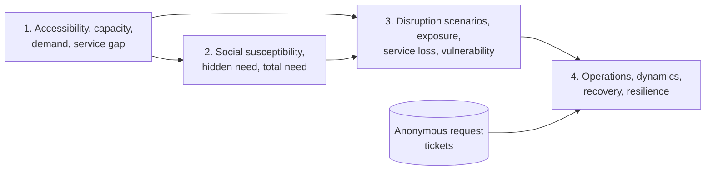

# SolidarityNode

**Open-source spatial probabilistic framework for social service accessibility, hidden need (κρυφή ανάγκη), vulnerability (τρωτότητα) and resilience (ανθεκτικότητα).**

!!! warning "Early development: diagnostic model only"
    Platform version **{{ platform_version }}**. The platform works end to end on **synthetic data**, but the only model is the *diagnostic model* `diagnostic-v0`, which checks the platform's mechanics. **There are no research results yet.** The methods of the four papers are added in order ([roadmap](roadmap.md)).

## Who it is for

| You are | Start with |
| --- | --- |
| **Municipal staff** (analysts, viewers, administrators) | [User guide](user-guide/index.md) and [Concepts](concepts.md) |
| **Testers** of a pull request or release | [Testing (UAT)](uat/README.md) |
| **Researchers** reviewing the method | [Domain model](specs/00-domain-model.md), [open questions](specs/open-questions.md), [paper revisions](specs/paper-revisions.md) |
| **Developers** | [Architecture](architecture.md), [components](architecture/components.md), [decisions](adr/README.md), [contributing](../CONTRIBUTING.md) |

## What SolidarityNode is

SolidarityNode is an open-source platform that moves the analysis of social infrastructure (healthcare facilities, social care and other public services) from a static map of spatial adequacy to a **dynamic, probabilistic view**.

It combines in a single framework:

- spatial **accessibility** and **capacity** of service facilities,
- estimation of **hidden social need**: need that is never expressed as a request,
- **vulnerability** of population groups: how a service disruption turns into consequences for each group,
- **real operational data** from the services themselves (anonymous request tickets),
- the **dynamics of impact and recovery** over time, leading to estimates of system **resilience**.

A degraded facility is not automatically treated as lost service. The platform estimates what the population of each area actually loses, given the alternative facilities and routes available in the network, and how the system recovers after a disruption.

## How it fits together

The framework is developed in four connected parts (see the [domain model](specs/00-domain-model.md)):

1. **Baseline**: group-specific accessibility, facility capacity shared among the areas that reach it (two-step floating catchment area), estimated demand and the **service gap**.
2. **Hidden need**: total need is the share of a group that needs a service; a latent non-take-up level, informed by social susceptibility, the shortfall of supply against total need, access deterrence and alternatives outside the network, splits it into visible and **hidden need**.
3. **Vulnerability**: simulated disruption scenarios give group exposure and service loss; together with social susceptibility they feed the **vulnerability relationship** of each group.
4. **Resilience**: operational data, the functional state of facilities and areas, and a Dynamic Bayesian Network describe loss and recovery over time; the vulnerability relationship is updated from real observations and **resilience** is derived from recovery trajectories.

## Core ideas

**Unit of analysis.** Everything is modelled at the level of:

> spatial unit × social group × service × time

**Vulnerability is not resilience.** The vulnerability of a group is the relationship that turns a disruption into consequences for that group, given its exposure, the service loss and its social susceptibility. A vulnerability value is that relationship evaluated at a given scenario, and maps compare areas at the same standardised reference scenarios (minor, moderate, severe). Resilience is a dynamic property that emerges from the trajectory of loss and recovery. They are modelled separately, and neither is the same as risk.

**Facility state is not population-level service loss.** A facility can be degraded without any loss of coverage for an area, if alternative facilities and routes still serve it. Coverage is therefore computed at the level of the service network, not the individual facility.

**Observed demand is not need.** Need is split into three kinds that never overlap: **hidden need** (never expressed as a request, because people do not seek the service, cannot reach it, are discouraged or use alternatives), **unmet expressed need** (requests not fulfilled within the service's maximum acceptable waiting time) and **met need**. Hidden need is estimated explicitly, as a share of the group with an interval.

**Social group is not social susceptibility.** The group says who is examined; social susceptibility is how prone that group is to unmet provision of a service, from its social characteristics and independently of the service system.

**Need is measured in service units.** Need, capacity, supply, gap and loss are measured in service units (visits, appointments or hours) per reference period, defined per service. Quantities of different services are never added together.

**Uncertainty is first-class.** Methods are probabilistic (Bayesian Networks, Dynamic Bayesian Networks and Monte Carlo simulation) so that results carry uncertainty instead of single deterministic numbers. Expert-elicited relationships act as priors, and their parameters are learned as real operational observations accumulate.

**Operational support is a system response.** Mobilising extra resources (including approved volunteers) is part of how the system responds to a disruption, not an independent measure of resilience.

## What the platform offers

Version 0.1 delivers the platform foundation (A) on synthetic data, without the hub. The analytical tools (B) are added through the tickets of the four papers; the [roadmap](roadmap.md) gives the order and the [Kintsugi board](https://github.com/orgs/SolidarityNode/projects/6) the live state.

### A. Platform foundation

The foundation provides the map, scenarios, runs and data management that the analytical tools later plug into.

#### Users and roles

- Sign-in with an account.
- Roles: **admin** (users, data), **analyst** (scenarios, runs), **viewer** (sees shared work).

#### Study area on a map

- Spatial units, facilities and the road network of one or more municipalities, plus a **buffer** of neighbouring areas, so that people served across the boundary are counted correctly.
- A **quality** flag on every feature (open data, estimate, verified by the municipality) and an **edge-effect warning** where data on neighbours is missing.

#### "What if…" scenarios

- Built by clicking on the map: increase or reduce capacity, add a facility, degrade or close a facility, close a road.
- Every change is kept as a **version**. Scenarios are private or shared.

#### Runs

- Run in the background, with progress and cancellation.
- Every run is **fully reproducible**: it records the data version, code, model, parameters and random seed.

#### Results

- Maps and tables by spatial unit, social group and service, with uncertainty always visible.
- **Comparison** with the current situation (side by side or a difference map).
- **Export** to CSV and GeoPackage, together with the reproducibility details.

#### Data and updates

- Import of **data packages** with integrity checks and a **preview of changes** before they are applied.
- Past results never change. Scenarios can be rerun on new data and compared.

#### Central hub (planned: v0.2, hub onboarding)

- Registration of national sources (boundaries, network, population) without processing the whole country.
- Step-by-step **onboarding** of a municipality, with a coverage matrix showing what is available and what is missing.
- Import and extension of facilities from Excel, CSV or GeoPackage, with an error report and change history.
- Publication of packages per municipality, and a notice when onboarding a neighbour improves another municipality's data.

### B. Analytical tools

Each paper adds an analytical tool on top of the foundation, in the order 1 → 2 → 3 → 4.

#### Accessibility and adequacy (Paper 1)

- Travel times by group and transport mode (walking, car, public transport).
- Actual service supply per area, taking into account that several areas share the same facilities.
- **Service gap** by group, with an explanation of why (low capacity, poor access or high demand).

#### Hidden need (Paper 2)

- Estimate of the **share of each group with need that is not visible**, for example "7–17 % of older people in local community X".
- A map of areas where recorded demand most likely underestimates reality.

#### Vulnerability (Paper 3)

- What each group loses when a facility is degraded or closed, or a road is cut, taking alternatives into account.
- Maps at standard reference scenarios (minor, moderate, severe disruption), so that areas are compared fairly.
- How many people are affected and how deeply, not only how much service is lost overall.

#### Real operation and resilience (Paper 4)

- **Anonymous request logging** (QR code or appointments) at facilities, with no personal data.
- Operational indicators: waiting time, delay, unmet requests, coverage.
- **State of each facility** (normal, under pressure, degraded, critical, recovering) and an **operational view**: "which facility needs help now, and of what kind".
- Monitoring of **recovery** after a disruption and estimation of **resilience** by spatial unit, group and service.
- Estimates **learn** from real operation over time.

#### Shared tools

- Uncertainty analysis (Monte Carlo) and sensitivity analysis ("which factor matters most").
- Expert elicitation tools that feed the probabilistic models.

### C. Principles that apply everywhere

- **Open source**, with no closed editions.
- **Privacy by design:** no personal data. Operational data stays with the municipality; only anonymous aggregates are shared upwards, and only if the municipality chooses to.
- **One installation per municipality**, or group of municipalities, with a shared hub for open data.
- **Reproducibility:** every result can be reproduced exactly.
- **Transparency:** every dataset has a source and a processing note, and every method decision is recorded.

## Open questions at a glance

The method still has open questions; code never resolves them ([how they are handled](../CONTRIBUTING.md#how-open-questions-are-handled)). Current state, counted from the summary table of [`open-questions.md`](specs/open-questions.md):

<!-- BEGIN GENERATED: oq-counts (scripts/docs_indexes.py) -->
30 questions: **10 decided**, 2 partly decided, 1 proposed, **17 open**.
<!-- END GENERATED: oq-counts -->

## Background

The framework draws on the literature on accessibility (Geurs & van Wee, 2004), social vulnerability (Cutter et al., 2003; Adger, 2006), community and system resilience (Holling, 1973; Bruneau et al., 2003; Norris et al., 2008), critical infrastructure interdependencies (Rinaldi et al., 2001), probabilistic graphical models (Pearl, 1988; Koller & Friedman, 2009; Murphy, 2002) and Digital Twins (Grieves & Vickers, 2017). A full reference list will be added with the per-paper specifications.
