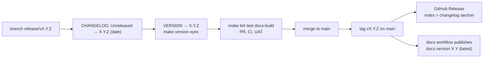
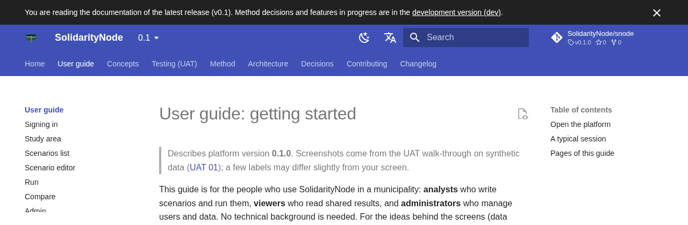
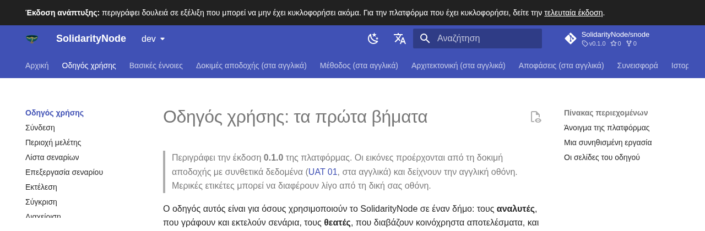
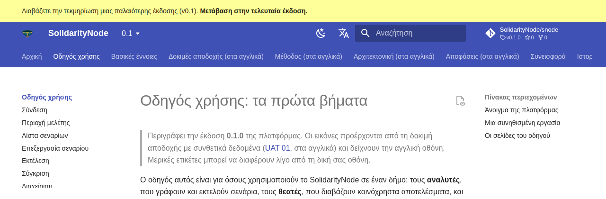

# Releasing

> For the maintainer. The version lives in one place, the file [`VERSION`](../VERSION) at the repository root.

## Versions

SolidarityNode follows [semantic versioning](https://semver.org/). While the version is **0.x**:

- the **minor** number (0.**1**.0 → 0.**2**.0) goes up for new features **and** for breaking changes (API, scenario schema, data package schema, configuration, database migrations that need care);
- the **patch** number (0.1.**0** → 0.1.**1**) goes up for fixes only, with no migration and no change of behaviour beyond the fix;
- 1.0.0 will mean a stable API and data formats for installations.

`VERSION` is the single source. `make version-sync` writes it into `core/pyproject.toml`, `backend/pyproject.toml`, `frontend/package.json` and the uv locks; `make lint` fails if they differ. From there it reaches `/version`, the frontend footer, the run reproducibility record (`environment.solidaritynode`) and the documentation site footer.

Model versions (for example `diagnostic-v0 0.2.1`) and data package versions are separate and recorded on every run.

## What a release must include

- [ ] Every merged change since the last release has a line under **Unreleased** in [`CHANGELOG.md`](../CHANGELOG.md), and the affected [user guide](user-guide/index.md) pages are updated.
- [ ] **UAT passed** on the release commit: `make uat`, then the current checklists in [`docs/uat/`](uat/README.md), by the maintainer.
- [ ] CI green on `main`: lint, tests, end-to-end, docs, licences.
- [ ] **Migrations**: every new Alembic migration listed in the changelog, with what it does to existing data.
- [ ] **Upgrade notes for installations** in the changelog section: new or changed settings (`.env.example`), migrations, data package or scenario schema changes, anything an administrator must do, and whether a backup is needed first.
- [ ] Known limitations stated.

## How to cut a release



1. On a branch `release/vX.Y.Z`: in `CHANGELOG.md`, rename **Unreleased** to `[X.Y.Z] - YYYY-MM-DD`, start a new empty **Unreleased** section above it, and update the comparison links at the bottom.
2. Write `X.Y.Z` into `VERSION` and run `make version-sync`.
3. Run `make lint test docs-build`, open a PR titled `chore(release): vX.Y.Z`, wait for CI and UAT, merge.
4. Tag the merge commit and push the tag (signed tags are welcome):
   ```bash
   git switch main && git pull
   git tag -a vX.Y.Z -m "SolidarityNode X.Y.Z"
   git push origin vX.Y.Z
   ```
5. Create the GitHub Release from the tag, with the changelog section of `X.Y.Z` as the notes:
   ```bash
   gh release create vX.Y.Z --title "SolidarityNode X.Y.Z" --notes-file <(python3 - <<'PY'
   import re, pathlib
   text = pathlib.Path("CHANGELOG.md").read_text()
   print(re.search(r"## \[X\.Y\.Z\][^\n]*\n(.*?)(?=\n## \[)", text, re.S).group(1).strip())
   PY
   )
   ```
6. The tag starts the `docs` workflow, which publishes the documentation as version `X.Y` with the alias `latest` (the default version of the site). `dev` keeps following `main`.
7. Update `CITATION.cff` (`version`, `date-released`) in the next PR if it was not done in the release PR.

## Documentation versions

The site is versioned with [mike](https://github.com/jimporter/mike): `dev` is built from `main` on every push, and each release tag `vX.Y.Z` publishes `X.Y` (patch releases overwrite their minor version) and moves `latest` to it. The version selector at the top of the site lists them. Each version holds both languages: the Greek pages are under `el/` (for example `/snode/latest/el/`), and the language switcher keeps the version.

### Version banners

Every page says which version of the documentation it belongs to, in the page's language
(English or Greek, terms from `docs/i18n/glossary.md`):

| Version | Banner | Can be closed | Link |
| --- | --- | --- | --- |
| `latest` (the release it points to, for example `0.1`) | dark bar: "You are reading the documentation of the latest release (v0.1). Method decisions and features in progress are in the development version (dev)." | yes; it stays closed in that browser until the text changes (a new release) | the same page in `dev`, or the `dev` home |
| `dev` | dark bar: "Development version: describes work in progress that may not be released yet. For the released platform, see the latest version." | no | the same page in `latest`, or the `latest` home |
| an older release (no longer `latest`) | Material's yellow outdated-version banner: "You are reading the documentation of an older release (v0.1). Go to the latest version." | no | the same page in `latest`, or the `latest` home |

How it works:

- **Which kind of build.** `tools/docs/hooks.py` sets `extra.docs_channel` from `DOCS_GIT_REF`: a
  release tag `vX.Y.Z` (set by the docs workflow for tags) gives `release`, anything else
  (`main`, or a local `make docs`) gives `dev`. The version in the text, `vX.Y`, is
  `extra.docs_release`, taken from `VERSION` at build time; nothing is hard-coded.
- **Latest or older.** A release build cannot know whether a later release will replace it, so
  the browser decides from mike's `versions.json`: the bar is shown only while the version has
  the alias `latest`; otherwise Material's outdated banner (`extra.version.default`) appears.
  Old versions are never rebuilt.
- **Links** keep the language and the page: they are resolved on click
  (`docs/assets/javascripts/version-banners.js`); if the page does not exist in the other
  version, the link opens that version's home in the same language.
- **Templates:** `tools/docs/overrides/main.html` (blocks `announce` and `outdated`, feature
  `announce.dismiss`); `tools/docs/overrides/partials/javascripts/outdated.html` fixes Material's
  inline script for relative base URLs.
- **Testing locally** (in a throw-away clone, because `mike deploy` commits to the `gh-pages`
  branch of the repository it runs in):

  ```bash
  git clone . /tmp/sn-docs-test && cd /tmp/sn-docs-test
  export PATH="$OLDPWD/tools/docs/.venv/bin:$PATH"
  DOCS_GIT_REF=v0.1.0 mike deploy -F mkdocs.yml --update-aliases 0.1 latest
  mike set-default -F mkdocs.yml latest
  DOCS_GIT_REF=main mike deploy -F mkdocs.yml dev
  mike serve -F mkdocs.yml -a 127.0.0.1:8002
  ```

  Open `http://127.0.0.1:8002/latest/`, `/dev/` and their `el/` pages. For the outdated banner,
  deploy a second release in the clone (set `VERSION` to `0.2.0`, then
  `DOCS_GIT_REF=v0.2.0 mike deploy -F mkdocs.yml --update-aliases 0.2 latest`) and open `/0.1/`.





**One-time setup (maintainer):** in the repository settings, **Settings → Pages → Build and deployment → Source: Deploy from a branch**, branch `gh-pages`, folder `/ (root)`. The branch is created by the first run of the `docs` workflow on `main`. The site is then at <https://solidaritynode.github.io/snode/>.
