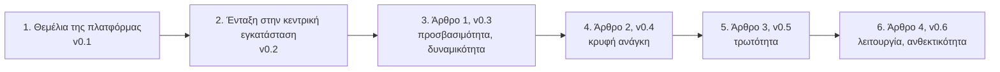

# Πορεία ανάπτυξης { #roadmap }

> Η σειρά των εργασιών και τι δίνει κάθε βήμα στους χρήστες. Η **τρέχουσα** κατάσταση (θέματα, ποιος δουλεύει σε τι, τι έχει γίνει) βρίσκεται στο GitHub και δεν αντιγράφεται εδώ: στον [πίνακα Kintsugi](https://github.com/orgs/SolidarityNode/projects/6) και στα [ορόσημα](https://github.com/SolidarityNode/snode/milestones) (στα αγγλικά).

Κάθε βήμα ενός άρθρου ξεκινά μόνο όταν αποφασιστούν τα ανοιχτά ζητήματά του ([ανοιχτά ζητήματα](specs/open-questions.md), στα αγγλικά) και γραφτούν οι προδιαγραφές του ([προδιαγραφές](specs/README.md), στα αγγλικά). Κάθε βήμα είναι μία δευτερεύουσα έκδοση, από v0.1 έως v0.6 (τα ορόσημα στο GitHub έχουν τα ίδια ονόματα, στα αγγλικά).

| Βήμα | Τι δίνει στους χρήστες | Ορόσημο | Θέματα |
| --- | --- | --- | --- |
| **1. Θεμέλια της πλατφόρμας** (0.1.0) | Σύνδεση και ρόλοι· η περιοχή μελέτης σε χάρτη, με ποιότητα δεδομένων και προειδοποιήσεις φαινομένου ορίου· σενάρια «τι θα γινόταν αν» με εκδόσεις· εκτελέσεις στο παρασκήνιο με πρόοδο, ακύρωση και πλήρη αναπαραγωγιμότητα· αποτελέσματα με αβεβαιότητα, σύγκριση και εξαγωγή· πακέτα δεδομένων με προεπισκόπηση, ενημέρωση και επαναφορά. Τα αποτελέσματα προέρχονται μόνο από το διαγνωστικό μοντέλο. | [v0.1 Platform foundation](https://github.com/SolidarityNode/snode/milestone/1) | [πίνακας](https://github.com/orgs/SolidarityNode/projects/6) |
| **2. Ένταξη στην κεντρική εγκατάσταση (hub)** (v0.2) | Ο ρόλος της κεντρικής εγκατάστασης: εθνικές πηγές, ένταξη ενός δήμου βήμα βήμα με πίνακα κάλυψης, εισαγωγή δομών από Excel, CSV ή GeoPackage με αναφορά σφαλμάτων, δημοσίευση πακέτων, και ειδοποίηση των γειτονικών δήμων όταν βελτιώνονται τα δεδομένα τους. Πραγματικά (ανοιχτά) δεδομένα για μια πρώτη περιοχή μελέτης. | [v0.2 Hub onboarding](https://github.com/SolidarityNode/snode/milestone/2) | [πίνακας](https://github.com/orgs/SolidarityNode/projects/6) |
| **3. Άρθρο 1: προσβασιμότητα και δυναμικότητα** (v0.3) | Χρόνοι διαδρομής ανά ομάδα και τρόπο μετακίνησης· προσφορά ανά περιοχή όταν οι δομές είναι κοινές (2SFCA)· το **κενό εξυπηρέτησης** ανά ομάδα, με την αιτία του (δυναμικότητα, πρόσβαση ή ζήτηση)· τα πρώτα ερευνητικά αποτελέσματα, με αβεβαιότητα και ανάλυση ευαισθησίας. | [v0.3 Paper 1 Accessibility](https://github.com/SolidarityNode/snode/milestone/3) | [ετικέτα `paper:1`](https://github.com/SolidarityNode/snode/issues?q=label%3Apaper%3A1) |
| **4. Άρθρο 2: κρυφή ανάγκη** (v0.4) | Το ποσοστό κάθε ομάδας με ανάγκη που δεν εκφράζεται ποτέ, με διάστημα· χάρτες με τα σημεία όπου η καταγεγραμμένη ζήτηση υποεκτιμά την ανάγκη. | [v0.4 Paper 2 Hidden need](https://github.com/SolidarityNode/snode/milestone/4) | [ετικέτα `paper:2`](https://github.com/SolidarityNode/snode/issues?q=label%3Apaper%3A2) |
| **5. Άρθρο 3: τρωτότητα** (v0.5) | Τι χάνει κάθε ομάδα όταν υποβαθμίζονται δομές ή κλείνουν δρόμοι, λαμβάνοντας υπόψη τις εναλλακτικές· χάρτες σε τυποποιημένα σενάρια αναφοράς· πόσοι άνθρωποι επηρεάζονται και πόσο βαθιά. | [v0.5 Paper 3 Vulnerability](https://github.com/SolidarityNode/snode/milestone/5) | [ετικέτα `paper:3`](https://github.com/SolidarityNode/snode/issues?q=label%3Apaper%3A3) |
| **6. Άρθρο 4: λειτουργία και ανθεκτικότητα** (v0.6) | Ανώνυμη καταγραφή αιτημάτων (αφού αποφασιστούν οι κανόνες απορρήτου, ADR 0010)· επιχειρησιακοί δείκτες και καταστάσεις δομών· παρακολούθηση της ανάκαμψης και της **ανθεκτικότητας** ανά περιοχή, ομάδα και υπηρεσία· εκτιμήσεις που μαθαίνουν από την πραγματική λειτουργία. | [v0.6 Paper 4 Resilience](https://github.com/SolidarityNode/snode/milestone/6) | [ετικέτα `paper:4`](https://github.com/SolidarityNode/snode/issues?q=label%3Apaper%3A4) |

Τι σημαίνει κάθε βήμα για τη μέθοδο: [μοντέλο πεδίου](specs/00-domain-model.md) και [αναθεωρήσεις των άρθρων](specs/paper-revisions.md) (στα αγγλικά). Τι άλλαξε σε κάθε έκδοση: [ιστορικό αλλαγών](../CHANGELOG.md) (στα αγγλικά).
