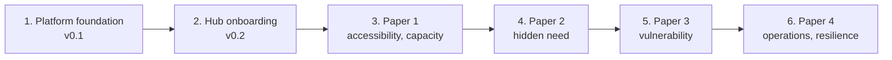

# Roadmap

> The order of work and what each step gives users. The **live** state (issues, who works on what, what is done) is on GitHub, never copied here: the [Kintsugi board](https://github.com/orgs/SolidarityNode/projects/6) and the [milestones](https://github.com/SolidarityNode/snode/milestones).

Each paper step starts only when its open questions are decided ([open questions](specs/open-questions.md)) and its per-paper spec is written ([specifications](specs/README.md)). Release numbers after v0.2 are not fixed yet.

| Step | What it delivers for users | Milestone | Kintsugi |
| --- | --- | --- | --- |
| **1. Platform foundation** (0.1.0) | Sign-in and roles; the study area on a map with data quality and edge-effect warnings; versioned "what if" scenarios; background runs with progress, cancel and full reproducibility; results with uncertainty, comparison and export; data packages with preview, update and rollback. Results come from the diagnostic model only. | [v0.1 Platform foundation](https://github.com/SolidarityNode/snode/milestone/1) | [board](https://github.com/orgs/SolidarityNode/projects/6) |
| **2. Hub onboarding** | The hub role: national sources, step-by-step onboarding of a municipality with a coverage matrix, facility imports from Excel, CSV or GeoPackage with an error report, publication of packages, and a notice to neighbours whose data improves. Real (open) data for a first study area. | [v0.2 Hub onboarding](https://github.com/SolidarityNode/snode/milestone/2) | [board](https://github.com/orgs/SolidarityNode/projects/6) |
| **3. Paper 1: accessibility and capacity** | Travel times by group and mode; supply per area with shared facilities (2SFCA); the **service gap** by group with the reason (capacity, access or demand); the first research results, with uncertainty and sensitivity. | [Paper 1](https://github.com/SolidarityNode/snode/milestone/3) | [label `paper:1`](https://github.com/SolidarityNode/snode/issues?q=label%3Apaper%3A1) |
| **4. Paper 2: hidden need** | The share of each group with need that is never expressed, with an interval; maps of where recorded demand underestimates need. | [Paper 2](https://github.com/SolidarityNode/snode/milestone/4) | [label `paper:2`](https://github.com/SolidarityNode/snode/issues?q=label%3Apaper%3A2) |
| **5. Paper 3: vulnerability** | What each group loses when facilities degrade or roads close, given the alternatives; maps at standard reference scenarios; how many people are affected and how deeply. | [Paper 3](https://github.com/SolidarityNode/snode/milestone/5) | [label `paper:3`](https://github.com/SolidarityNode/snode/issues?q=label%3Apaper%3A3) |
| **6. Paper 4: operations and resilience** | Anonymous request logging (after the privacy rules, ADR 0010); operational indicators and facility states; monitoring of recovery and **resilience** by area, group and service; estimates that learn from real operation. | [Paper 4](https://github.com/SolidarityNode/snode/milestone/6) | [label `paper:4`](https://github.com/SolidarityNode/snode/issues?q=label%3Apaper%3A4) |

What each step means for the method: [domain model](specs/00-domain-model.md) and [paper revisions](specs/paper-revisions.md). What changed in each release: [changelog](../CHANGELOG.md).
