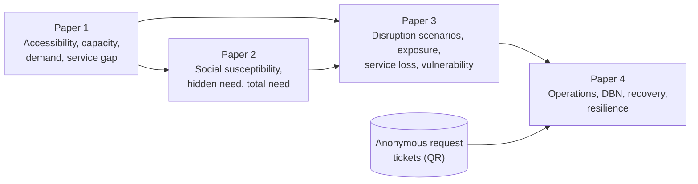

# Domain model (v0 draft)

> **Status: DRAFT for human review.** This is a digest of Papers 1–4. The original texts will be stored verbatim in `docs/specs/source/` and as per-paper specs `01`–`04`. Where this digest and a paper disagree, the paper wins and this file must be corrected. Anything the papers leave unspecified is listed in `open-questions.md` as `OQ-n` and must **not** be resolved in code or in this file.

## 1. Pipeline

- **Paper 1** builds the baseline: group-specific accessibility, capacity, estimated demand, supply and **Service Gap**, with a BBN, Monte Carlo uncertainty, sensitivity and what-if scenarios.
- **Paper 2** splits total need (`Population × p`) into visible and **hidden need** through a latent non-take-up node with parents Social Susceptibility, need-based gap, access deterrence and alternatives outside the network (OQ-8, OQ-10, OQ-11), giving **Estimated Total Need**.
- **Paper 3** runs simulated disruption scenarios and infers **Vulnerability** from Group Exposure, Service Loss and Social Susceptibility. It stops before resilience.
- **Paper 4** adds real operational data (anonymous tickets), facility and territorial functional state, a **DBN**, Bayesian updating of vulnerability, recovery trajectories and **Resilience**, plus per-facility operational output.

## 2. Indices and unit of analysis

Notation decided in OQ-1 (the papers' original symbols differ; see `paper-revisions.md`).

| Symbol | Meaning |
| --- | --- |
| `i` | spatial unit. First application: Local Community, Greek **ΤΚ** (Τοπική Κοινότητα). The code must stay generic. Demand, supply and gap belong to `i` |
| `f` | facility; travel time is `T_if^{g,m}` |
| `g` | population group |
| `s` | service |
| `m` | transport mode: walking, public transport, car |
| `c` | scenario (counterfactual or disruption) |
| `t` | time |
| `l` | state of a discrete variable, as in `Σ_l P(X = l) …` |
| `k`, `p`, `τ` | intensity (OQ-24), need prevalence and take-up (OQ-8) |

**Unit of analysis (Paper 4 §3): `spatial unit × social group × service × time`.** The state of one facility is never automatically the state of a spatial unit: a facility can be degraded while the unit stays covered by alternatives.

**Three kinds of need (OQ-8, decided).** *Hidden need*: need never expressed (Paper 2). *Unmet expressed need*: requests not fulfilled within the maximum acceptable waiting time (Service Gap, Paper 1; Service Loss, Paper 3). *Met need*: requests fulfilled. They never overlap, so no unmet need is counted twice.

**Units of measurement (OQ-24, decided).** Need, capacity, supply, gap and loss are measured in **service units per reference period** (visits, appointments or hours, defined per service). Need is `people with need × intensity`. Quantities of different services are never summed. The reference period is open (OQ-25). A request not fulfilled within the service's maximum acceptable waiting time counts as unmet (OQ-26).

## 3. Entities

- **SpatialUnit**: id, geometry, population by group.
- **PopulationGroup**: id, definition rule (for example `Age ≥ 65`, `Income < T`), and three profiles: demographic (how many people), mobility (how they can travel), demand (how likely they need the service). Examples: Elderly, Mobility-limited, Unemployed, Low-income. Groups may overlap (OQ-6). A group is **not** a measure of need.
- **Service**: a type of social service, with its own service unit (visit, appointment, hour) and maximum acceptable waiting time (OQ-24, OQ-26).
- **Facility**: location, type, services offered, capacity inputs (places, staff, throughput), operating hours, operational status, availability.
- **TransportMode** and per-mode **Network** (road, pedestrian, public transport) plus DEM.
- **Scenario**: a set of **changes relative to the baseline** (an overlay, never a copy of the data): what-if interventions (Paper 1 §13, for example capacity +20 %, new facility) and disruptions (Paper 3: facility severities `DS ∈ [0,1]` with 0 none, 0.25 minor, 0.5 moderate, 0.75 severe, 1 complete; closed network edges), plus rationing case (OQ-24) and a reference-scenario flag (OQ-16). Stored as versioned, schema-validated JSON with an owner and visibility (private, shared).
- **Run**: one **immutable** execution of a scenario. Records everything needed to reproduce it: scenario version, data package version, code version (git commit), model and parameter version (CPTs, priors), random seed, configuration. Lifecycle `queued → running → succeeded | failed | cancelled`, with progress. Identical inputs may reuse results.
- **Result**: belongs to one run. Summary values per `unit × group × service` (probabilities, intervals) in the database for maps; full Monte Carlo samples in Parquet files.
- **Study area**: one or more core municipalities plus a buffer of neighbouring units (OQ-28).
- **Onboarding**: the hub keeps national raw sources (boundaries, network, population, DEM) as versioned files and **processes them only for onboarded study areas** (clip with buffer, clean, checks, `DP-NNN` notes). Thematic layers (facilities, services, capacities, transit, susceptibility indicators) are added per municipality, incrementally, through validated imports. Each municipality has an onboarding status and a **coverage matrix** (layer × status: missing, open data, estimated, verified).
- **Stable identifiers and history**: every unit, facility, node and edge keeps the same id across packages and installations; features carry `municipality_id`, `role` (core | buffer), `quality` and `valid_from`/`valid_to` (closed, never deleted).
- **Data package**: a versioned (semantic versioning), checksummed bundle for one study area **plus a buffer**, with layer coverage, changelog and provenance, produced by the hub and imported by an installation after a preview of changes. When a municipality is onboarded or corrected, the hub publishes new versions of the packages of every study area whose buffer includes it.
- **Deployment**: the same code runs as a **municipal installation** (one per study area: its own users, scenarios, runs and tickets) or as the **hub** (raw sources, onboarding, curated data, packages, optional aggregated indicators shared upwards by municipalities).
- **Ticket**: anonymous request (section 4.4).
- **RecoveryTrajectory**: time series of service loss or observed consequence per `(unit, group, service)`.

## 4. Variable catalogue

Kinds: `INPUT`, `PARAMETER` (uncertain input), `COMPUTED` (simulation, not a BN node), `EVIDENCE` (computed outside the BN, fed in as evidence), `BN-PARENT`, `BN-TARGET`, `LATENT`, `OBSERVED`, `OUTPUT`. Formulas are as stated in the papers unless a decision in `open-questions.md` replaced them (marked with the `OQ-n`); open gaps are listed there. Notation follows OQ-1.

### 4.1 Paper 1: baseline

| Variable | As stated | Kind | Dimensions |
| --- | --- | --- | --- |
| Population | population by unit and group (ELSTAT) | INPUT | unit × group |
| Demand rate `DemandRate^g` | **visible use**: share of the group that reaches the service in the reference period, conceptually `p × τ` (OQ-8, OQ-24); from literature, statistics, expert elicitation. Not need prevalence | PARAMETER | group × service |
| People making requests (Paper 1) | `Population × DemandRate`, under average conditions. Not people with need, which is `Population × p` (Paper 2, OQ-8) | COMPUTED | unit × group × service |
| Intensity `k` | service units one person needs per reference period (OQ-24) | PARAMETER | group × service |
| Estimated demand `D_{i,g,s}` | people making requests `× k`, in **service units** per reference period (OQ-24, OQ-25). Labelled **Estimated**, never Observed | COMPUTED | unit × group × service |
| Travel time `T_if^{g,m}` | access time from unit `i` to facility `f` for group `g`, mode `m` | COMPUTED | unit × facility × group × mode |
| Access weight `w(T)` | converts time to a weight (form not given, OQ-3) | COMPUTED | |
| Accessibility `Accessibility_i^{g,m}` | built from `w(T_if^{g,m})` (combination of modes: OQ-5) | COMPUTED | |
| Physical capacity `C_f^physical` | from places, staff, throughput, and so on | INPUT/PARAMETER | facility |
| Availability | availability of the facility | PARAMETER | facility |
| Functional capacity `C_f^functional` | `C_f^physical × Availability_f` | COMPUTED | facility |
| Effective capacity | ~~`C_ij^effective = C_i^functional × w(T_ij)`~~ (original notation) replaced by 2SFCA allocation (OQ-2, decided): each facility's functional capacity is shared among the units and groups that reach it, in proportion to access-weighted demand; shares sum to the facility's capacity | COMPUTED | facility × unit × group |
| Supply `S_{i,g,s}` | sum of the 2SFCA shares a unit and group receive from all facilities (OQ-2) | COMPUTED | unit × group × service |
| Service Gap `SG_{i,g,s}` | `max(0, D − S)`: unmet **expressed** need (OQ-8); ratio `SG/D`; states LOW / MEDIUM / HIGH with documented thresholds (relation to the BBN: OQ-4) | COMPUTED + BN node | unit × group × service |

BBN (Paper 1 §9): Population group → Demand; Accessibility; Infrastructure → Physical capacity → Functional capacity → Effective supply → Service Gap. Supply-related nodes stay **explicit** and are not hidden inside Service Gap, so the network can explain why a gap is high (low capacity, low accessibility or high demand). CPTs are initialised from expert elicitation, literature and deterministic relations of the service model.

### 4.2 Paper 2: hidden need

| Variable | As stated | Kind | Dimensions |
| --- | --- | --- | --- |
| Group characteristics | indicators **not** already used in the group definition (household dependency and composition, living alone, employment stability, 80+, mobility indicators) | INPUT | unit × group |
| Social Susceptibility `SS_{i,g,s}` | propensity of a group to experience unmet or insufficient provision of a service due to its characteristics, **independently** of current availability, accessibility or capacity. States Low / Medium / High. Indicators may differ by service; group-definition variables never reused (OQ-9, decided) | BN-PARENT | unit × group × service |
| Need-based gap | `max(0, Population × p × k − Supply)`: shortfall of Paper 1 supply relative to **total need**, not to current users. Replaces reuse of Paper 1 Service Gap, which would create a loop through take-up (OQ-10, decided) | EVIDENCE | unit × group × service |
| Access deterrence | accessibility only as a **direct deterrent to seeking** the service, for example travel time to the nearest facility offering it. Not capacity reaching the unit, which is in the need-based gap (OQ-11, decided) | EVIDENCE | unit × group × service |
| Alternatives outside the network | options **not** among modelled facilities (private services, family, NGOs, parishes); expert estimates where no data (OQ-11, decided). Alternative facilities in the network are already in the need-based gap | EVIDENCE | unit × group × service |
| Need prevalence `p` | share of the group that needs the service in the reference period; from data if available, otherwise experts (OQ-8) | PARAMETER | unit × group × service |
| Non-take-up level (the Hidden Need node) | latent; `P(state | SS, need-based gap, access deterrence, outside alternatives)`, no edges among the parents (OQ-11); states are ranges of `1 − τ`, for example Low 0–20 %, Medium 20–50 %, High 50–80 % (OQ-8, OQ-10; edges OQ-11). CPT learned from observed use (parameter learning, pooled across units) | LATENT | unit × group × service |
| Take-up `τ` | share of people with need who **express** it (make a request), whether or not they are served; sampled within the posterior state ranges in Monte Carlo (OQ-8) | COMPUTED | unit × group × service |
| Hidden need (people) | need never expressed: `Population × p × (1 − τ)`; share of group `= p × (1 − τ)`, reported with an interval and with sensitivity to `p` | OUTPUT | unit × group × service |
| Visible need (people) | `Population × p × τ`. Used for aggregate calibration where aggregate figures exist; the ratio to Paper 1 demand is a descriptive indicator only (OQ-8) | COMPUTED | unit × group × service |
| Observed use | requests from administrative records or tickets; evidence for learning take-up, only from facilities with known recording coverage (OQ-8) | OBSERVED | unit × group × service × period |
| Estimated Total Need `ETN` | `Population × p × k` in service units (OQ-8, OQ-24); replaces `EstimatedDemand + E(HiddenNeed)` | OUTPUT | unit × group × service |

CPTs come from expert elicitation by comparing scenarios (for example Low SS, Low gap, high accessibility, many alternatives against High SS, Low gap, low accessibility, few alternatives). Counterfactuals here serve uncertainty, sensitivity and robustness, **not** estimation.

### 4.3 Paper 3: disruption and vulnerability

| Variable | As stated | Kind |
| --- | --- | --- |
| Need Pressure `NP` | `ETN / BaselineAvailableService`. Descriptive baseline indicator. **Decision:** not a parent of Vulnerability (double counting risk); used for characterisation, sensitivity, optional covariate | COMPUTED |
| Disruption severity `DS_{f,c}` | scenario parameter in `[0,1]` | PARAMETER (not a BN node) |
| Disrupted capacity | `C^D_f = C_f (1 − DS_f)` | COMPUTED |
| Disrupted network, accessibility | `Network^D`, then accessibility recomputed from `Network^D`, DEM, population | COMPUTED |
| Group Exposure `GE` | `AffectedPopulation / Population_{i,g}` per group (no separate population, infrastructure or network exposure nodes) | EVIDENCE |
| Baseline available service `AS⁰` | available service without disruption | COMPUTED |
| Disrupted available service `ASᴰ` | `f(Capacity^D, Accessibility^D)` (OQ-14). No adaptive redistribution or alternative activation here (Paper 4) | COMPUTED |
| Baseline gap `PUN⁰` | `max(0, ETN − AS⁰)`, need unmet before any disruption (OQ-12) | COMPUTED |
| Potential Unmet Need `PUNᴰ` | `max(0, ETN − ASᴰ)` | COMPUTED |
| Disruption loss `ΔPUN` | `PUNᴰ − PUN⁰`, always stored in absolute service units (OQ-12, OQ-24) | COMPUTED / OUTPUT |
| Service Loss `SL` | `(PUNᴰ − PUN⁰) / ETN`, in `[0,1]`, 0 when nothing changes (OQ-12, decided; replaces the paper's `PUN / ETN`). Not latent, not Vulnerability, not Resilience | EVIDENCE |
| Relative Service Loss `SL′` | `(PUNᴰ − PUN⁰) / min(ETN, AS⁰)`, secondary indicator, **not** a BN node (OQ-12) | OUTPUT |
| Rationing | uniform or concentrated, bounding how shortage is spread among people (OQ-24) | PARAMETER (scenario) |
| Breadth, depth, severity of loss | per-person loss indicators in the Foster–Greer–Thorbecke style, computed for each rationing case, **not** BN nodes (OQ-24) | OUTPUT |
| Social Susceptibility `SS_{i,g,s}` | from Paper 2, not recomputed (OQ-9) | BN-PARENT |
| Vulnerability relationship | the CPT `P(V | GE, SL, SS)`: how a disruption turns into consequences for a group (OQ-16, decided). States Low / Medium / High (OQ-15). Expert elicitation first; no ad hoc weighted average | BN-TARGET (CPT) |
| Vulnerability at a scenario `V_{i,g,s,c}` | the relationship evaluated at scenario `c`; run separately per group. Mapped at **reference scenarios** (minor, moderate, severe) so areas compare at the same intensity | OUTPUT |
| Risk | vulnerability averaged over scenarios weighted by their probability of occurrence. **Not** vulnerability; produced only if disruption probabilities exist (OQ-16) | OUTPUT (future) |

Two layers: **Layer 1** is computational (scenario, disruption, simulation, evidence). **Layer 2** is Bayesian inference over the three parents. Monte Carlo samples uncertain parameters, runs the simulation, infers, stores, and yields `P(V = High)` rather than a score.

### 4.4 Paper 4: operations, dynamics, resilience

| Variable | As stated | Kind |
| --- | --- | --- |
| Ticket | anonymous request: spatial unit, group (overlap rule: OQ-6), service/need, request time `t_r`, scheduled time `t_a`, service time `t_f`, expiry `t_e`, and a flag "first request in this period" (yes/no, no identifier) to count people without identifying them (OQ-8, OQ-21) | OBSERVED |
| Recording coverage | share of a facility's requests captured by the ticket system, per facility and period; observations are used for learning only where coverage is full or known (OQ-8) | OBSERVED |
| Operational indicators | demand rate, waiting time, fulfilment delay, appointment adherence, overdue requests, expired requests, service coverage, unfulfilled need | COMPUTED |
| Facility functional state | Normal → Under Pressure → Degraded → Critical → Recovering → Normal, from operational indicators | LATENT/STATE |
| Need for support, resource mobilisation | response mechanism, approved and controlled volunteer resources included; **not** an independent "community resilience" measure | STATE |
| Network redundancy, territorial (ΤΚ) service coverage and functional state | combine facility coverages and redundancy | STATE |
| Observed exposure and loss `GE(t)`, `SL(t)` | derived from territorial functional state and tickets, using the same definitions as Paper 3 (OQ-12, OQ-16) | COMPUTED |
| Expected group consequence | the Paper 3 vulnerability relationship evaluated at observed `GE(t)`, `SL(t)` and `SS`. The disruption enters once (OQ-16) | COMPUTED |
| Observed group consequence | from total need, covered need, unfulfilled need in tickets; linked to latent `V` by a measurement node `P(ObservedConsequence | V)` (OQ-18) | OBSERVED |
| Updated vulnerability relationship | Bayesian **parameter learning** of the CPT, with the expert CPT as prior (for example Dirichlet per row). Weight of prior against data: OQ-27 | BN update |
| Recovery trajectory | `ServiceLoss(t)` or `ObservedGroupConsequence(t)` | OBSERVED series |
| Resilience `P(Resilience_{unit,g,s} | trajectory)` | indicators: maximum loss, recovery time, recovery rate, cumulative impact (AUC), final restoration level | OUTPUT |
| Facility operational output | functional state, coverage, pending requests, resource need by type (for example medical, administrative, transport) | OUTPUT |

DBN (Paper 4 §12): `State(t−1) → FunctionalState(t) → ObservedConsequence(t) → Response(t) → Recovery(t) → State(t+1)`, in parallel with `Vulnerability → ExpectedConsequence → ObservedConsequence`. Since OQ-16, the parallel branch is: observed `GE(t)`, `SL(t)` and `SS` → vulnerability relationship → Expected Consequence, compared with Observed Consequence to learn the relationship's parameters. Exact topology and time slice: OQ-17.

## 5. Cross-cutting machinery (shared by all papers)

- **Discrete Bayesian modelling**: ordinal variables, CPTs, elicitation from expert scenarios, inference. Engine choice via ADR.
- **Monte Carlo uncertainty**: sample uncertain inputs and CPT parameters, run the model, collect `P(·)` or a distribution (Paper 1 §11, Paper 2 §14, Paper 3 §22).
- **Sensitivity**: rank factors by influence (Paper 1 §12, Paper 2 §16, Paper 3 §23).
- **Scenarios**: controlled interventions (Paper 1 §13, for example capacity +20 %, staff +1, new facility, accessibility −20 %) and disruption scenarios (Paper 3 §7–10). One shared engine.
- **Validation**: expert validation, plausibility and monotonicity checks, sensitivity; later calibration against observed data (Papers 1–3 §14/18/24).
- **Alternative allocation models** (future, see OQ-2 notes N-2a, N-2b): 3SFCA as a candidate refinement, and capacity-constrained allocation as an alternative model for sensitivity analysis only. The baseline is 2SFCA. The `capacity` module should expose allocation behind an interface so these can be added without changing callers.

## 6. Module map for `core/`

| Module | Papers | Responsibility |
| --- | --- | --- |
| `model` | all | entities and the typed unit-of-analysis container |
| `bayes` | 1–4 | discrete variables, CPTs, elicitation, inference interface |
| `accessibility` | 1 §5 | travel times, weights, group- and mode-specific accessibility |
| `demand` | 1 §6 | estimated demand |
| `capacity` | 1 §7 | physical, functional, effective capacity, supply |
| `service_gap` | 1 §8–9 | service gap and its BBN |
| `latent_need` | 2 | social susceptibility, hidden need, total need |
| `scenarios` | 1 §13, 3 §7–10 | counterfactual and disruption scenarios |
| `vulnerability` | 3 §11–21 | exposure, service loss, vulnerability BBN |
| `operations` | 4 §4–5 | tickets, indicators, facility functional state |
| `dynamics` | 4 §7–9, 12 | territorial state, expected/observed consequence, DBN |
| `resilience` | 4 §10–13 | Bayesian update of vulnerability, trajectories, resilience |
| `uncertainty` | 1 §11, 2 §14, 3 §22 | Monte Carlo propagation |
| `sensitivity` | 1 §12, 2 §16, 3 §23 | sensitivity analysis |
| `validation` | 1 §14, 2 §18, 3 §24 | validation tools |

## 7. Invariants

See `CLAUDE.md` ("Domain invariants"). The most important: keep BN nodes, computed simulation variables and scenario parameters separate (section 4); never mix vulnerability and resilience; never treat estimated demand as total need.
