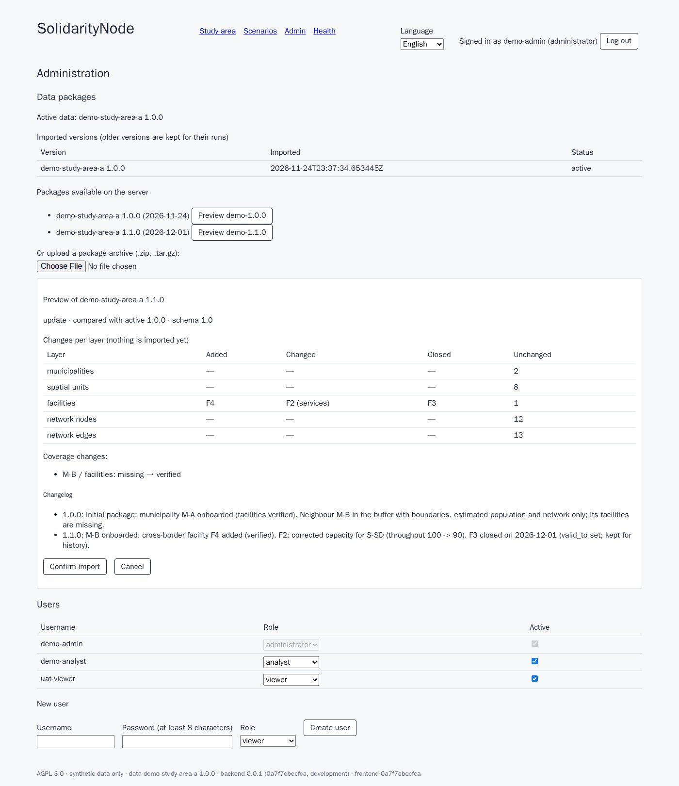
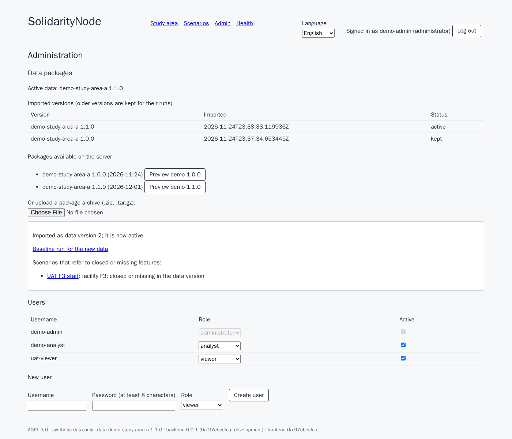

# Διαχείριση { #admin }

> Περιγράφει την έκδοση **0.1.0** της πλατφόρμας. Μόνο για διαχειριστές· οι άλλοι χρήστες βλέπουν «Η σελίδα αυτή είναι για διαχειριστές.»

## Πακέτα δεδομένων { #data-packages }

- **Ενεργά δεδομένα** (Active data): η έκδοση δεδομένων που χρησιμοποιούν τα νέα σενάρια και οι νέες εκτελέσεις.
- **Εισαγμένες εκδόσεις** (Imported versions): όλες οι εκδόσεις που εισήχθησαν ποτέ. Οι παλαιότερες **διατηρούνται** για τις εκτελέσεις τους· το κουμπί **Ενεργοποίηση ξανά της …** (Make … active again) επιστρέφει σε μία από αυτές (επαναφορά).
- **Διαθέσιμα πακέτα στον διακομιστή** (Packages available on the server), ή **ανεβάστε αρχείο πακέτου** (upload a package archive, .zip ή .tar.gz).
- Η **Προεπισκόπηση** (Preview) δείχνει, πριν εισαχθεί οτιδήποτε: αν το πακέτο είναι νέο, ενημέρωση ή έχει ήδη εισαχθεί· τις αλλαγές ανά επίπεδο (στοιχεία που προστέθηκαν, άλλαξαν, έκλεισαν, έμειναν αμετάβλητα)· τις αλλαγές κάλυψης· το ιστορικό αλλαγών του πακέτου· και τυχόν προβλήματα ελέγχου. Τα προβλήματα ελέγχου εμφανίζονται στα αγγλικά, γιατί αναφέρουν ονόματα αρχείων και στηλών.
- Η **Επιβεβαίωση εισαγωγής** (Confirm import) εισάγει το πακέτο σε ένα βήμα. Η νέα έκδοση γίνεται ενεργή, μπαίνει στην ουρά μια **εκτέλεση βάσης** και εμφανίζονται τα σενάρια που αναφέρονται σε στοιχεία που έκλεισαν ή δεν υπάρχουν.

Τι σημαίνει αυτό για τους άλλους χρήστες: [Πακέτα δεδομένων και ενημερώσεις](data-updates.md). Από τερματικό, οι ίδιες ενέργειες γίνονται με `make import-package PKG=…` και `make activate-version VERSION=…`.

## Χρήστες { #users }

- **Νέος χρήστης** (New user): όνομα χρήστη, κωδικός (τουλάχιστον 12 χαρακτήρες· οι πολύ συνηθισμένοι κωδικοί δεν γίνονται δεκτοί) και ρόλος (θεατής, αναλυτής, διαχειριστής).
- Μπορείτε να αλλάξετε τον **ρόλο** ενός χρήστη ή να τον κάνετε ανενεργό. Δεν μπορείτε να υποβιβάσετε ή να απενεργοποιήσετε τον εαυτό σας, και ο τελευταίος ενεργός διαχειριστής δεν μπορεί ποτέ να υποβιβαστεί ή να απενεργοποιηθεί.
- Ο πρώτος διαχειριστής μιας νέας εγκατάστασης δήμου δημιουργείται από τερματικό με `make create-admin`.

Οι ρόλοι εξηγούνται στη σελίδα [Ρόλοι](roles.md).

## Χώρος αποτελεσμάτων { #results-storage }

«N αρχείο(α) δειγμάτων για N εκτέλεση(-εις): … MB· ελεύθερα στον τόμο αποτελεσμάτων: … MB.» Τίποτα δεν διαγράφεται αυτόματα. Κρατάτε αντίγραφα ασφαλείας της βάσης δεδομένων και του τόμου αποτελεσμάτων μαζί (δεν έχει γραφτεί ακόμη οδηγός για τα αντίγραφα ασφαλείας· δείτε το [ιστορικό αλλαγών](../../CHANGELOG.md), στα αγγλικά).
