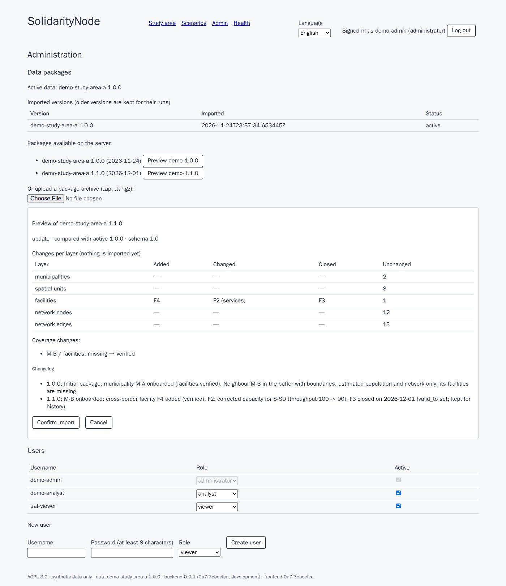
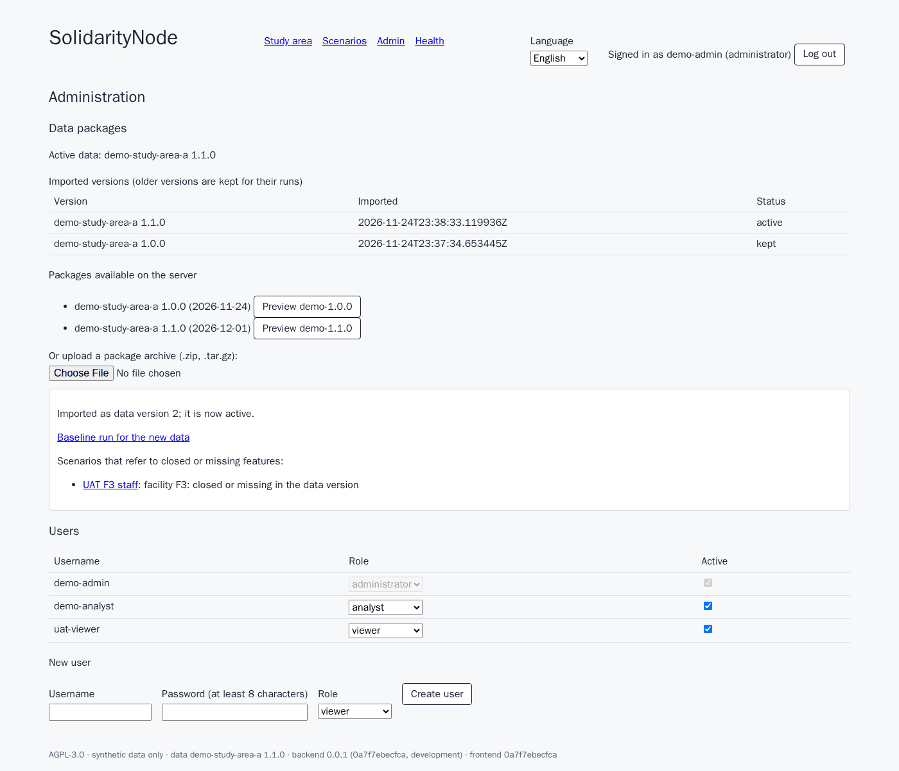

# Admin

> Describes platform version **0.1.0**. For administrators only; other users see "This page is for administrators."

## Data packages

- **Active data**: the data version that new scenarios and runs use.
- **Imported versions**: every version ever imported. Earlier ones are **kept** for their runs; **Make … active again** goes back to one (rollback).
- **Packages available on the server**, or **upload a package archive** (.zip, .tar.gz).
- **Preview** shows, before anything is imported: whether it is new, an update or already imported; the changes per layer (added, changed, closed, unchanged features); coverage changes; the package changelog; and any validation problems (in English, since they quote file and column names).
- **Confirm import** imports it in one step. The new version becomes active, a **baseline run** is queued, and scenarios that refer to closed or missing features are listed.

What this means for everyone else: [Data packages and updates](data-updates.md). From a terminal, the same actions are `make import-package PKG=…` and `make activate-version VERSION=…`.

## Users

- **New user**: username, password (at least 12 characters; common passwords are refused) and role (viewer, analyst, administrator).
- Change a user's **role** or make them inactive. You cannot demote or disable yourself, and the last active administrator can never be demoted or disabled.
- The first administrator of a new installation is created in a terminal with `make create-admin`.

Roles are explained in [Roles](roles.md).

## Results storage

"N samples file(s) for N run(s): … MB; free on the results volume: … MB." Nothing is deleted automatically. Back up the database and the results volume together (a backup guide is not written yet; see the [changelog](../../CHANGELOG.md)).
