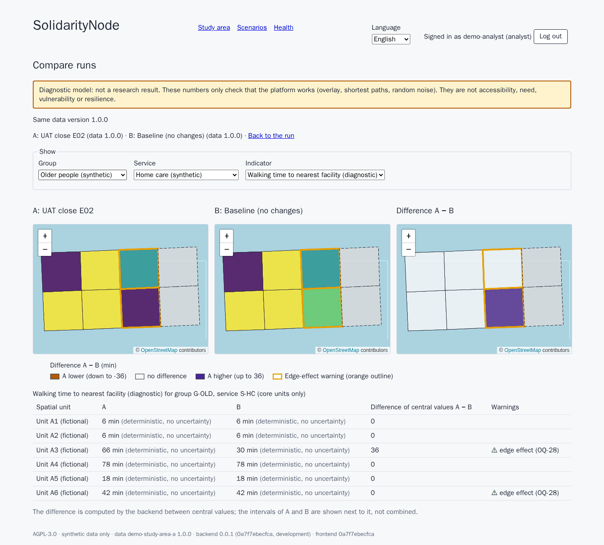
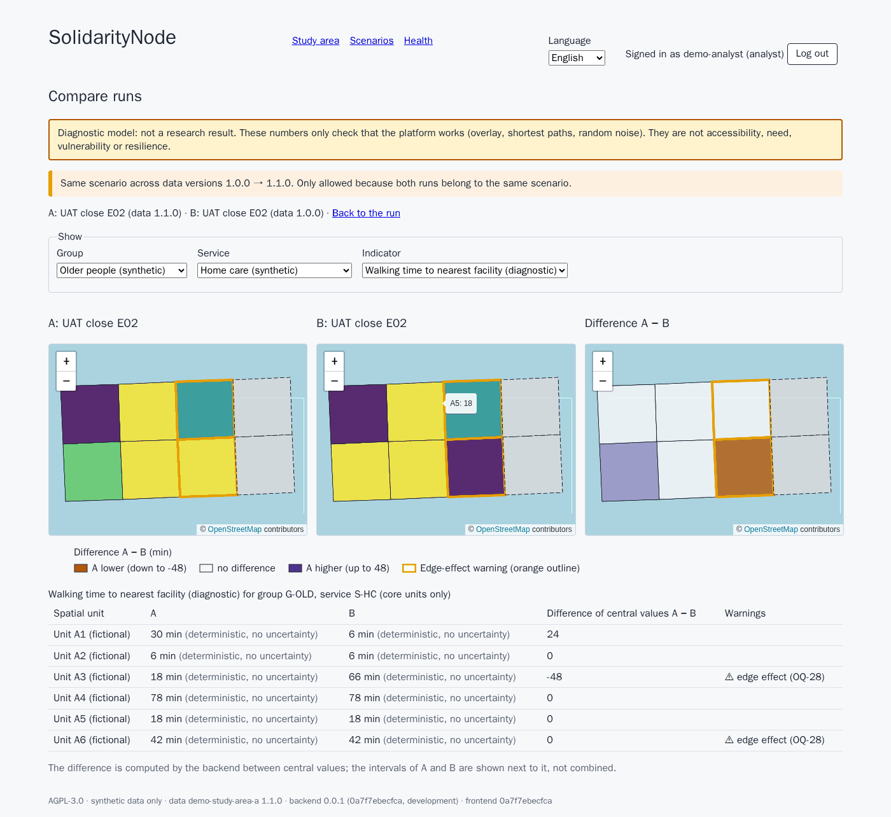

# Σύγκριση { #compare }

> Περιγράφει την έκδοση **0.1.0** της πλατφόρμας.

Σε μια εκτέλεση που ολοκληρώθηκε, το κουμπί **Σύγκριση με τη βάση** (Compare with baseline) ανοίγει τη σελίδα **Σύγκριση εκτελέσεων** (Compare runs): την εκτέλεση Α (τη δική σας) δίπλα στην εκτέλεση Β (τη βάση, χωρίς αλλαγές).

## Τι βλέπετε { #what-you-see }

- Τρεις χάρτες: **Α**, **Β** και **Διαφορά διαμέσων Α − Β** (Difference of medians A − B).
- **Μία κλίμακα χρωμάτων για Α και Β**: μια μονάδα με την ίδια τιμή έχει το ίδιο χρώμα και στους δύο χάρτες.
- Ο πίνακας δίνει «Α: διάμεσος (διάστημα 90 %)», «Β: διάμεσος (διάστημα 90 %)» και τη **Διαφορά διαμέσων Α − Β**. Η διαφορά υπολογίζεται ανάμεσα στις δύο κεντρικές τιμές· η δική της αβεβαιότητα δεν υπολογίζεται ακόμη ([ADR 0017](../adr/0017-run-reproducibility-and-result-storage.md), στα αγγλικά).
- Η επιλογή **Αβεβαιότητα** (Uncertainty) δείχνει στους χάρτες Α και Β το εύρος των διαστημάτων τους, πάλι με μία κοινή κλίμακα.

## Ποιες εκτελέσεις μπορούν να συγκριθούν { #which-runs-can-be-compared }

- Δύο εκτελέσεις με την **ίδια έκδοση δεδομένων**: οποιαδήποτε δύο σενάρια.
- Δύο εκτελέσεις του **ίδιου σεναρίου** με διαφορετικές εκδόσεις δεδομένων: η σελίδα γράφει «Same scenario across data versions 1.0.0 → 1.1.0. Επιτρέπεται μόνο επειδή και οι δύο εκτελέσεις ανήκουν στο ίδιο σενάριο.» (η πρώτη πρόταση εμφανίζεται ακόμη στα αγγλικά). Έτσι βλέπετε τι άλλαξε με την ενημέρωση των δεδομένων.
- Διαφορετικά σενάρια με διαφορετικές εκδόσεις δεδομένων: δεν επιτρέπεται, γιατί η διαφορά θα ανακάτευε δύο αιτίες.

Από τη σελίδα μιας εκτέλεσης, **Εκτελέσεις αυτού του σεναρίου** (Runs of this scenario) → **Σύγκριση με αυτή την εκτέλεση** (Compare with this run) συγκρίνει δύο εκτελέσεις του ίδιου σεναρίου.
