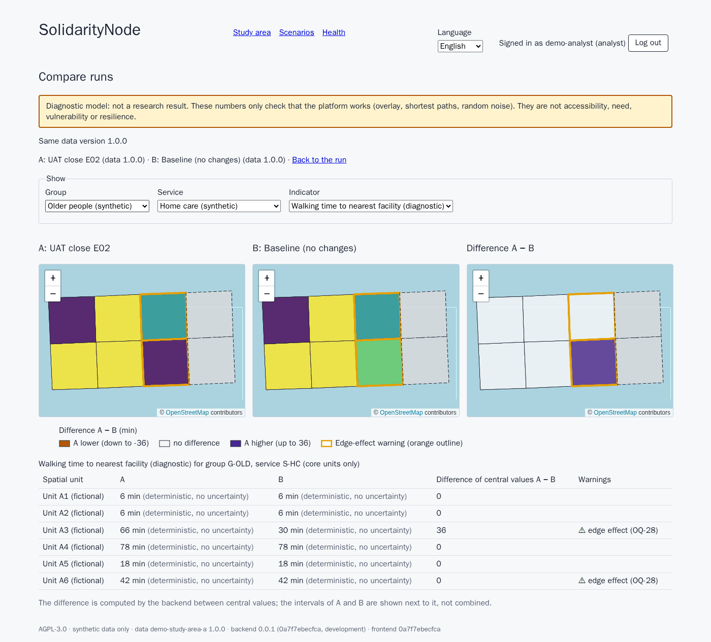
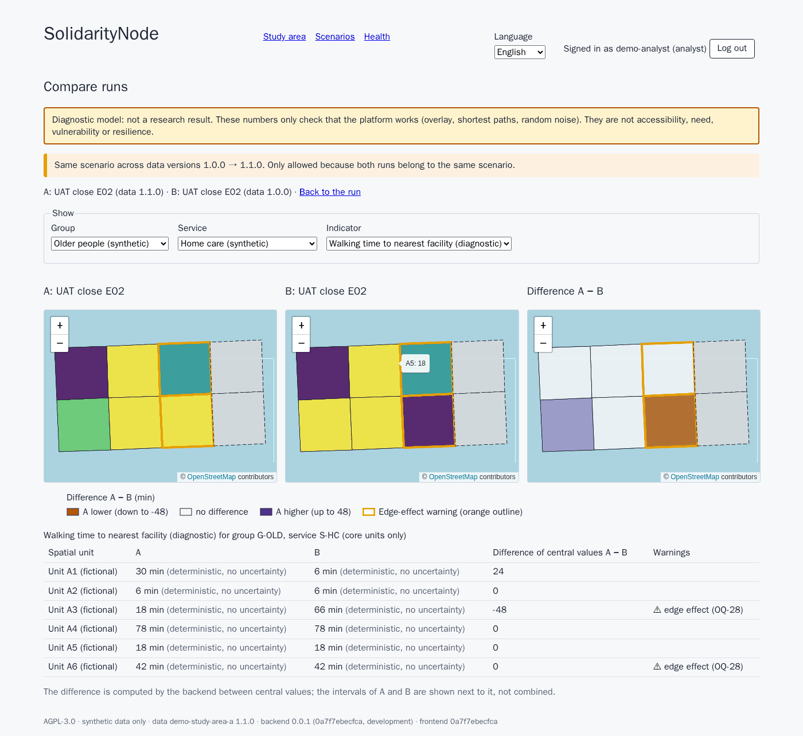

# Compare

> Describes platform version **0.1.0**.

On a succeeded run, **Compare with baseline** opens the **Compare runs** page: run A (yours) next to run B (the baseline, no changes).

## What you see

- Three maps: **A**, **B** and **Difference A − B**.
- **One colour scale for A and B**: a unit with the same value has the same colour on both maps.
- The table gives "A: median (90 % interval)", "B: median (90 % interval)" and the **difference of medians A − B**. The difference is between the two central values; its own uncertainty is not computed yet ([ADR 0017](../adr/0017-run-reproducibility-and-result-storage.md)).
- **Uncertainty** switches maps A and B to the width of their intervals, again with one scale.

## Which runs can be compared

- Two runs on the **same data version**: any two scenarios.
- Two runs of the **same scenario** on different data versions: the page says "Same scenario across data versions 1.0.0 → 1.1.0." This shows what the data update changed.
- Different scenarios on different data versions: refused, because the difference would mix two causes.

From a run page, **Runs of this scenario** → **Compare with this run** compares two runs of the same scenario.
