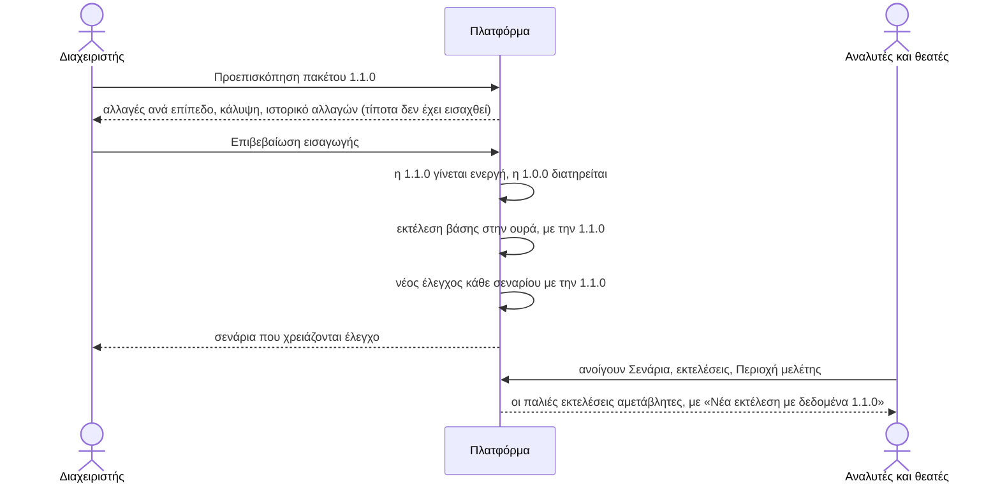

# Πακέτα δεδομένων και ενημερώσεις { #data-packages-and-updates }

> Περιγράφει την έκδοση **0.1.0** της πλατφόρμας, από τη σκοπιά του χρήστη. Η μορφή των πακέτων περιγράφεται στο [ADR 0013](../adr/0013-data-packages.md) (στα αγγλικά).

Τα επίσημα δεδομένα της περιοχής μελέτης σας έρχονται ως **πακέτο δεδομένων**. Το φτιάχνει η κεντρική εγκατάσταση (hub) από επίσημες πηγές και ανοιχτά δεδομένα, με σημείωση επεξεργασίας για κάθε βήμα. Το εισάγει ένας διαχειριστής· οι αναλυτές και οι θεατές δεν ανεβάζουν ποτέ δεδομένα ([Βασικές έννοιες](../concepts.md#data-package-what-is-true)).

## Τι γίνεται σε μια ενημέρωση { #what-happens-on-an-update }

1. **Οι παλιές εκτελέσεις δεν αλλάζουν ποτέ.** Συνεχίζουν να δείχνουν τα δεδομένα που χρησιμοποίησαν, με μια σημείωση και το κουμπί **Νέα εκτέλεση με δεδομένα 1.1.0** (Rerun on data 1.1.0).
2. **Τα σενάρια ελέγχονται ξανά.** Ένα σενάριο που αναφέρει στοιχείο που δεν υπάρχει πια (για παράδειγμα μια δομή που έκλεισε) δείχνει **Χρειάζεται έλεγχο με τα τρέχοντα δεδομένα** (Needs attention) και δεν μπορεί να εκτελεστεί μέχρι να διορθωθεί.
3. **Μια εκτέλεση βάσης** με τα νέα δεδομένα μπαίνει αμέσως στην ουρά.
4. Στα **Σενάρια** (Scenarios), ένα σενάριο χωρίς εκτέλεση με τα νέα δεδομένα δείχνει **Τελευταία εκτέλεση στα δεδομένα 1.0.0** (Latest run on data 1.0.0).
5. **Συγκρίνετε** δύο εκτελέσεις του ίδιου σεναρίου με τις δύο εκδόσεις δεδομένων, για να δείτε τι άλλαξε με την ενημέρωση ([Σύγκριση](compare.md)).

## Επιστροφή σε προηγούμενη έκδοση { #going-back }

Ένας διαχειριστής μπορεί να ενεργοποιήσει ξανά μια προηγούμενη έκδοση (**Διαχείριση** (Admin) → **Εισαγμένες εκδόσεις** (Imported versions) → **Ενεργοποίηση ξανά της …** (Make … active again)). Γίνονται τα ίδια: μια εκτέλεση βάσης μπαίνει στην ουρά, τα σενάρια ελέγχονται ξανά, τίποτα δεν διαγράφεται.

## Αν τα δεδομένα είναι λάθος { #if-the-data-is-wrong }

Μην το παρακάμψετε με ένα σενάριο. Στείλτε τη διόρθωση στην κεντρική εγκατάσταση (μέσω του διαχειριστή σας). Η διόρθωση έρχεται στην επόμενη έκδοση του πακέτου, για κάθε εγκατάσταση δήμου που το χρησιμοποιεί.
