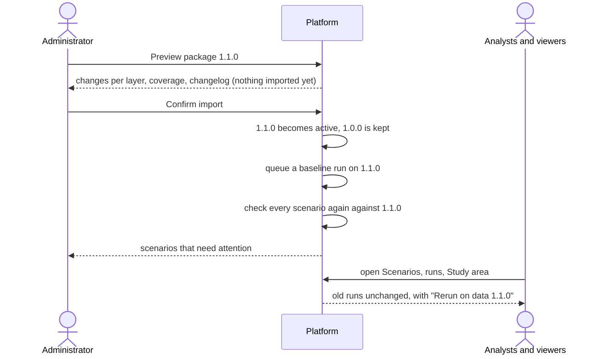

# Data packages and updates

> Describes platform version **0.1.0**. From the user's point of view; the format is in [ADR 0013](../adr/0013-data-packages.md).

The official data of your study area arrives as a **data package** (πακέτο δεδομένων), built by the hub from official and open sources, with a processing note for every step. An administrator imports it; analysts and viewers never upload data ([Concepts](../concepts.md#data-package-what-is-true)).

## What happens on an update

1. **Old runs never change.** They keep showing the data they used, with a note and **Rerun on data 1.1.0**.
2. **Scenarios are checked again.** One that names a feature that no longer exists (for example a closed facility) shows **Needs attention** and cannot run until it is edited.
3. **A baseline run** on the new data is queued at once.
4. In **Scenarios**, a scenario without a run on the new data shows **Latest run on data 1.0.0**.
5. **Compare** two runs of the same scenario across the two data versions to see what the update changed ([Compare](compare.md)).

## Going back

An administrator can make an earlier version active again (**Admin** → **Imported versions** → **Make … active again**). The same things happen: a baseline run is queued, scenarios are checked again, nothing is deleted.

## If the data is wrong

Do not work around it with a scenario. Send the correction to the hub (through your administrator): it arrives in the next package version, for every installation that uses it.
