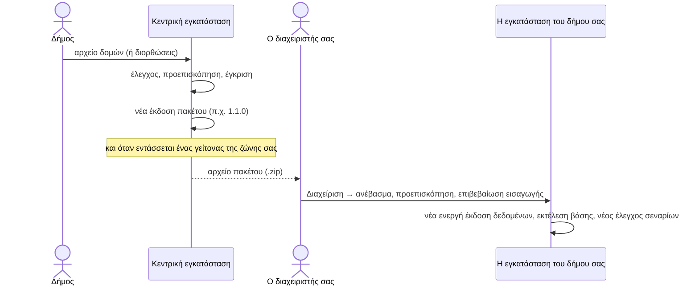

# Συνεργασία με την κεντρική εγκατάσταση { #working-with-the-hub }

> Περιγράφει την έκδοση **0.2** της πλατφόρμας. Για τον δήμο: τι στέλνετε στην κεντρική εγκατάσταση, τι λαμβάνετε και πώς έρχεται μια ενημέρωση. Οι οθόνες της ίδιας της κεντρικής εγκατάστασης περιγράφονται στη σελίδα [Κεντρική εγκατάσταση](hub.md).

Η εγκατάσταση του δήμου σας παίρνει τα επίσημα δεδομένα της από την **κεντρική εγκατάσταση (hub)**. Η κεντρική εγκατάσταση δεν συνδέεται ποτέ στη δική σας: λαμβάνετε ένα αρχείο πακέτου και ένας διαχειριστής το εισάγει.

## Τι στέλνετε { #what-you-send }

- **Τις δομές σας**, στο πρότυπο εισαγωγής της κεντρικής εγκατάστασης (XLSX με οδηγίες στα ελληνικά και στα αγγλικά, ή CSV, ή GeoPackage): όνομα, θέση (συντεταγμένες· οι διευθύνσεις δεν γεωκωδικοποιούνται), είδος, υπηρεσίες με τη δυναμικότητά τους (θέσεις, προσωπικό, παραγωγικότητα στη μονάδα κάθε υπηρεσίας), ωράριο, κατάσταση, ποιότητα δεδομένων και πηγή. Δείτε την [Εισαγωγή δομών](../data-processing/facility-import.md) (στα αγγλικά).
- **Διορθώσεις και νέες δομές** αργότερα: ζητήστε από την κεντρική εγκατάσταση τον τρέχοντα κατάλογο των δομών σας στο πρότυπο, διορθώστε τον και στείλτε τον πίσω. Οι γραμμές κρατούν τον μόνιμο κωδικό τους (`HF-…`), οπότε φαίνεται ακριβώς ποια πεδία άλλαξαν.
- **Ποτέ προσωπικά δεδομένα.** Οι δομές είναι οργανισμοί, όχι πρόσωπα: όχι ονόματα εργαζομένων ή υπευθύνων, όχι προσωπικά τηλέφωνα ή e-mail. Τέτοιες στήλες αφαιρούνται και αναφέρονται στην αναφορά ελέγχου. Ένα τηλεφωνικό κέντρο και ένα γενικό e-mail (`info@…`) επιτρέπονται.

Σήμερα στέλνετε το αρχείο στην ομάδα της κεντρικής εγκατάστασης με τον συνήθη τρόπο· η αποστολή από την εγκατάσταση του δήμου θα σχεδιαστεί χωριστά.

## Τι λαμβάνετε { #what-you-receive }

Ένα **πακέτο δεδομένων**, αρχείο `.zip` με το όνομα της περιοχής μελέτης και την έκδοση (π.χ. `study-area-a-1.1.0.zip`). Περιέχει τον δήμο σας (κεντρικό) και τους γείτονές του (ζώνη), τις χωρικές μονάδες τους, τον πληθυσμό ανά ομάδα, το δίκτυο και τις δομές, την ποιότητα δεδομένων και την κάλυψη κάθε επιπέδου, άδειες, σημειώσεις επεξεργασίας και αρχείο αλλαγών. Κάθε στοιχείο κρατά τον ίδιο κωδικό σε κάθε έκδοση.

## Πώς έρχεται μια ενημέρωση { #how-an-update-arrives }

1. Η κεντρική εγκατάσταση δημοσιεύει νέα έκδοση όταν αλλάζουν τα δεδομένα σας, αλλά και όταν εντάσσεται ή διορθώνεται ένας **γειτονικός δήμος** της ζώνης σας: οι δομές του εμφανίζονται τότε στο πακέτο σας ως δομές της ζώνης.
2. Ο διαχειριστής σας την εισάγει όπως στη σελίδα [Πακέτα δεδομένων και ενημερώσεις](data-updates.md): **Διαχείριση** → ανέβασμα του `.zip` (ή `make import-package PKG=<αρχείο>`), ανάγνωση της προεπισκόπησης (στοιχεία που προστίθενται, αλλάζουν ή κλείνουν, αλλαγές κάλυψης), επιβεβαίωση.
3. Όταν έρχονται οι δομές ενός γείτονα, η **προειδοποίηση φαινομένου ορίου** (OQ-28) εξαφανίζεται για τις μονάδες σας που συνορεύουν μαζί του: η πλατφόρμα δεν υποθέτει πια ότι εκεί λείπουν δομές.

Ο αριθμός έκδοσης δείχνει το είδος της ενημέρωσης: το `1.1.0` προσθέτει ή αλλάζει δεδομένα, το `1.0.1` μόνο διορθώνει σφάλματα. Οι παλαιότερες εκδόσεις μένουν στην εγκατάστασή σας και οι εκτελέσεις κρατούν την έκδοση που χρησιμοποίησαν.
