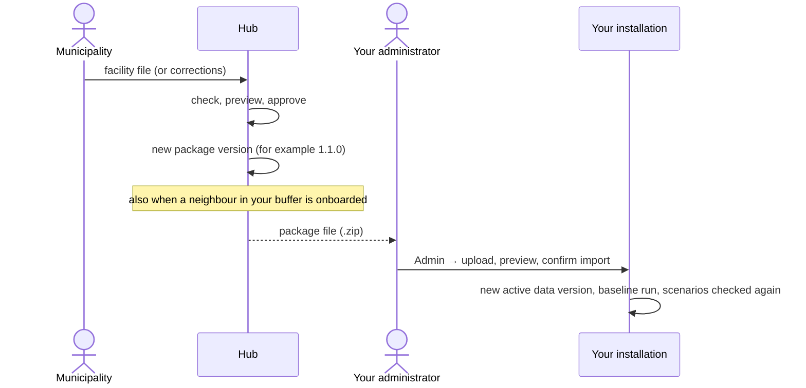

# Working with the hub

> Describes platform version **0.2**. For the municipality: what you send to the hub, what you receive, and how an update arrives. The hub's own screens are in [Hub](hub.md).

Your installation gets its official data from the **hub** (κεντρική εγκατάσταση). The hub never connects to your installation: you receive a package file and an administrator imports it.

## What you send

- **Your facilities**, in the hub's import template (XLSX with instructions in Greek and English, or CSV, or GeoPackage): name, location (coordinates; addresses are not geocoded), type, services with their capacity (places, staff, throughput in the unit of each service), opening hours, status, data quality, and the source. See [Facility import](../data-processing/facility-import.md).
- **Corrections and new facilities** later: ask the hub for the current list of your facilities in the template, edit it and send it back. Rows keep their permanent id (`HF-…`), so the hub sees exactly which fields changed.
- **Never personal data.** Facilities are organisations, not people: no names of staff or responsible persons, no personal phones or e-mails. The hub drops such columns and lists them in its report. A switchboard number and a generic e-mail (`info@…`) are fine.

Today you send the file to the hub team by the usual means; submitting it from your installation is planned separately.

## What you receive

A **data package**, a `.zip` file named after your study area and version (for example `study-area-a-1.1.0.zip`). It contains your municipality (core) and its neighbours (buffer), their spatial units, population by group, network and facilities, the data quality and coverage of every layer, licences, processing notes and a changelog. Every feature keeps the same id in every version.

## How an update arrives

1. The hub publishes a new version when your data changes, and also when a **neighbouring municipality** in your buffer is onboarded or corrected: its facilities then appear in your package as buffer facilities.
2. Your administrator imports it as in [Data packages and updates](data-updates.md): **Admin** → upload the `.zip` (or `make import-package PKG=<file>`), read the preview (added, changed and closed features, coverage changes), confirm.
3. When a neighbour's facilities arrive, the **edge-effect warning** (OQ-28) disappears for your units next to it: the platform no longer assumes facilities are missing there.

The version number tells you what kind of update it is: `1.1.0` adds or changes data, `1.0.1` only corrects errors. Earlier versions stay in your installation, and runs keep the version they used.
