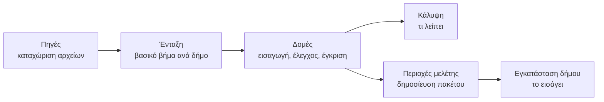
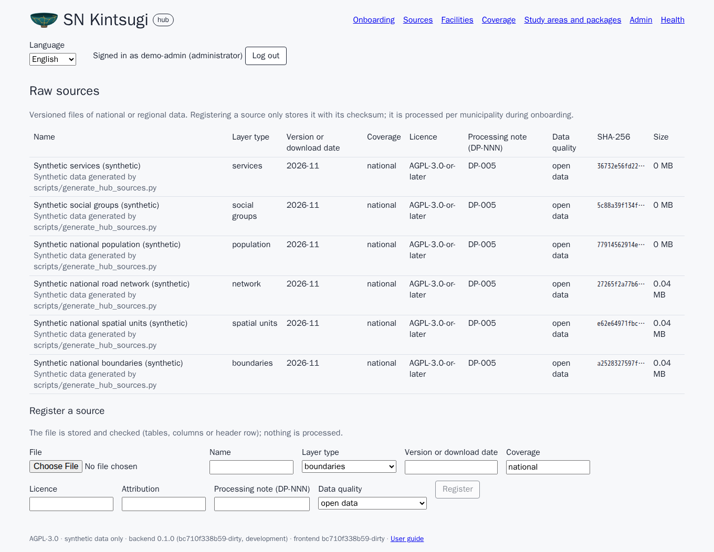
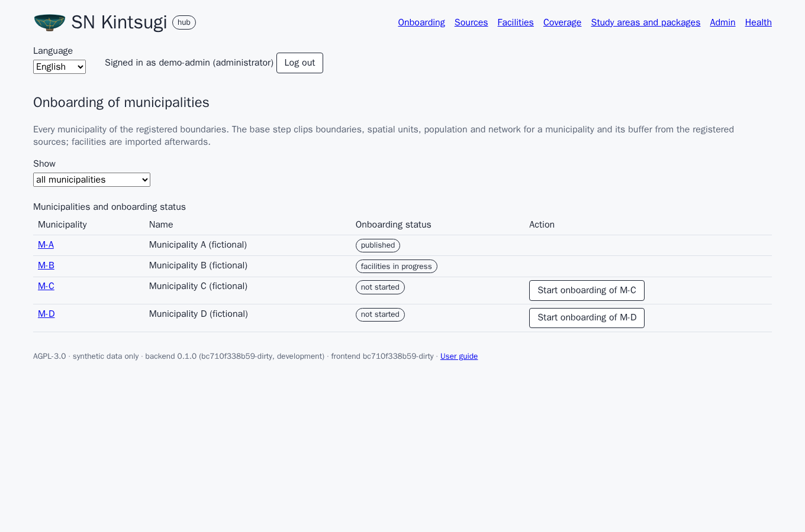
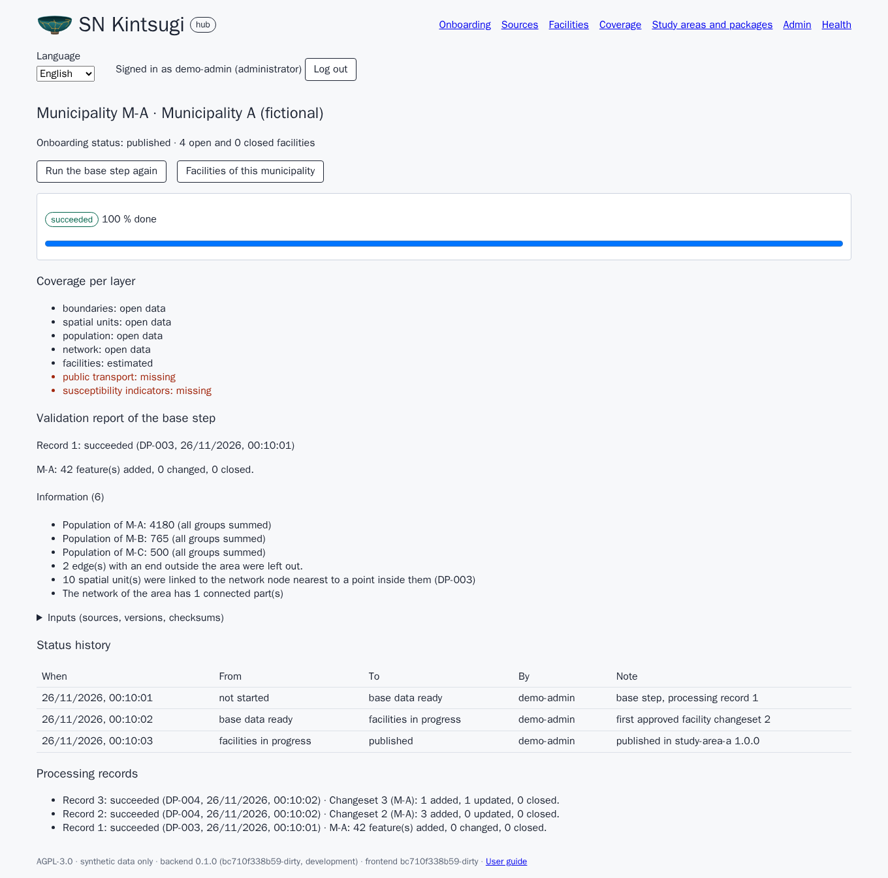
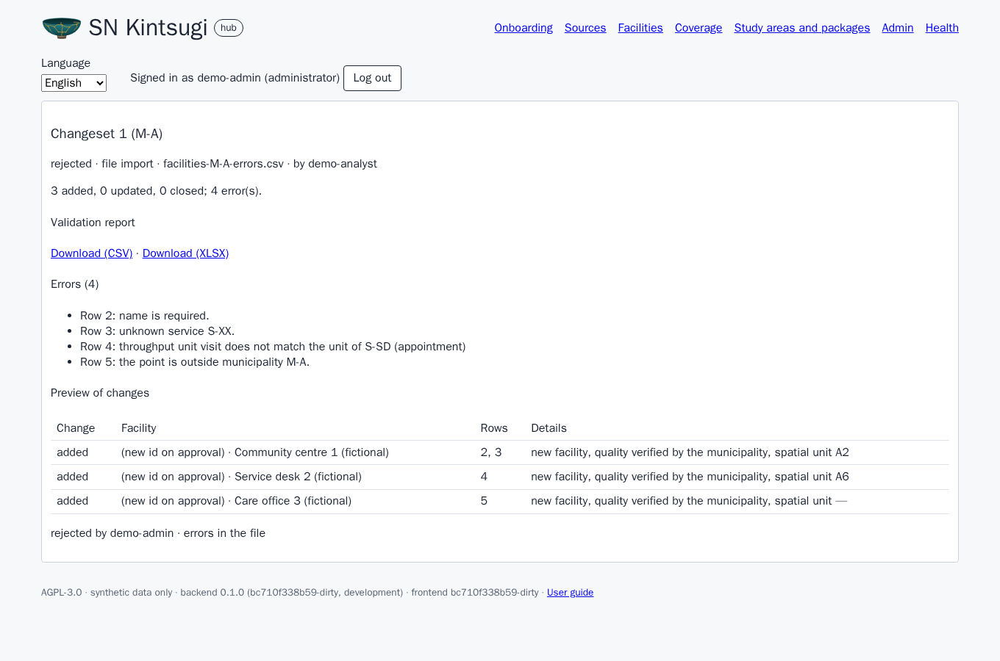
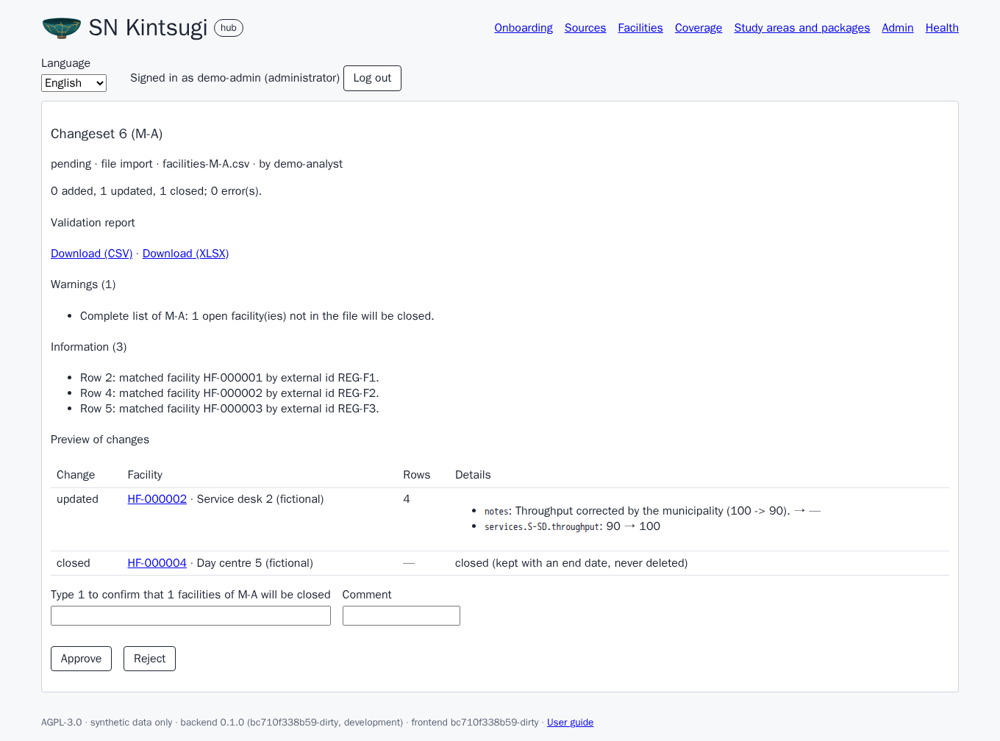
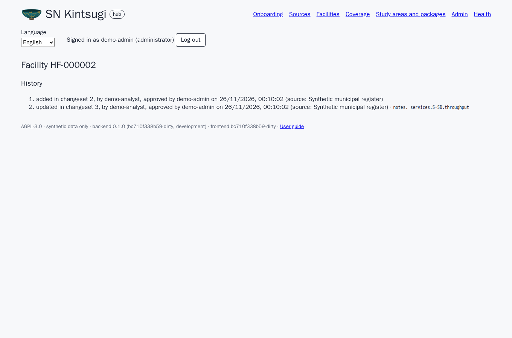
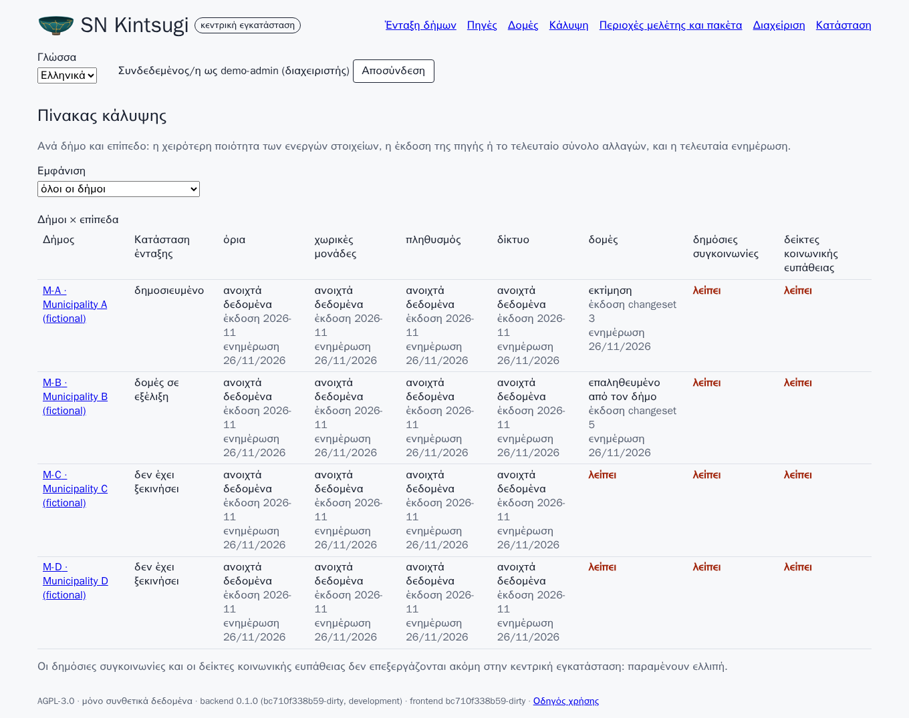
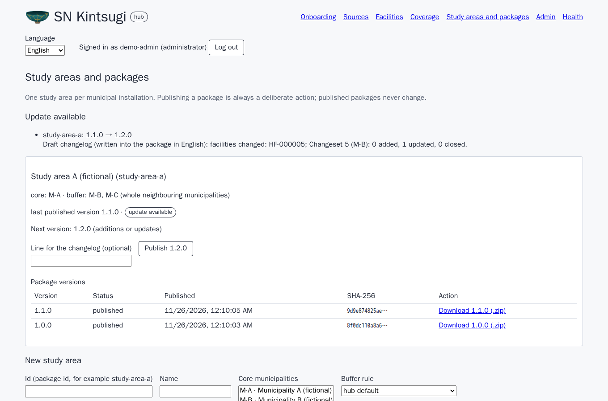

# Κεντρική εγκατάσταση { #hub }

> Περιγράφει την έκδοση **0.2** της πλατφόρμας (ένταξη δήμων). Για την ομάδα της κεντρικής εγκατάστασης, που προετοιμάζει τα δεδομένα όλων των δήμων. Οι εικόνες προέρχονται από τις δοκιμές αποδοχής [UAT 02](../uat/02-hub-onboarding.md) (στα αγγλικά) με συνθετικά δεδομένα και δείχνουν την αγγλική διεπαφή.

Η **κεντρική εγκατάσταση (hub)** είναι το ίδιο λογισμικό με μια εγκατάσταση δήμου, με τη ρύθμιση `DEPLOYMENT_MODE=hub`. Κρατά τις εθνικές **πρωτογενείς πηγές**, εντάσσει τους δήμους έναν έναν, επιμελείται τις **δομές** τους και **δημοσιεύει πακέτα δεδομένων** που εισάγουν οι εγκαταστάσεις των δήμων ([Βασικές έννοιες](../concepts.md), [Συνεργασία με την κεντρική εγκατάσταση](hub-updates.md) για την πλευρά του δήμου). Το μενού έχει **Ένταξη δήμων**, **Πηγές**, **Δομές**, **Κάλυψη**, **Περιοχές μελέτης και πακέτα**, **Διαχείριση** (χρήστες) και **Κατάσταση**· η ένδειξη «κεντρική εγκατάσταση» δίπλα στο όνομα δείχνει τον ρόλο που χρησιμοποιείτε.



| Ρόλος | Μπορεί |
| --- | --- |
| **Θεατής** | να βλέπει τα πάντα: πηγές, ένταξη, κάλυψη, δομές και ιστορικό τους, περιοχές μελέτης, πακέτα |
| **Αναλυτής** | επιπλέον να ανεβάζει αρχεία δομών και να προτείνει αλλαγές με το χέρι (περιμένουν έγκριση) |
| **Διαχειριστής** | επιπλέον να καταχωρίζει πηγές, να εκτελεί το βασικό βήμα, να αλλάζει την κατάσταση ένταξης, να εγκρίνει ή να απορρίπτει σύνολα αλλαγών, να δημιουργεί περιοχές μελέτης, να δημοσιεύει πακέτα και να διαχειρίζεται χρήστες |

## Πηγές { #sources }



Μια **πρωτογενής πηγή** είναι αρχείο με έκδοση: όρια, χωρικές μονάδες, δίκτυο, πληθυσμός, ομάδες, υπηρεσίες (και ψηφιακό μοντέλο εδάφους, δημόσιες συγκοινωνίες ή άλλα αρχεία, που αποθηκεύονται αλλά δεν επεξεργάζονται ακόμη). Η καταχώριση μόνο **αποθηκεύει** το αρχείο με το άθροισμα ελέγχου SHA-256 και ελέγχει τη δομή του (πίνακες και στήλες ή επικεφαλίδες CSV)· δεν γίνεται επεξεργασία. Συμπληρώστε όνομα, είδος επιπέδου, έκδοση ή ημερομηνία λήψης, γεωγραφική κάλυψη, άδεια, αναφορά πηγής και σημείωση επεξεργασίας (`DP-NNN`). Η ίδια καταχώριση με το ίδιο περιεχόμενο δεν αλλάζει τίποτα· άλλο περιεχόμενο με την ίδια έκδοση απορρίπτεται: καταχωρίστε το ως νέα έκδοση. Μεγάλα αρχεία καταχωρίζονται και από το τερματικό:

```bash
make hub-register-source FILE=/path/boundaries.gpkg NAME="National boundaries" LAYER=boundaries SOURCE_VERSION=2026-11 LICENCE=CC-BY-4.0 ATTRIBUTION="Source agency" NOTE=DP-003
```

## Ένταξη δήμων { #onboarding }



Η λίστα **Ένταξη δήμων** δείχνει κάθε δήμο της τελευταίας πηγής ορίων με την κατάστασή του:

| Κατάσταση | Σημασία |
| --- | --- |
| δεν έχει ξεκινήσει | τίποτα ακόμη (ο δήμος μπορεί να έχει ήδη βασικά δεδομένα ως ζώνη ενός γείτονα) |
| βασικά δεδομένα έτοιμα | το βασικό βήμα ολοκληρώθηκε |
| δομές σε εξέλιξη | εγκρίθηκε τουλάχιστον ένα σύνολο αλλαγών δομών |
| σε έλεγχο | ένας διαχειριστής τον σημείωσε έτοιμο για έλεγχο |
| δημοσιευμένο | δημοσιεύτηκε πακέτο με αυτόν ως κεντρικό δήμο |

Η **Έναρξη ένταξης** βάζει σε αναμονή το **βασικό βήμα**: για τον δήμο και τη ζώνη του αποκόπτει όρια, χωρικές μονάδες, πληθυσμό και δίκτυο από τις τελευταίες πηγές, δίνει σε κάθε στοιχείο τον μόνιμο κωδικό του (τον επίσημο κωδικό όπου υπάρχει) και εκτελεί τους ελέγχους. Εκτελείται στο παρασκήνιο· η σελίδα του δήμου δείχνει την πρόοδο και κουμπί **Ακύρωση** (ένα βήμα που ακυρώνεται ή αποτυγχάνει δεν αποθηκεύει τίποτα). Νέα εκτέλεση με τις ίδιες πηγές δεν αλλάζει τίποτα. Η ένταξη ενός γείτονα αργότερα ξαναχρησιμοποιεί ό,τι υπάρχει ήδη: προστίθενται μόνο τα νέα στοιχεία.



Η σελίδα του δήμου δείχνει την **αναφορά ελέγχου** του βασικού βήματος (σφάλματα, προειδοποιήσεις, πληροφορίες: μετασχηματισμός, μη έγκυρες γεωμετρίες, τμήματα δικτύου, σύνολα πληθυσμού, ο κανόνας του κοντινότερου κόμβου για τις μονάδες), τις πηγές που χρησιμοποίησε με εκδόσεις και αθροίσματα ελέγχου, το ιστορικό κατάστασης (ποιος και πότε) και κουμπιά για **έτοιμο για έλεγχο** ή επιστροφή. Ο κανόνας της ζώνης ρυθμίζεται και ο ορισμός του είναι ανοιχτό ζήτημα (OQ-28).

## Δομές { #facilities }

Στις **Δομές** επιλέξτε δήμο σε ένταξη. Κατεβάστε το **πρότυπο εισαγωγής** (XLSX με οδηγίες στα ελληνικά και στα αγγλικά, CSV ή GeoPackage) ή τις **τρέχουσες δομές** στο πρότυπο, για να τις συμπληρώσετε ή να τις διορθώσετε. Οι στήλες και οι έλεγχοι περιγράφονται στην [Εισαγωγή δομών](../data-processing/facility-import.md) (στα αγγλικά). **Οι δομές είναι οργανισμοί, όχι πρόσωπα**: μην καταχωρίζετε ονόματα, προσωπικά τηλέφωνα ή προσωπικά e-mail.

1. Επιλέξτε το αρχείο, δηλώστε την πηγή του (και άδεια, αναφορά πηγής, σχόλιο), σημειώστε **διορθώσεις** αν το αρχείο μόνο διορθώνει σφάλματα και **πλήρη κατάλογο** μόνο αν πρέπει να κλείσουν όσες δομές λείπουν από το αρχείο. Πατήστε **Έλεγχος αρχείου**.
2. Διαβάστε την **αναφορά ελέγχου**. Τα σφάλματα (λείπει όνομα, άγνωστη υπηρεσία, λάθος μονάδα, σημείο εκτός δήμου …) εμποδίζουν την έγκριση: διορθώστε το αρχείο και ανεβάστε το ξανά. Οι στήλες με προσωπικά δεδομένα αφαιρούνται και αναφέρονται ως προειδοποιήσεις.

   

3. Διαβάστε την **προεπισκόπηση αλλαγών**: νέες δομές (παίρνουν κωδικό όπως `HF-000001` με την έγκριση), ενημερωμένες (κάθε πεδίο που αλλάζει με την παλιά και τη νέα τιμή) και κλειστές.

   

4. Ένας διαχειριστής κάνει **Έγκριση** ή **Απόρριψη**. Για πλήρη κατάλογο, η έγκριση ζητά να πληκτρολογήσετε πόσες δομές θα κλείσουν. Τίποτα δεν διαγράφεται: μια κλειστή δομή κρατά ημερομηνία λήξης.

Κάθε δομή έχει σελίδα με το **ιστορικό** της (κάθε εγκεκριμένη αλλαγή με συντάκτη, εγκρίνοντα, ημερομηνία, πηγή και πεδία) και φόρμα για **αλλαγή** ή **κλείσιμο**· η φόρμα δημιουργεί σύνολο αλλαγών όπως μια εισαγωγή. Η **Προσθήκη δομής με το χέρι** κάνει το ίδιο για νέα δομή.



## Κάλυψη { #coverage }



Ο **πίνακας κάλυψης** δείχνει ανά δήμο και επίπεδο **λείπει**, **εκτίμηση**, **ανοιχτά δεδομένα** ή **επαληθευμένο από τον δήμο** (τη χειρότερη ποιότητα των στοιχείων του επιπέδου), με την έκδοση της πηγής ή το τελευταίο σύνολο αλλαγών και την τελευταία ενημέρωση. Φιλτράρετε δήμους σε ένταξη ή χωρίς ένταξη. Οι δημόσιες συγκοινωνίες και οι δείκτες κοινωνικής ευπάθειας λείπουν σε αυτή την έκδοση. Ο ίδιος πίνακας μπαίνει σε κάθε πακέτο.

## Περιοχές μελέτης και πακέτα { #study-areas-and-packages }



Για κάθε εγκατάσταση δήμου καταχωρίζεται μια **περιοχή μελέτης**: κωδικός (γίνεται ο κωδικός του πακέτου, π.χ. `study-area-a`), όνομα, κεντρικοί δήμοι και κανόνας ζώνης. Εμφανίζονται οι δήμοι της ζώνης της.

Η **Δημοσίευση** συνθέτει την επόμενη έκδοση στο παρασκήνιο: πρώτα `1.0.0`, μετά **δευτερεύουσα** έκδοση (1.1.0) για προσθήκες, κλεισίματα ή ενημερώσεις, ή έκδοση **διόρθωσης** (1.0.1) όταν οι αλλαγές είναι μόνο διορθώσεις. Το πακέτο περιέχει τα στοιχεία των κεντρικών δήμων και της ζώνης, την κάλυψη, τις πηγές με τις άδειές τους, τις σημειώσεις επεξεργασίας, τις εγγραφές επεξεργασίας και αρχείο αλλαγών (στα αγγλικά, ως δεδομένα του πακέτου)· ελέγχεται με τους ίδιους ελέγχους εισαγωγής της εγκατάστασης πριν θεωρηθεί δημοσιευμένο. Τα δημοσιευμένα πακέτα δεν αλλάζουν ποτέ. Η **Λήψη** δίνει το `.zip` που στέλνετε στον δήμο, ή από το τερματικό:

```bash
make hub-export-package STUDY_AREA=study-area-a VERSION=1.1.0 OUT=exports
```

Η **Διαθέσιμη ενημέρωση** δείχνει τις περιοχές μελέτης των οποίων το επόμενο πακέτο θα διέφερε από το τελευταίο, για παράδειγμα όταν εντάχθηκε ένας γείτονας της ζώνης τους ή άλλαξε μια δομή, με πρόχειρο αρχείο αλλαγών. Η δημοσίευση της νέας έκδοσης είναι πάντα δική σας απόφαση.
