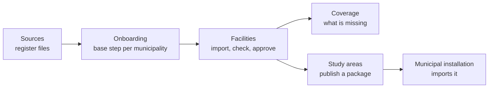
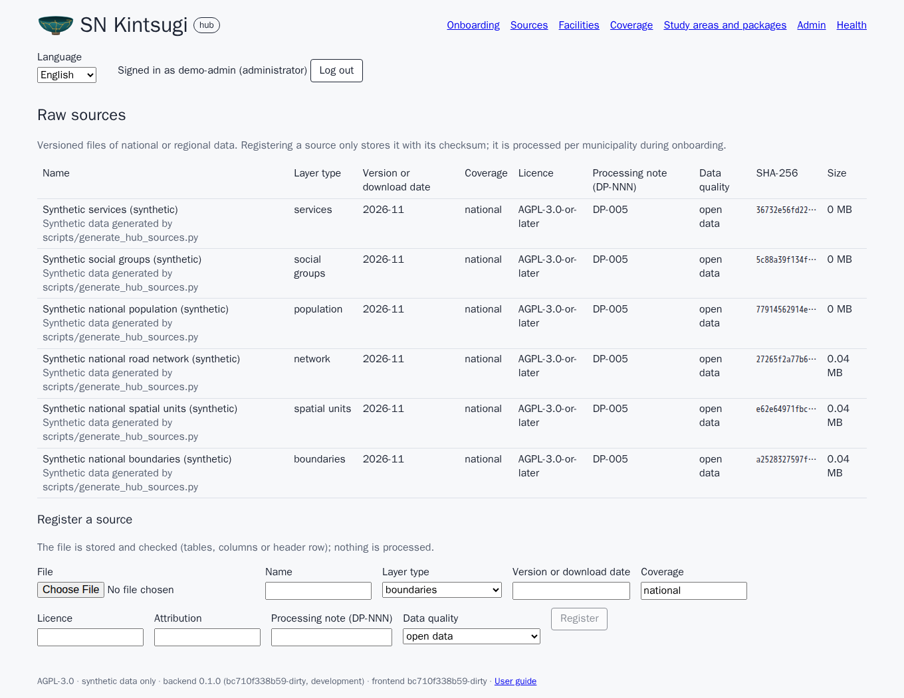
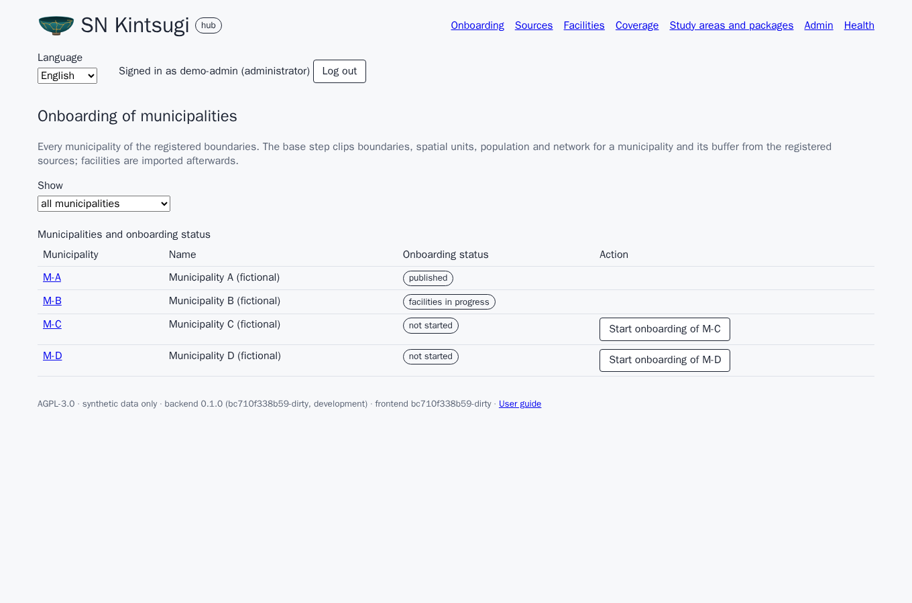
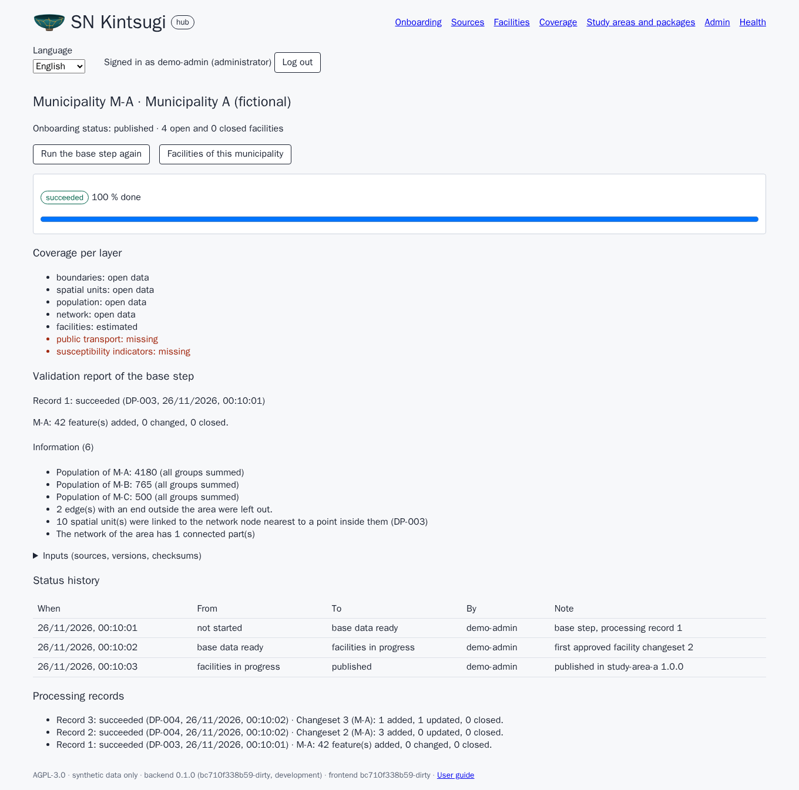
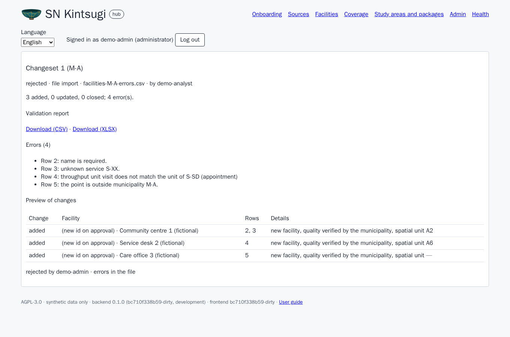
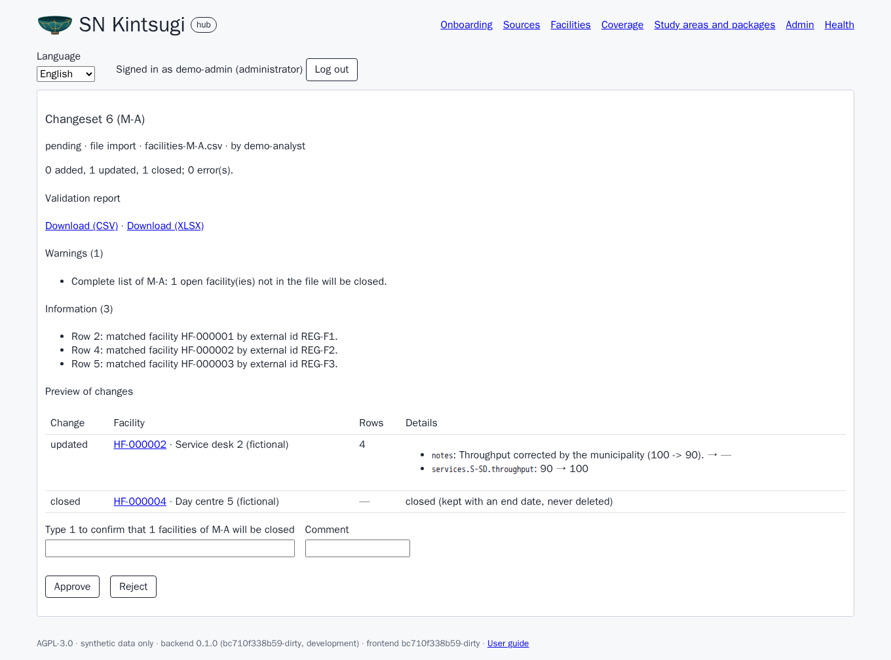
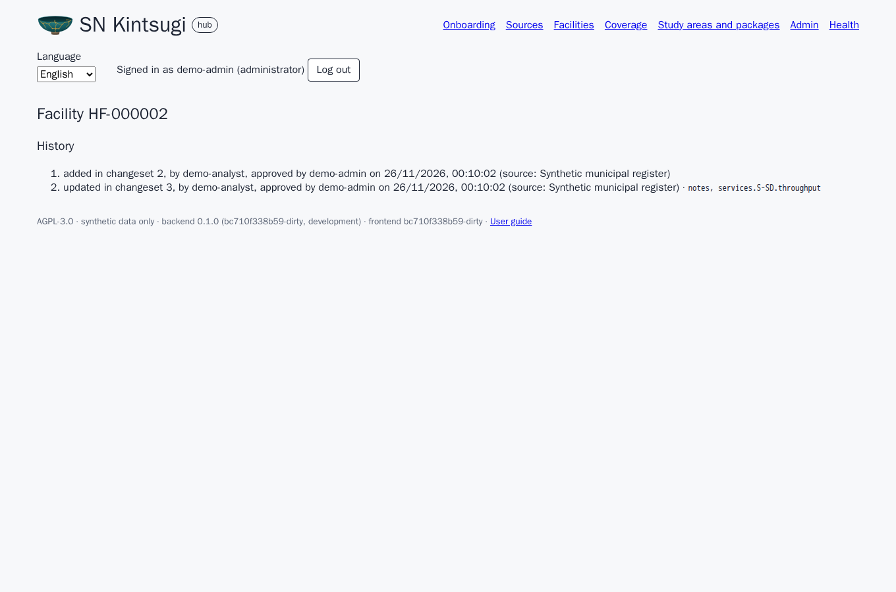
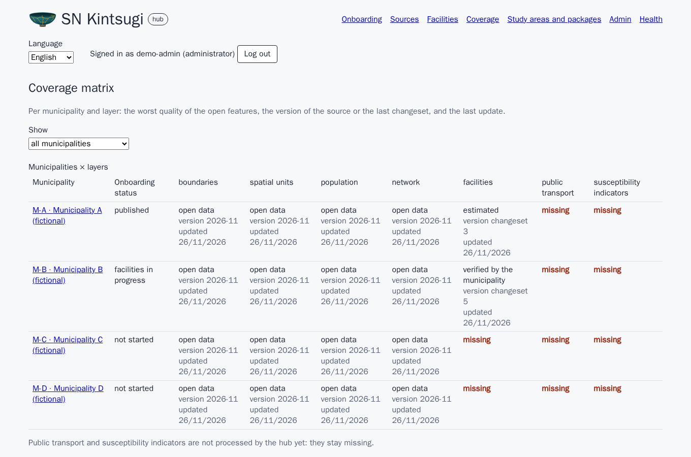
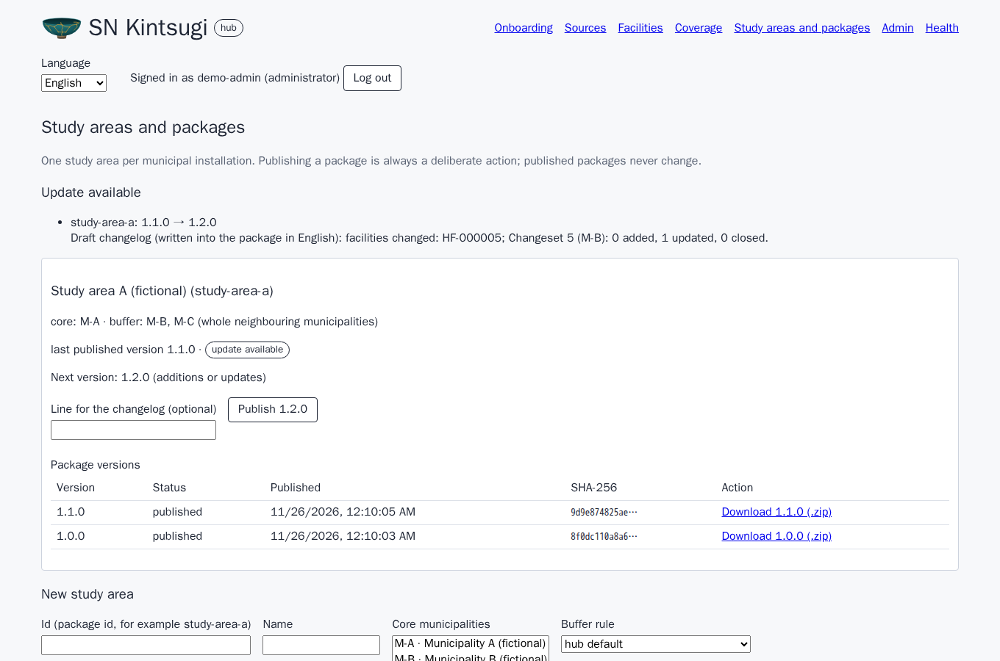

# Hub

> Describes platform version **0.2** (hub onboarding). For the hub team, which prepares data for all municipalities. Screenshots come from the [UAT 02](../uat/02-hub-onboarding.md) walk-through on synthetic data.

The **hub** (κεντρική εγκατάσταση) is the same software as a municipal installation, run with `DEPLOYMENT_MODE=hub`. It keeps national **raw sources**, **onboards** municipalities one by one, curates their **facilities**, and **publishes data packages** that municipal installations import ([Concepts](../concepts.md), [Working with the hub](hub-updates.md) for the municipality's side). The menu has **Onboarding**, **Sources**, **Facilities**, **Coverage**, **Study areas and packages**, **Admin** (users) and **Health**; a "hub" badge next to the name says which role you are using.



| Who | Can |
| --- | --- |
| **Viewer** | see everything: sources, onboarding, coverage, facilities and their history, study areas, packages |
| **Analyst** | also upload facility files and propose manual edits (they wait for approval) |
| **Administrator** | also register sources, run the base step, change the onboarding status, approve or reject changesets, create study areas, publish packages, manage users |

## Sources



A **raw source** is a versioned file: boundaries, spatial units, network, population, groups, services (and DEM, public transport or other files, which are stored but not processed yet). Registering one only **stores** it with its SHA-256 checksum and checks its structure (tables and columns, or the CSV header); nothing is processed. Fill in name, layer type, version or download date, coverage, licence, attribution and the processing note (`DP-NNN`). Registering the same file again with the same name and version changes nothing; different content under the same version is refused: register it as a new version. Large files can also be registered from the terminal:

```bash
make hub-register-source FILE=/path/boundaries.gpkg NAME="National boundaries" LAYER=boundaries SOURCE_VERSION=2026-11 LICENCE=CC-BY-4.0 ATTRIBUTION="Source agency" NOTE=DP-003
```

## Onboarding



The **Onboarding** list shows every municipality of the latest boundaries source with its status:

| Status | Meaning |
| --- | --- |
| not started | nothing done yet (a municipality may already have base data as the buffer of a neighbour) |
| base data ready | the base step succeeded |
| facilities in progress | at least one facility changeset was approved |
| in review | an administrator marked it ready for review |
| published | a package with it as core municipality was published |

**Start onboarding** queues the **base step**: for the municipality plus its buffer it clips boundaries, spatial units, population and network from the latest sources, gives every feature its permanent id (the official code where one exists), and runs the checks. It runs in the background; the municipality page shows its progress and a **Cancel** button (a cancelled or failed step stores nothing). Running it again with the same sources changes nothing. Onboarding a neighbour later reuses everything already there: only new features are added.



The municipality page shows the **validation report** of the base step (errors, warnings, information: reprojection, invalid geometries, network parts, population totals, the nearest-node rule for units), the sources it used with versions and checksums, the status history (who and when), and buttons to mark it **ready for review** or send it back. The buffer rule is configurable and its definition is an open question (OQ-28).

## Facilities

On **Facilities**, choose an onboarded municipality. Download the **import template** (XLSX with instructions in Greek and English, CSV, or GeoPackage) or the **current facilities** in the template, to extend or correct them. The columns and checks are described in [Facility import](../data-processing/facility-import.md). **Facilities are organisations, not people**: never enter names, personal phone numbers or personal e-mails.

1. Choose the file, state its source (and licence, attribution, a comment), tick **corrections** if the file only fixes errors, and **complete list** only if facilities missing from the file must be closed. Click **Check the file**.
2. Read the **validation report**. Errors (missing name, unknown service, wrong unit, point outside the municipality …) block the approval: fix the file and upload it again. Personal-data columns are dropped and listed as warnings.

   

3. Read the **preview of changes**: facilities added (they get an id such as `HF-000001` when approved), updated (each changed field with its old and new value) and closed.

   

4. An administrator **approves** or **rejects** it. For a complete list, the approval asks you to type how many facilities will be closed. Nothing is deleted: a closed facility keeps an end date.

Each facility has a page with its **history** (every approved change with author, approver, date, source and the fields changed) and a form to **edit** or **close** it; the form creates a changeset like an import. **Add a facility by hand** does the same for a new one.



## Coverage



The **coverage matrix** shows, per municipality and layer, **missing**, **estimated**, **open data** or **verified by the municipality** (the worst quality among the layer's features), with the source version or last changeset and the last update. Filter onboarded or not onboarded municipalities. Public transport and susceptibility indicators stay missing in this version. The same matrix goes into every package.

## Study areas and packages



A **study area** is registered for each municipal installation: an id (it becomes the package id, for example `study-area-a`), a name, the core municipalities and the buffer rule. Its buffer municipalities are shown.

**Publish** assembles the next version in the background: `1.0.0` first, then a **minor** version (1.1.0) for additions, closures or updates, or a **patch** version (1.0.1) when the changes are only corrections. The package holds core and buffer features, coverage, sources with licences, processing notes, the processing records behind it and a changelog (written in English, as package data); it is checked with the installation's own import checks before it counts as published. Published packages never change. **Download** gives the `.zip` to send to the municipality, or from the terminal:

```bash
make hub-export-package STUDY_AREA=study-area-a VERSION=1.1.0 OUT=exports
```

**Update available** lists the study areas whose next package would differ from their last one, for example when a neighbour in their buffer was onboarded or a facility changed, with a draft changelog. Publishing their new version is always your decision.
