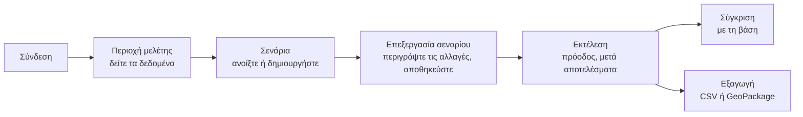

# Οδηγός χρήσης: τα πρώτα βήματα { #user-guide-getting-started }

> Περιγράφει την έκδοση **0.1.0** της πλατφόρμας. Οι εικόνες προέρχονται από τη δοκιμή αποδοχής με συνθετικά δεδομένα ([UAT 01](../uat/01-platform.md), στα αγγλικά) και δείχνουν την αγγλική οθόνη. Μερικές ετικέτες μπορεί να διαφέρουν λίγο από τη δική σας οθόνη.

Ο οδηγός αυτός είναι για όσους χρησιμοποιούν το SolidarityNode σε έναν δήμο: τους **αναλυτές**, που γράφουν και εκτελούν σενάρια, τους **θεατές**, που διαβάζουν κοινόχρηστα αποτελέσματα, και τους **διαχειριστές**, που διαχειρίζονται χρήστες και δεδομένα. Δεν χρειάζονται τεχνικές γνώσεις. Για τις βασικές ιδέες πίσω από τις οθόνες (πακέτο δεδομένων, σενάριο, εκτέλεση, έκδοση δεδομένων), διαβάστε πρώτα τις [Βασικές έννοιες](../concepts.md). Ο οδηγός υπάρχει και στα αγγλικά: επιλέξτε **English** στο μενού γλώσσας στο πάνω μέρος του ιστότοπου.

!!! warning "Δεν υπάρχουν ακόμη ερευνητικά αποτελέσματα"
    Όλα τα αποτελέσματα της έκδοσης 0.1.0 προέρχονται από το **διαγνωστικό μοντέλο**, το οποίο ελέγχει μόνο ότι η πλατφόρμα λειτουργεί. Κάθε σελίδα με αποτελέσματα το γράφει σε κίτρινο πλαίσιο. Δείτε τις [Συχνές ερωτήσεις](faq.md#why-does-every-result-say-diagnostic-model).

## Άνοιγμα της πλατφόρμας { #open-the-platform }

Η εγκατάστασή σας έχει μια διεύθυνση, που σας τη δίνει ο διαχειριστής. Σε υπολογιστή δοκιμών, μετά την εντολή `make uat`, η διεύθυνση είναι <http://127.0.0.1:8080> ([οδηγός UAT](../uat/README.md), στα αγγλικά).

1. Ανοίξτε τη διεύθυνση και [συνδεθείτε](login.md).
2. Ανοίγει η σελίδα **Περιοχή μελέτης** (Study area): ο χάρτης των δεδομένων σας ([Περιοχή μελέτης](study-area.md)).
3. Χρησιμοποιήστε το μενού στο πάνω μέρος: **Περιοχή μελέτης**, **Σενάρια** (Scenarios), **Διαχείριση** (Admin, μόνο για διαχειριστές), **Κατάσταση** (Health).
4. Αλλάξτε τη **Γλώσσα** (Language) σε English ή Ελληνικά όποτε θέλετε. Οι ελληνικοί όροι ακολουθούν το [γλωσσάριο](../i18n/glossary.md) (στα αγγλικά).

Στο κάτω μέρος κάθε σελίδας φαίνεται ποια έκδοση της πλατφόρμας χρησιμοποιείτε: η άδεια χρήσης, η ενεργή έκδοση δεδομένων, η έκδοση του backend με το git commit και το περιβάλλον του, και το commit του frontend. Αναφέρετε αυτή τη γραμμή όταν αναφέρετε ένα πρόβλημα.

## Μια συνηθισμένη εργασία { #a-typical-session }

## Οι σελίδες του οδηγού { #pages-of-this-guide }

| Οθόνη | Τι κάνετε εκεί | Για ποιους |
| --- | --- | --- |
| [Σύνδεση](login.md) | σύνδεση, αποσύνδεση, τι γίνεται μετά από λάθος κωδικούς | όλους |
| [Περιοχή μελέτης](study-area.md) | χωρικές μονάδες, δομές και δρόμοι, ποιότητα και κάλυψη δεδομένων | όλους |
| [Λίστα σεναρίων](scenarios.md) | τα δικά σας και τα κοινόχρηστα σενάρια, οι τελευταίες εκτελέσεις τους | όλους |
| [Επεξεργασία σεναρίου](scenario-editor.md) | γράφετε ένα «τι θα γινόταν αν», το ελέγχετε και αποθηκεύετε εκδόσεις | αναλυτές, διαχειριστές |
| [Εκτέλεση](run.md) | παρακολουθείτε μια εκτέλεση, διαβάζετε αποτελέσματα με την αβεβαιότητά τους, κάνετε εξαγωγή | όλους (οι θεατές: κοινόχρηστα σενάρια) |
| [Σύγκριση](compare.md) | συγκρίνετε μια εκτέλεση με τη βάση ή με άλλη έκδοση δεδομένων | όλους |
| [Διαχείριση](admin.md) | χρήστες, πακέτα δεδομένων, χώρος αποτελεσμάτων | διαχειριστές |
| [Πακέτα δεδομένων και ενημερώσεις](data-updates.md) | τι γίνεται όταν έρχονται νέα δεδομένα | όλους |
| [Ρόλοι](roles.md) | ποιος μπορεί να κάνει τι | όλους |
| [Συχνές ερωτήσεις](faq.md) | σπόρος τυχαιότητας, εκτελέσεις που ξαναχρησιμοποιούνται, φαινόμενο ορίου, διαγνωστικό μοντέλο | όλους |
