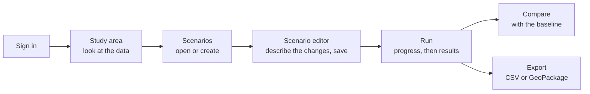

# User guide: getting started

> Describes platform version **0.1.0**. Screenshots come from the UAT walk-through on synthetic data ([UAT 01](../uat/01-platform.md)); a few labels may differ slightly from your screen.

This guide is for the people who use SolidarityNode in a municipality: **analysts** who write scenarios and run them, **viewers** who read shared results, and **administrators** who manage users and data. No technical background is needed. For the ideas behind the screens (data package, scenario, run, data version), read [Concepts](../concepts.md) first. This guide is also in Greek: choose **Ελληνικά** in the language menu at the top of this site.

!!! warning "No research results yet"
    Every result in version 0.1.0 comes from the **diagnostic model** (διαγνωστικό μοντέλο), which only checks that the platform works. Every page that shows results says so in a yellow banner. See the [FAQ](faq.md#why-does-every-result-say-diagnostic-model).

## Open the platform

Your installation has an address given by your administrator. On a test machine, after `make uat`, it is <http://127.0.0.1:8080> ([UAT guide](../uat/README.md)).

1. Open the address and [sign in](login.md).
2. The **Study area** page opens: the map of your data ([Study area](study-area.md)).
3. Use the menu at the top: **Study area**, **Scenarios**, **Admin** (administrators only), **Health**.
4. Switch the **Language** between English and Ελληνικά at any time; Greek terms follow the [glossary](../i18n/glossary.md).

The footer of every page names the build you are using: licence, the active data version, the backend version with its git commit and environment, and the frontend commit. Quote it when you report a problem.

## A typical session

## Pages of this guide

| Screen | What you do there | Who |
| --- | --- | --- |
| [Signing in](login.md) | sign in, sign out, what happens after wrong passwords | everyone |
| [Study area](study-area.md) | see units, facilities and roads, data quality and coverage | everyone |
| [Scenarios list](scenarios.md) | find your scenarios and shared ones, their latest runs | everyone |
| [Scenario editor](scenario-editor.md) | write a "what if", validate and save versions | analysts, administrators |
| [Run](run.md) | follow a run, read results with uncertainty, export | everyone (viewers: shared scenarios) |
| [Compare](compare.md) | compare a run with the baseline or another data version | everyone |
| [Admin](admin.md) | users, data packages, results storage | administrators |
| [Data packages and updates](data-updates.md) | what happens when new data arrives | everyone |
| [Working with the hub](hub-updates.md) | what you send to the hub, what you receive, how an update arrives | everyone |
| [Hub](hub.md) | the hub's screens: sources, onboarding, facilities, coverage, packages | hub team |
| [Roles](roles.md) | who can do what | everyone |
| [FAQ](faq.md) | seed, reused runs, edge effect, diagnostic model | everyone |
