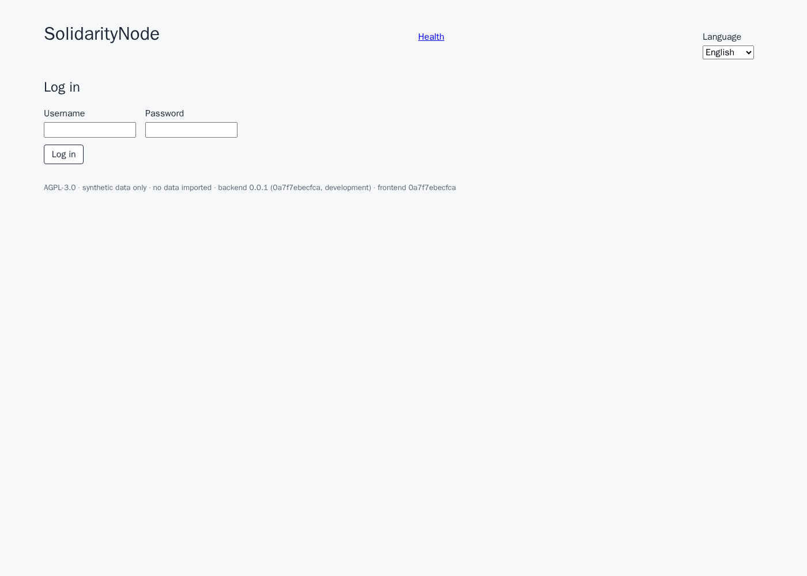

# Σύνδεση { #signing-in }

> Περιγράφει την έκδοση **0.1.0** της πλατφόρμας.

1. Γράψτε το **Όνομα χρήστη** (Username) και τον **Κωδικό** (Password) σας και πατήστε **Σύνδεση** (Log in).
2. Ανοίγει η σελίδα **Περιοχή μελέτης** (Study area). Στο πάνω μέρος γράφει «Συνδεδεμένος/η ως *όνομα* (*ρόλος*)», για παράδειγμα «Συνδεδεμένος/η ως demo-analyst (αναλυτής)».
3. Για να βγείτε, πατήστε **Αποσύνδεση** (Log out). Η σύνδεση λήγει μόνη της μετά από μερικές ώρες (12 ώρες, αν δεν έχει οριστεί άλλος χρόνος).

Τους λογαριασμούς τους δημιουργεί ένας διαχειριστής ([Διαχείριση](admin.md)). Δεν μπορείτε να φτιάξετε μόνοι σας λογαριασμό. Οι κωδικοί έχουν τουλάχιστον 12 χαρακτήρες, και οι πολύ συνηθισμένοι κωδικοί δεν γίνονται δεκτοί.

## Λάθος κωδικός και κλείδωμα { #wrong-password-and-locks }

- Αν το όνομα χρήστη ή ο κωδικός είναι λάθος, εμφανίζεται πάντα το ίδιο μήνυμα, «Λάθος όνομα χρήστη ή κωδικός.». Έτσι κανείς δεν μπορεί να μάθει ποια ονόματα χρηστών υπάρχουν.
- Μετά από αρκετές αποτυχίες για ένα όνομα χρήστη, οι επόμενες προσπάθειες καθυστερούν και μετά το όνομα κλειδώνει για περίπου 15 λεπτά: «Πάρα πολλές αποτυχημένες προσπάθειες σύνδεσης. Περιμένετε λίγα λεπτά και δοκιμάστε ξανά.»
- Οι αποτυχίες για ένα όνομα χρήστη δεν κλειδώνουν ποτέ άλλο όνομα χρήστη.
- Ένας διαχειριστής μπορεί να ξεκλειδώσει νωρίτερα (`make clear-login-locks USERNAME=…`, δείτε τον [οδηγό UAT](../uat/README.md#sign-in-locks), στα αγγλικά).

Λεπτομέρειες και αιτιολόγηση: [ADR 0015](../adr/0015-authentication-and-roles.md) (στα αγγλικά).

## Λογαριασμοί επίδειξης (μόνο σε υπολογιστές δοκιμών) { #demo-accounts-test-machines-only }

Η εντολή `make uat` δημιουργεί τους λογαριασμούς `demo-admin` και `demo-analyst`, μόνο όταν `APP_ENV=development`. Οι κωδικοί τους είναι δημόσιοι. Δεν υπάρχουν ποτέ σε πραγματική εγκατάσταση δήμου.
