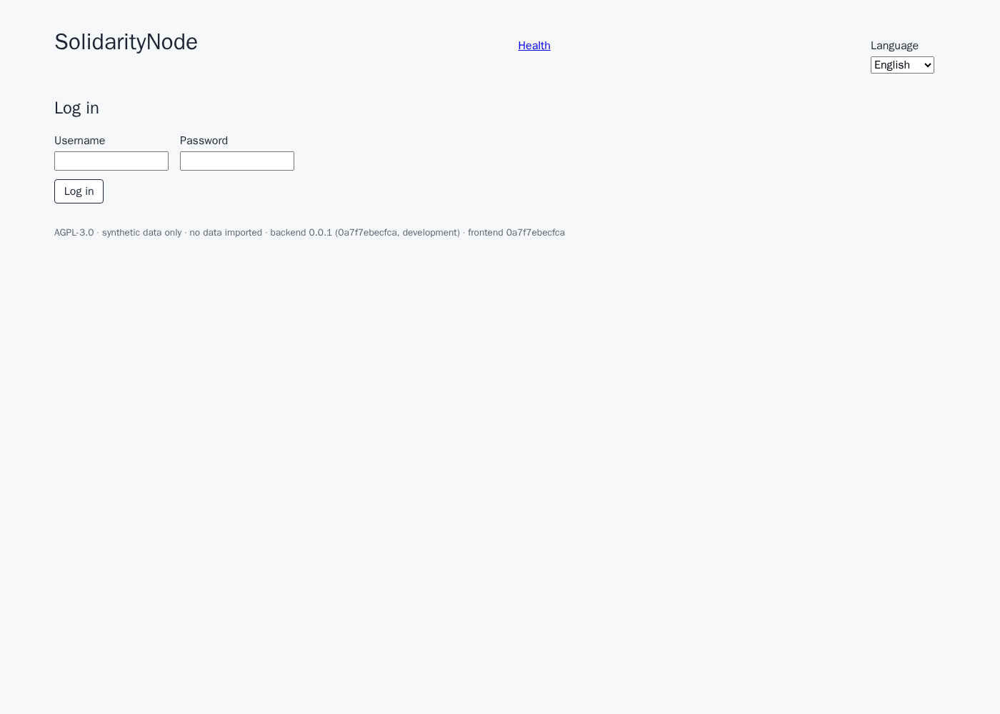

# Signing in

> Describes platform version **0.1.0**.

1. Enter your **username** and **password** and press **Log in**.
2. The **Study area** page opens. The header says "Signed in as *name* (*role*)", for example "Signed in as demo-analyst (analyst)".
3. To leave, press **Log out**. A session ends by itself after some hours (12 by default).

Accounts are created by an administrator ([Admin](admin.md)); there is no self-registration. Passwords have at least 12 characters, and common passwords are refused.

## Wrong password and locks

- A wrong username or password always gives the same message, "Wrong username or password.", so nobody can learn which usernames exist.
- After several failures for one username, the next tries are delayed, and then the username is locked for about 15 minutes: "Too many failed sign-in attempts. Wait a few minutes and try again."
- Failures for one username never lock out another username.
- An administrator can clear a lock early (`make clear-login-locks USERNAME=…`, see the [UAT guide](../uat/README.md#sign-in-locks)).

Details and the reasons: [ADR 0015](../adr/0015-authentication-and-roles.md).

## Demo accounts (test machines only)

`make uat` creates `demo-admin` and `demo-analyst`, only when `APP_ENV=development`. Their passwords are public; they never exist on a real installation.
