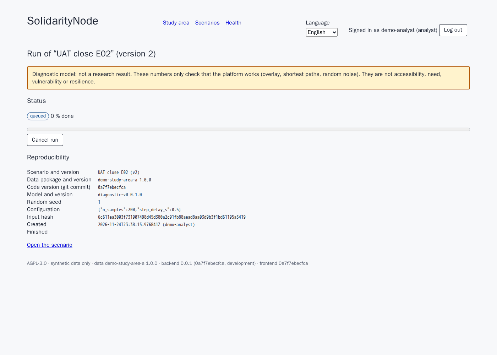
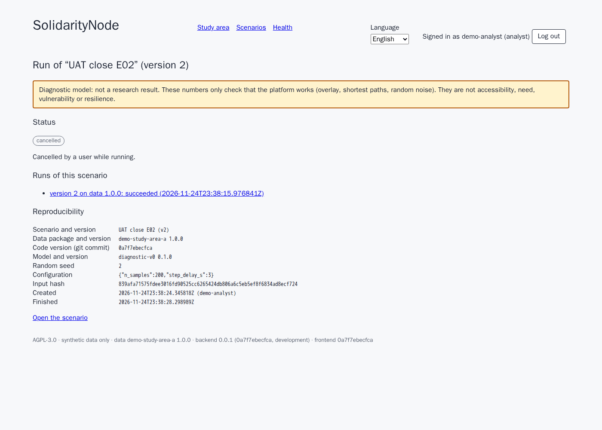
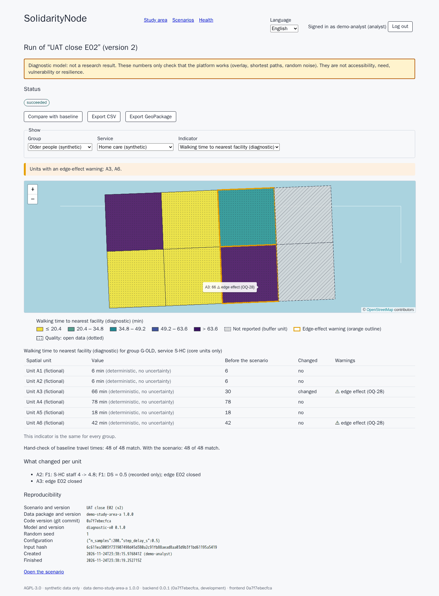
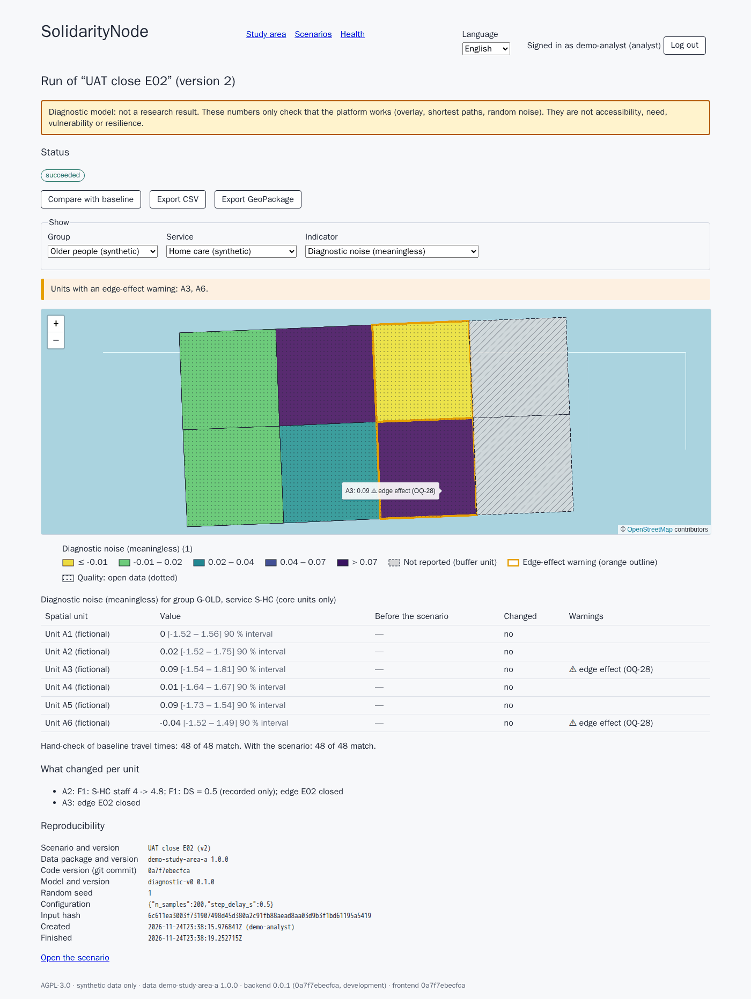
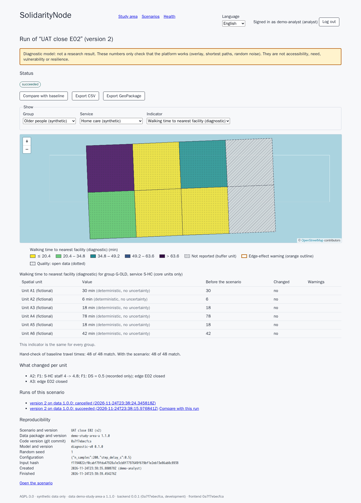
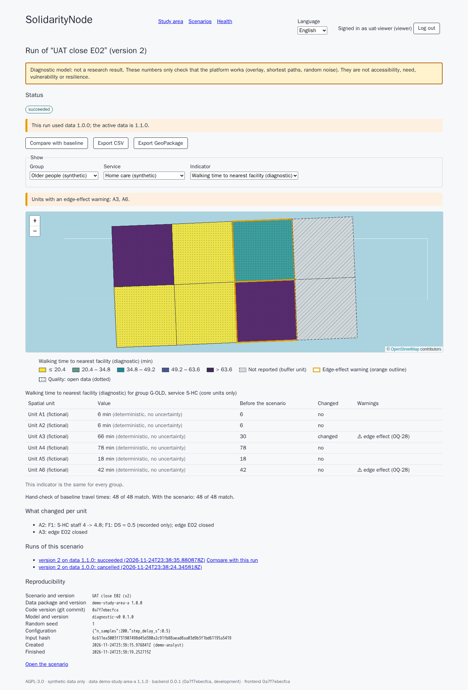

# Εκτέλεση { #run }

> Περιγράφει την έκδοση **0.1.0** της πλατφόρμας.

Μια **εκτέλεση** υπολογίζει μία έκδοση σεναρίου με μία έκδοση δεδομένων, στο παρασκήνιο, και δεν αλλάζει ποτέ μετά ([Βασικές έννοιες](../concepts.md#run-the-answer-kept-unchanged)).

## Ξεκινήστε μια εκτέλεση { #start-a-run }

Ανοίξτε ένα σενάριο και πατήστε **Εκτέλεση αυτής της έκδοσης** (Run this version), ή **Εκτέλεση** (Run) στη [λίστα σεναρίων](scenarios.md). Πριν ξεκινήσετε, μπορείτε να ορίσετε:

- **Σπόρος τυχαιότητας** (Random seed): ένας αριθμός που σταθεροποιεί τις τυχαίες επιλογές, ώστε η εκτέλεση να επαναλαμβάνεται ακριβώς. Αν τον αφήσετε κενό, η πλατφόρμα διαλέγει έναν και τον καταγράφει ([Συχνές ερωτήσεις](faq.md#what-is-the-seed)).
- **Παύση μετά από κάθε βήμα, δευτερόλεπτα (για δοκιμές)** (Pause after each step): επιβραδύνει την εκτέλεση, ώστε να φαίνονται η πρόοδος και η ακύρωση (για δοκιμές).

Πριν ξεκινήσει, η πλατφόρμα εκτιμά το μέγεθος του αρχείου αποτελεσμάτων και σας προειδοποιεί αν είναι μεγάλο.

## Παρακολουθήστε την { #follow-it }

Η **Κατάσταση** (Status) αλλάζει από **σε αναμονή** (queued) σε **εκτελείται** (running, με μπάρα προόδου και «… % ολοκληρώθηκε») και τέλος σε **ολοκληρώθηκε** (succeeded), **απέτυχε** (failed) ή **ακυρώθηκε** (cancelled). Μπορείτε να φύγετε από τη σελίδα· η εκτέλεση συνεχίζεται.

- Η **Ακύρωση εκτέλεσης** (Cancel run) τη σταματά στο επόμενο βήμα της: «Ακυρώθηκε από χρήστη ενώ εκτελούνταν.» Δεν κρατιούνται αποτελέσματα.
- Αν η υπηρεσία εκτέλεσης σταματήσει κατά τη διάρκεια της εκτέλεσης, η εκτέλεση τελειώνει ως **απέτυχε**, με μήνυμα που το εξηγεί. **Ξεκινήστε ξανά την εκτέλεση** (μια αποτυχημένη εκτέλεση δεν ξαναχρησιμοποιείται ποτέ).

## Διαβάστε τα αποτελέσματα { #read-the-results }

1. Το κίτρινο πλαίσιο: **Διαγνωστικό μοντέλο: δεν είναι ερευνητικό αποτέλεσμα.**
2. Στην **Εμφάνιση** (Show), επιλέξτε **Ομάδα** (Group), **Υπηρεσία** (Service) και **Δείκτη** (Indicator).
3. Ο **χάρτης** χρωματίζει τις κεντρικές μονάδες. Οι μονάδες ζώνης είναι γκρι («Δεν αναφέρεται»). Τα πορτοκαλί περιγράμματα δείχνουν το [φαινόμενο ορίου](faq.md#what-is-the-edge-effect).
4. Ο **πίνακας** δίνει για κάθε μονάδα την τιμή, την τιμή **Πριν από το σενάριο** (Before the scenario), αν **Άλλαξε** (Changed), και **Προειδοποιήσεις** (Warnings) με λέξεις.

**Η αβεβαιότητα φαίνεται πάντα.** Μια τιμή είναι η **διάμεσος** με το **διάστημα 90 %** σε παρένθεση, για παράδειγμα `0,05 (-1,6–1,7)`· η επικεφαλίδα της στήλης γράφει «Διάμεσος (διάστημα 90 %)». Οι τιμές χωρίς αβεβαιότητα γράφουν «(ντετερμινιστικό, χωρίς αβεβαιότητα)».

**Επίπεδα χάρτη** (Map layers, και τα δύο κλειστά αρχικά):

- **Αβεβαιότητα** (Uncertainty): ένας δεύτερος χάρτης, σε μπλε αποχρώσεις, με το εύρος του διαστήματος 90 %·
- **Ποιότητα δεδομένων** (Data quality): διαγράμμιση για εκτιμήσεις, κουκκίδες για ανοιχτά δεδομένα.

Κάτω από τον πίνακα:

- **Έλεγχος χρόνων διαδρομής βάσης** (Hand-check of travel times): οι διαγνωστικοί χρόνοι διαδρομής συγκρίνονται με χρόνους που υπολογίστηκαν με το χέρι και υπάρχουν στο πακέτο δεδομένων.
- **Τι άλλαξε ανά μονάδα** (What changed per unit): κάθε αλλαγή του σεναρίου, με λέξεις.
- **Καταγράφηκαν, χωρίς επίδραση ακόμα** (Recorded, no effect yet): αλλαγές που η πλατφόρμα κρατά αλλά δεν εφαρμόζει ακόμη ([Επεξεργασία σεναρίου](scenario-editor.md#what-has-an-effect-today)).

## Αναπαραγωγιμότητα { #reproducibility }

Η ενότητα **Αναπαραγωγιμότητα** (Reproducibility) δείχνει όλα όσα χρειάζονται για να επαναληφθεί η εκτέλεση: σενάριο και έκδοση, πακέτο και έκδοση δεδομένων, έκδοση κώδικα (git commit), μοντέλο και έκδοση, σπόρο τυχαιότητας, ρυθμίσεις, αποτύπωμα εισόδων, το αποτύπωμα SHA-256 του αρχείου δειγμάτων, και το περιβάλλον που την εκτέλεσε (πλατφόρμα, εκδόσεις Python και NumPy). Μια πορτοκαλί σημείωση εμφανίζεται όταν ο κώδικας είχε τοπικές αλλαγές (`-dirty`): μια τέτοια εκτέλεση επαναλαμβάνεται μόνο στον υπολογιστή όπου έγινε. Λεπτομέρειες: [ADR 0017](../adr/0017-run-reproducibility-and-result-storage.md) (στα αγγλικά).

## Εξαγωγή { #export }

- **Εξαγωγή CSV** (Export CSV): ένα αρχείο zip με το `results.csv` (διάμεσος, διάστημα, μέση τιμή), τους χρόνους διαδρομής, τις αλλαγές ανά μονάδα και το `metadata.json` με όλα τα στοιχεία αναπαραγωγιμότητας.
- **Εξαγωγή GeoPackage** (Export GeoPackage): ένα επίπεδο `results` με τα πολύγωνα των μονάδων, για το QGIS ή άλλο λογισμικό GIS.

## Μετά από ενημέρωση δεδομένων { #after-a-data-update }

Μια εκτέλεση κρατά τα δεδομένα που χρησιμοποίησε. Αν τα ενεργά δεδομένα είναι νεότερα, η σελίδα γράφει «Η εκτέλεση χρησιμοποίησε δεδομένα 1.0.0· τα ενεργά δεδομένα είναι 1.1.0.» και προσφέρει το κουμπί **Νέα εκτέλεση με δεδομένα 1.1.0** (Rerun on data 1.1.0), που δημιουργεί νέα εκτέλεση. Η ενότητα **Εκτελέσεις αυτού του σεναρίου** (Runs of this scenario) δείχνει όλες τις εκτελέσεις, με το κουμπί **Σύγκριση με αυτή την εκτέλεση** (Compare with this run).

Ένας θεατής βλέπει την ίδια σελίδα χωρίς τα κουμπιά **Εκτέλεση**, **Νέα εκτέλεση** και **Ακύρωση**:

