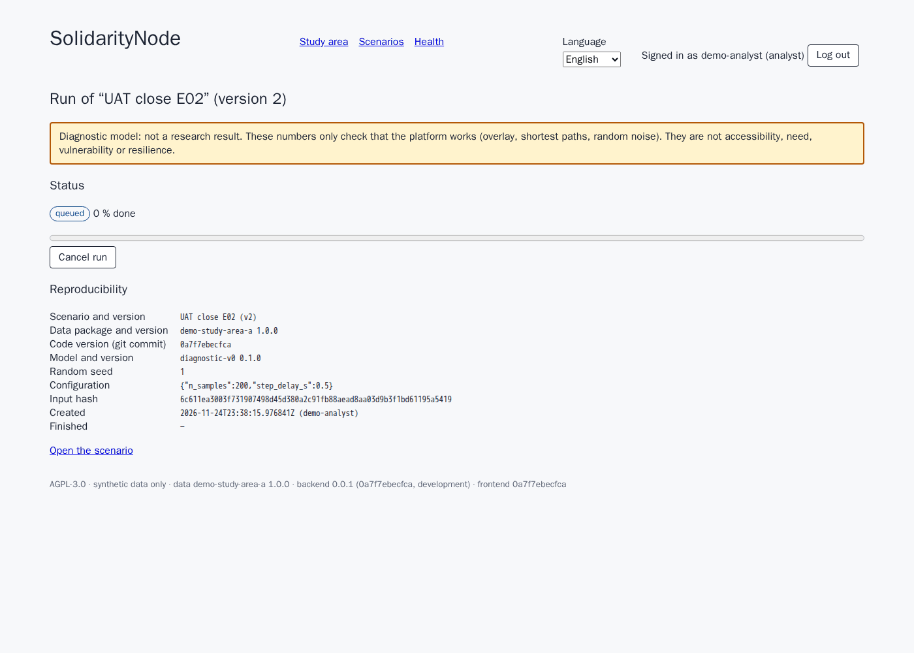
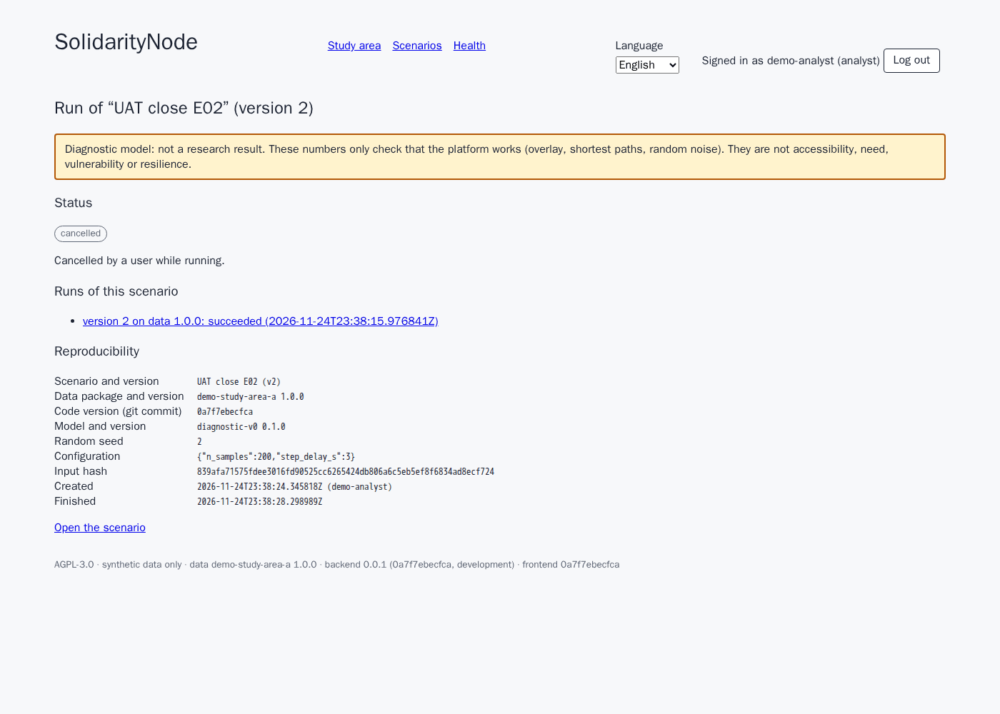
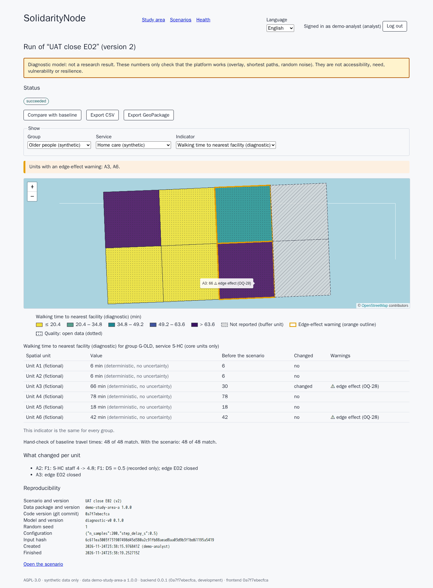
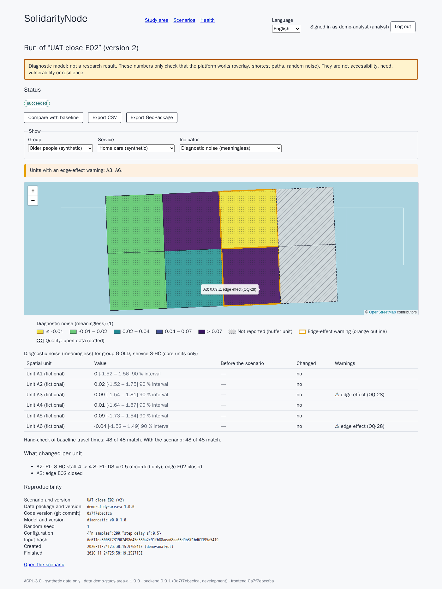
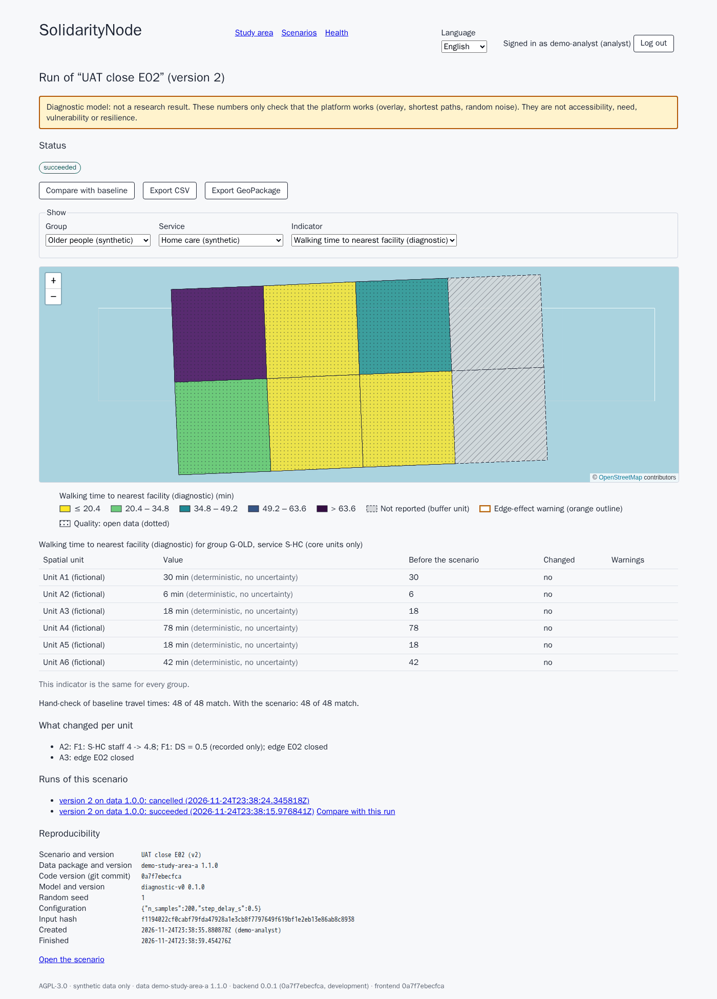
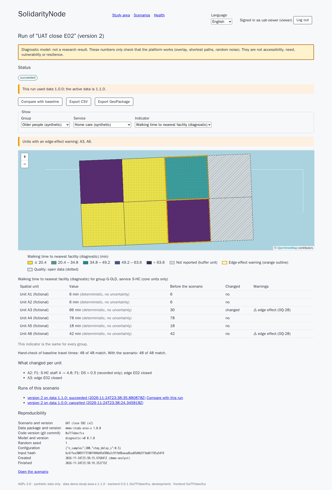

# Run

> Describes platform version **0.1.0**.

A **run** (εκτέλεση) computes one scenario version on one data version, in the background, and never changes afterwards ([Concepts](../concepts.md#run-the-answer-kept-unchanged)).

## Start a run

Open a scenario and click **Run this version** (or **Run** in the [Scenarios list](scenarios.md)). Optional settings before you start:

- **Random seed**: a number that fixes the random draws, so the run can be repeated exactly. Leave it empty and one is drawn and recorded ([FAQ](faq.md#what-is-the-seed)).
- **Pause after each step**: slows the run down so that progress and cancelling can be followed (for testing).

Before it starts, the platform estimates the size of the results file and warns if it is large.

## Follow it

The **Status** goes **queued** → **running** (with a progress bar and "… % done") → **succeeded**, **failed** or **cancelled**. You can leave the page; the run continues.

- **Cancel run** stops it at its next step: "Cancelled by a user while running." No results are kept.
- If the worker stops during the run, it ends as **failed** with a message saying so; **start the run again** (a failed run is never reused).

## Read the results

1. The yellow banner: **Diagnostic model: not a research result.**
2. Under **Show**, choose the **Group**, **Service** and **Indicator**.
3. The **map** colours the core units; buffer units are grey ("Not reported"). Orange outlines mark the [edge effect](faq.md#what-is-the-edge-effect).
4. The **table** gives, per unit, the value, the value **Before the scenario**, whether it **Changed**, and **Warnings** in words.

**Uncertainty is always shown.** A value is the **median** (διάμεσος) with its **90 % interval** (διάστημα) in brackets, for example `0.05 (-1.6–1.7)`; the column heading says "Median (90 % interval)". Values that have no uncertainty say "(deterministic, no uncertainty)".

**Map layers** (both off by default):

- **Uncertainty**: a second map, in blues, of the width of the 90 % interval;
- **Data quality**: hatching for estimated data, dots for open data.

Below the table:

- **Hand-check of travel times**: the diagnostic travel times are checked against hand-computed values from the data package.
- **What changed per unit**: each change of the scenario, in words.
- **Recorded, no effect yet**: changes the platform keeps but does not apply yet ([Scenario editor](scenario-editor.md#what-has-an-effect-today)).

## Reproducibility

The **Reproducibility** section lists everything needed to repeat the run: scenario and version, data package and version, code version (git commit), model and version, random seed, configuration, input hash, the checksum of the samples file, and the environment that executed it (platform, Python and NumPy versions). An orange note appears when the code had local changes (`-dirty`): such a run can be repeated only on the machine that made it. Details: [ADR 0017](../adr/0017-run-reproducibility-and-result-storage.md).

## Export

- **Export CSV**: a zip with `results.csv` (median, interval, mean), travel times, per-unit changes and `metadata.json` with every reproducibility field.
- **Export GeoPackage**: a `results` layer of unit polygons, for QGIS or other GIS software.

## After a data update

A run keeps the data it used. If the active data is newer, the page says "This run used data 1.0.0; the active data is 1.1.0." and offers **Rerun on data 1.1.0**, which makes a new run. **Runs of this scenario** lists every run, with **Compare with this run**.

A viewer sees the same page without the **Run**, **Rerun** and **Cancel** buttons:

