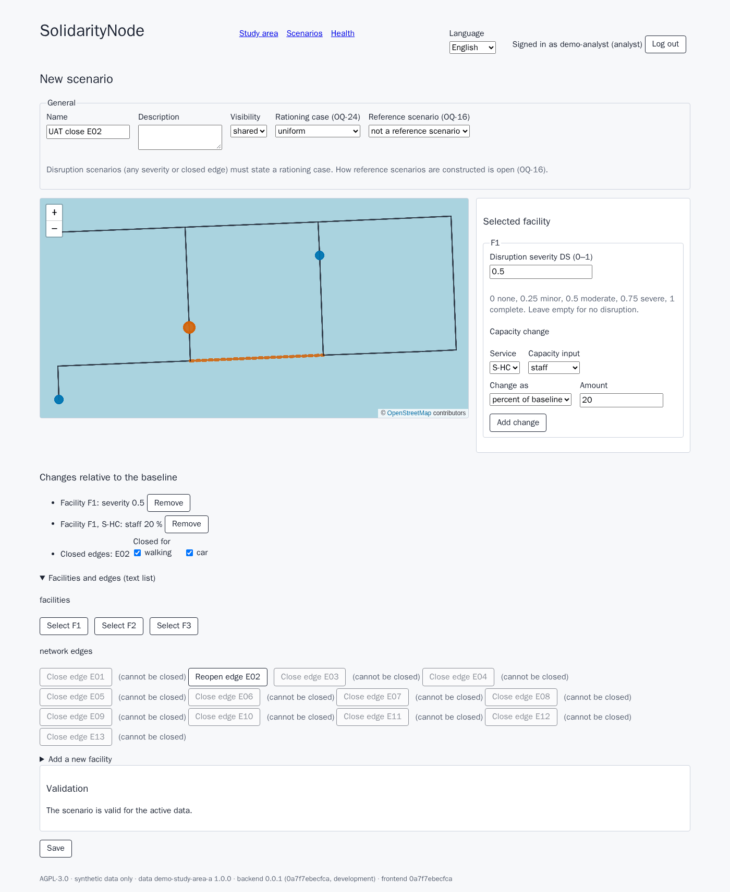

# Επεξεργασία σεναρίου { #scenario-editor }

> Περιγράφει την έκδοση **0.1.0** της πλατφόρμας. Για αναλυτές και διαχειριστές.

## Γράψτε ένα σενάριο { #write-a-scenario }

1. **Σενάρια** (Scenarios) → **Νέο σενάριο** (New scenario).
2. Γράψτε ένα **Όνομα** (Name, υποχρεωτικό) και, αν χρειάζεται, μια **Περιγραφή** (Description).
3. Επιλέξτε την **Ορατότητα** (Visibility): **ιδιωτικό** (εσείς και οι διαχειριστές) ή **κοινόχρηστο** (όλοι οι χρήστες, και οι θεατές).
4. Περιγράψτε τις αλλαγές, με κλικ στον χάρτη ή από τη λίστα **Δομές και τμήματα δικτύου (λίστα κειμένου)** (Facilities and edges (text list)):
    - **Κλείσιμο τμήματος** (Close edge): κάντε κλικ σε ένα τμήμα δρόμου· γίνεται πορτοκαλί και διακεκομμένο. Στο **Κλειστά για** (Closed for) σημειώστε για ποιους τρόπους μετακίνησης κλείνει (πεζή, αυτοκίνητο). Τα τμήματα που δεν μπορούν να κλείσουν το γράφουν.
    - **Σοβαρότητα διαταραχής DS** (Disruption severity DS) μιας δομής: επιλέξτε τη δομή και γράψτε μια τιμή από 0 (καμία) έως 1 (πλήρης), για παράδειγμα 0,5 (μέτρια).
    - **Αλλαγή δυναμικότητας** (Capacity change): επιλέξτε υπηρεσία, στοιχείο δυναμικότητας (θέσεις, προσωπικό, παραγωγικότητα), **ποσοστό της βάσης** ή **απόλυτη ποσότητα**, και την ποσότητα· μετά **Προσθήκη αλλαγής** (Add change).
5. Ένα σενάριο με διαταραχή πρέπει να δηλώνει **Περίπτωση κατανομής ελλείμματος (OQ-24)** (Rationing case), για παράδειγμα *ομοιόμορφη*.
6. Δείτε τον **Έλεγχο εγκυρότητας** (Validation). Γράφει «Το σενάριο είναι έγκυρο για τα ενεργά δεδομένα.» ή δείχνει τι είναι λάθος. Η **Αποθήκευση** (Save) μένει γκρι μέχρι το σενάριο να γίνει έγκυρο.
7. **Αποθήκευση**: «Αποθηκεύτηκε ως έκδοση 1.» Κάθε επόμενη **Αποθήκευση ως νέα έκδοση** (Save as new version) κρατά τις προηγούμενες εκδόσεις, ώστε κάθε εκτέλεση να λέει με ακρίβεια ποια έκδοση χρησιμοποίησε.

Η ενότητα **Αλλαγές σε σχέση με τη βάση** (Changes relative to the baseline) δείχνει με λέξεις όλα όσα αλλάζει το σενάριο.

## Τι επηρεάζει σήμερα τα αποτελέσματα { #what-has-an-effect-today }

Το διαγνωστικό μοντέλο εφαρμόζει τα κλειστά τμήματα και τις αλλαγές δυναμικότητας. Οι υπόλοιπες αλλαγές **καταγράφονται μόνο**: αποθηκεύονται, εμφανίζονται στη λίστα και στη σελίδα της εκτέλεσης, αλλά δεν επηρεάζουν ακόμη τα αποτελέσματα:

- η σοβαρότητα διαταραχής μιας δομής (δεν υπάρχει ακόμη μέθοδος που να τη μετατρέπει σε χαμένη δυναμικότητα)·
- οι αλλαγές χρόνου διαδρομής ή ταχύτητας, τα νέα τμήματα δικτύου και οι αλλαγές πληθυσμού (δεν έχουν ακόμη πεδία στην οθόνη· αν ένα σενάριο τις περιέχει, διατηρούνται όταν αποθηκεύετε).

Όταν ένα σενάριο συνδυάζει παρεμβάσεις και διαταραχές, η πλατφόρμα εφαρμόζει πρώτα τις παρεμβάσεις και μετά τις διαταραχές. Αυτή είναι μια προτεινόμενη επιλογή, που η μέθοδος δεν έχει ακόμη επιβεβαιώσει ([OQ-30](../specs/open-questions.md), στα αγγλικά· η σειρά περιγράφεται στους [Κύκλους ζωής](../architecture/lifecycles.md#scenario-application-order-oq-30-proposed), στα αγγλικά).

## Έκδοση δεδομένων { #data-version }

Ένα σενάριο δημιουργείται με μία έκδοση δεδομένων («Έκδοση 1, δημιουργήθηκε με δεδομένα 1.0.0, κάτοχος demo-analyst.»). Μια εκτέλεση χρησιμοποιεί πάντα τα **ενεργά** δεδομένα. Όταν διαφέρουν, η σελίδα το γράφει δίπλα στο κουμπί **Εκτέλεση αυτής της έκδοσης** (Run this version). Δείτε [Πακέτα δεδομένων και ενημερώσεις](data-updates.md).
