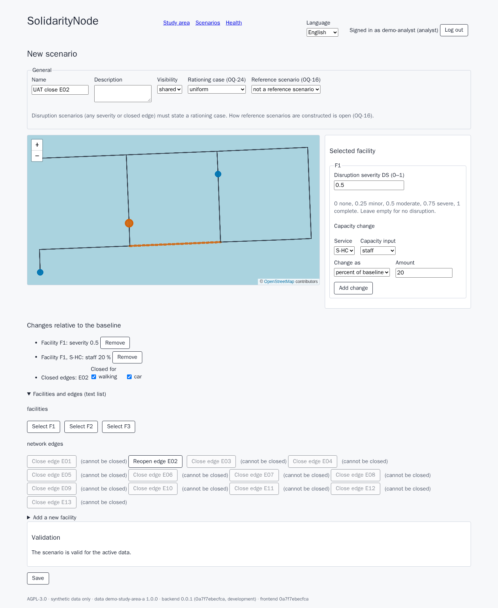

# Scenario editor

> Describes platform version **0.1.0**. For analysts and administrators.

## Write a scenario

1. **Scenarios** → **New scenario**.
2. Type a **Name** (required) and, if useful, a **Description**.
3. Choose the **Visibility**: **private** (you and administrators) or **shared** (every user, including viewers).
4. Describe the changes, by clicking on the map or using **Facilities and edges (text list)**:
    - **Close an edge**: click a road segment; it turns orange and dashed. Tick the transport modes it is closed for (walking, car). Segments that cannot be closed say so.
    - **Disruption severity DS** of a facility: select it and type a value from 0 (none) to 1 (complete), for example 0.5 (moderate).
    - **Capacity change**: choose a service, an input (places, staff, throughput), **percent of baseline** or **absolute amount**, and the amount; **Add change**.
5. A scenario with a disruption must state its **Rationing case (OQ-24)** (for example *uniform*).
6. Watch **Validation**: it says "The scenario is valid for the active data." or lists what is wrong; **Save** stays grey until the scenario is valid.
7. **Save**: "Saved as version 1." Each later **Save as new version** keeps the earlier versions, so every run can say exactly which version it used.

**Changes relative to the baseline** lists everything the scenario changes, in words.

## What has an effect today

The diagnostic model applies closed edges and capacity changes. Other changes are **recorded only** (καταγράφεται μόνο): saved, listed and shown on the run page, with no effect on results yet:

- the disruption severity of a facility (no method turns it into lost capacity yet);
- changes of travel time or speed, new edges, population changes (they have no fields in the editor yet; scenarios that contain them keep them when you save).

When a scenario combines interventions and disruptions, the platform applies the interventions first and the disruptions after. This is a proposed default, not yet confirmed by the method ([OQ-30](../specs/open-questions.md); order in [Lifecycles](../architecture/lifecycles.md#scenario-application-order-oq-30-proposed)).

## Data version

A scenario is created against one data version ("Version 1, created against data 1.0.0, owner demo-analyst"). A run always uses the **active** data; when they differ, the page says so next to **Run this version**. See [Data packages and updates](data-updates.md).
