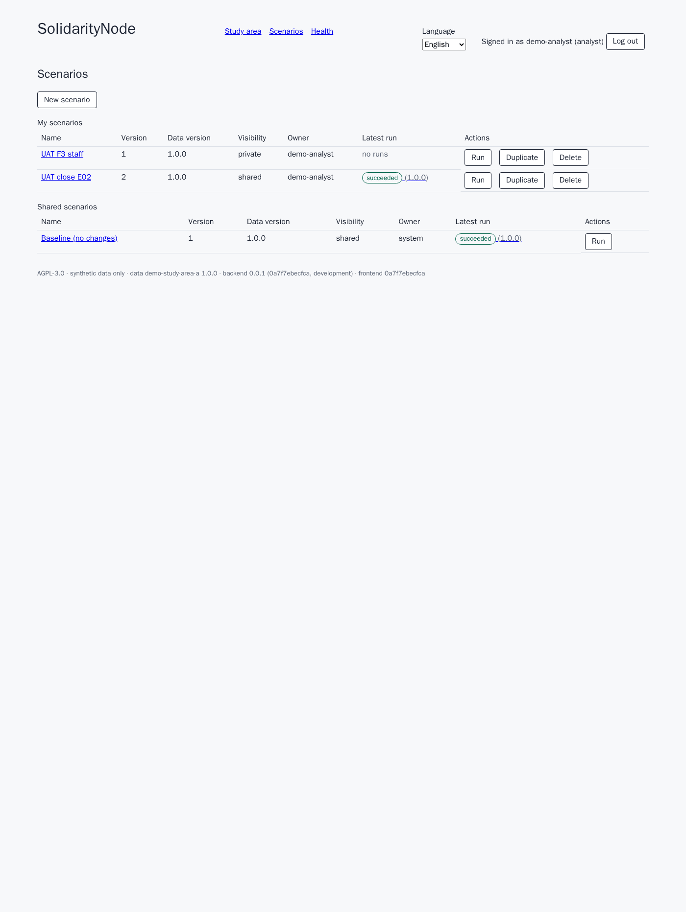

# Λίστα σεναρίων { #scenarios-list }

> Περιγράφει την έκδοση **0.1.0** της πλατφόρμας.

Ένα **σενάριο** είναι ένα «τι θα γινόταν αν»: μια λίστα αλλαγών πάνω στα δεδομένα ([Βασικές έννοιες](../concepts.md#scenario-what-if)). Η σελίδα **Σενάρια** (Scenarios) δείχνει όλα τα σενάρια που έχετε δικαίωμα να δείτε.

## Ενότητες { #sections }

- **Τα σενάριά μου** (My scenarios): τα σενάρια που σας ανήκουν (για αναλυτές και διαχειριστές). Το κουμπί **Νέο σενάριο** (New scenario) ανοίγει την [επεξεργασία σεναρίου](scenario-editor.md).
- **Κοινόχρηστα σενάρια** (Shared scenarios): σενάρια που βλέπουν όλοι οι χρήστες. Εδώ είναι και το σενάριο **Baseline (no changes)**, δηλαδή η βάση χωρίς αλλαγές, με κάτοχο το «σύστημα». Το όνομά του εμφανίζεται στα αγγλικά.
- **Ιδιωτικά σενάρια άλλων χρηστών (τα βλέπετε ως διαχειριστής)** (μόνο για διαχειριστές): το καθένα έχει την ένδειξη «ιδιωτικό (κάτοχος *όνομα*)».

## Στήλες { #columns }

- **Ορατότητα** (Visibility): ιδιωτικό (το βλέπουν ο κάτοχος και οι διαχειριστές) ή κοινόχρηστο (το βλέπουν όλοι οι χρήστες, και οι θεατές).
- **Τελευταία εκτέλεση** (Latest run): η κατάσταση της τελευταίας εκτέλεσης και σύνδεσμος προς αυτήν:
    - «ολοκληρώθηκε (1.1.0)»: η τελευταία εκτέλεση, με τα δεδομένα 1.1.0·
    - **Τελευταία εκτέλεση στα δεδομένα 1.0.0** (Latest run on data 1.0.0): το σενάριο δεν έχει ακόμη εκτέλεση με τα ενεργά δεδομένα·
    - **Δεν έχει εκτελεστεί ακόμη** (Not run yet): δεν εκτελέστηκε ποτέ. Ένας θεατής βλέπει «Ζητήστε από έναν αναλυτή να το εκτελέσει.»
- **Χρειάζεται έλεγχο με τα τρέχοντα δεδομένα** (Needs attention with the current data): το σενάριο αναφέρει κάτι που δεν υπάρχει πια στα ενεργά δεδομένα (για παράδειγμα μια δομή που έκλεισε). Δεν έχει κουμπί **Εκτέλεση** μέχρι να το διορθώσετε. Δείτε [Πακέτα δεδομένων και ενημερώσεις](data-updates.md).
- **Εκτέλεση** (Run): εκτελεί την τελευταία έκδοση του σεναρίου με τα ενεργά δεδομένα. Αν υπάρχει ήδη ίδια εκτέλεση, ανοίγει αυτή ([Συχνές ερωτήσεις](faq.md#why-did-my-run-open-at-once-without-computing)).
