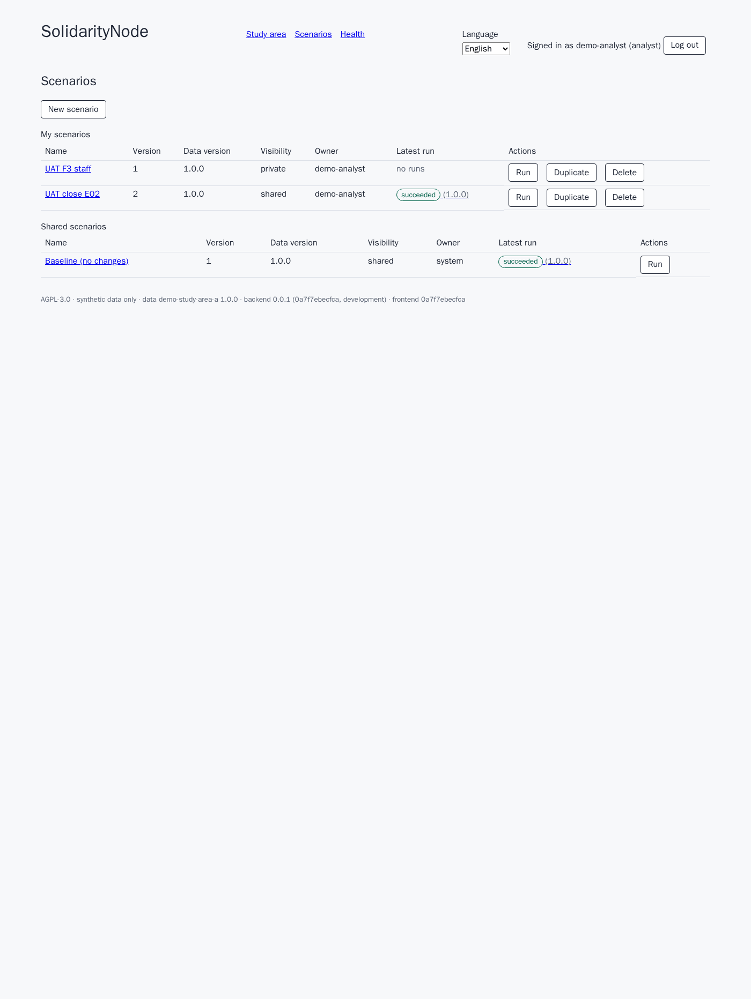

# Scenarios list

> Describes platform version **0.1.0**.

A **scenario** (σενάριο) is a "what if": a list of changes on top of the data ([Concepts](../concepts.md#scenario-what-if)). The **Scenarios** page lists every scenario you may see.

## Sections

- **My scenarios**: the scenarios you own (analysts and administrators). **New scenario** opens the [editor](scenario-editor.md).
- **Shared scenarios**: scenarios every user may see, including **Baseline (no changes)**, owned by "system".
- **Private scenarios of other users** (administrators only): each marked "private (owner *name*)".

## Columns

- **Visibility**: private (owner and administrators) or shared (every user, viewers included).
- **Latest run**: the status of the latest run and a link to it:
    - "succeeded (1.1.0)": the latest run, on data 1.1.0;
    - **Latest run on data 1.0.0**: the scenario has no run on the active data yet;
    - **Not run yet**: never run. A viewer sees "Ask an analyst to run it."
- **Needs attention with the current data**: the scenario names something that no longer exists in the active data (for example a closed facility). It has no **Run** button until it is edited. See [Data packages and updates](data-updates.md).
- **Run**: runs the latest version on the active data. If an identical run exists, it opens instead ([FAQ](faq.md#why-did-my-run-open-at-once-without-computing)).
