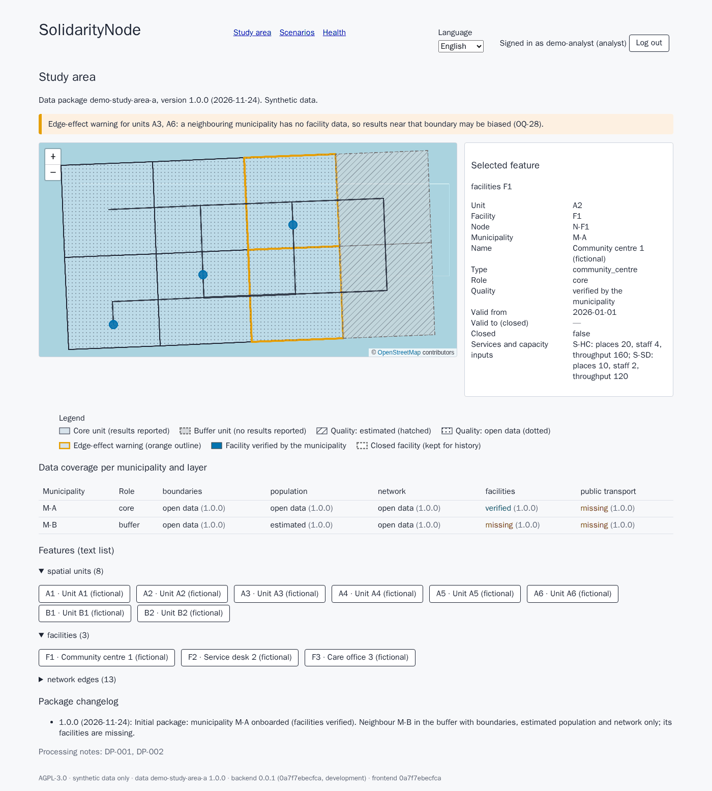
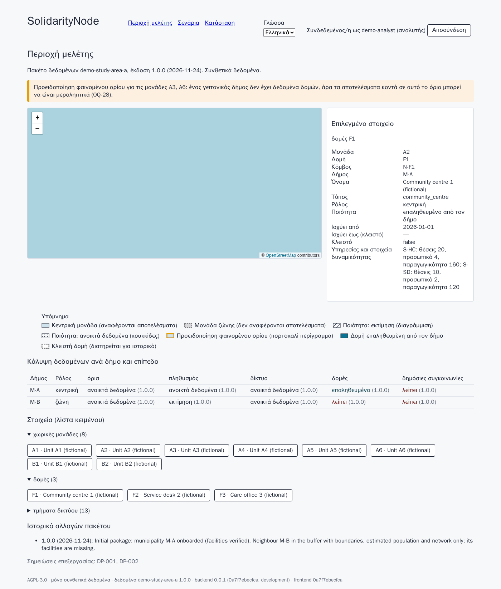
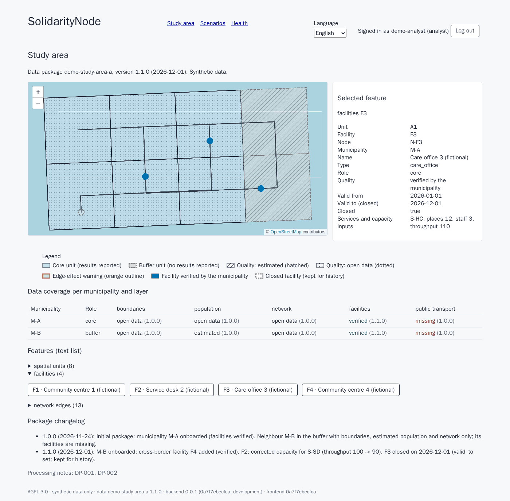

# Περιοχή μελέτης { #study-area }

> Περιγράφει την έκδοση **0.1.0** της πλατφόρμας.

Η σελίδα **Περιοχή μελέτης** (Study area) δείχνει την **ενεργή έκδοση δεδομένων**: τις χωρικές μονάδες, τις δομές και το οδικό δίκτυο που χρησιμοποιούν τα νέα σενάρια και οι νέες εκτελέσεις.

## Τι βλέπετε { #what-you-see }

- **Γραμμή τίτλου**: πακέτο δεδομένων, έκδοση και ημερομηνία, για παράδειγμα «Πακέτο δεδομένων demo-study-area-a, έκδοση 1.0.0 (2026-11-24). Συνθετικά δεδομένα.»
- **Χάρτης**:
    - οι **κεντρικές μονάδες** (συνεχές περίγραμμα) ανήκουν στον δήμο σας· για αυτές δίνονται αποτελέσματα·
    - οι **μονάδες ζώνης** (γκρι, διακεκομμένο περίγραμμα) ανήκουν σε γειτονικούς δήμους. Υπάρχουν για να μετρηθούν όσοι εξυπηρετούνται από την άλλη πλευρά του ορίου. Για αυτές δεν δίνονται αποτελέσματα·
    - οι **δομές** (κουκκίδες) και τα **τμήματα δικτύου** (γραμμές)·
    - τα **μοτίβα ποιότητας**: διαγράμμιση = εκτίμηση, κουκκίδες = ανοιχτά δεδομένα, χωρίς μοτίβο = επαληθευμένο από τον δήμο·
    - το **πορτοκαλί περίγραμμα**: προειδοποίηση φαινομένου ορίου ([Συχνές ερωτήσεις](faq.md#what-is-the-edge-effect))·
    - μια δομή που έκλεισε μένει στον χάρτη, λευκή με διακεκομμένο κύκλο, για το ιστορικό.
- **Επιλεγμένο στοιχείο** (Selected feature): κάντε κλικ σε μια μονάδα, δομή ή τμήμα στον χάρτη (ή στη λίστα **Στοιχεία (λίστα κειμένου)**, Features (text list)) για να δείτε τα στοιχεία του: δήμος, ρόλος (κεντρική ή ζώνη), ποιότητα, ισχύει από και έως, και για τις δομές τις υπηρεσίες με τα στοιχεία δυναμικότητας (θέσεις, προσωπικό, παραγωγικότητα).
- **Υπόμνημα** (Legend): κάθε σύμβολο με λέξεις.
- **Κάλυψη δεδομένων ανά δήμο και επίπεδο** (Data coverage per municipality and layer): για κάθε δήμο και επίπεδο (όρια, πληθυσμός, δίκτυο, δομές, δημόσιες συγκοινωνίες), αν τα δεδομένα είναι επαληθευμένα, ανοιχτά, εκτιμήσεις ή αν **λείπουν**.
- Το **Ιστορικό αλλαγών πακέτου** (Package changelog), οι **σημειώσεις επεξεργασίας** (DP-NNN) πίσω από τα δεδομένα και οι **Άδειες και αναφορά πηγής ανά επίπεδο** (Licences and attribution per layer).

## Πληκτρολόγιο και γλώσσα { #keyboard-and-language }

- Πατήστε **Tab** μέχρι ο χάρτης να αποκτήσει μπλε πλαίσιο. Μετά, μετακινηθείτε με τα βέλη και μεγεθύνετε ή σμικρύνετε με `+` / `-`.
- Κάθε στοιχείο του χάρτη υπάρχει και στη λίστα **Στοιχεία (λίστα κειμένου)**, ώστε να μη χρειάζεστε ποντίκι.
- Ελληνικά: η ίδια σελίδα στα ελληνικά («φαινόμενο ορίου» για το edge effect).

## Μετά από ενημέρωση δεδομένων { #after-a-data-update }

Όταν ένας διαχειριστής εισάγει νέα έκδοση δεδομένων, η σελίδα τη δείχνει αμέσως. Στο παράδειγμα επίδειξης, η έκδοση 1.1.0 προσθέτει τη δομή F4 στον γειτονικό δήμο (έτσι φεύγει η προειδοποίηση φαινομένου ορίου) και κλείνει τη δομή F3.

Περισσότερα: [Πακέτα δεδομένων και ενημερώσεις](data-updates.md).
