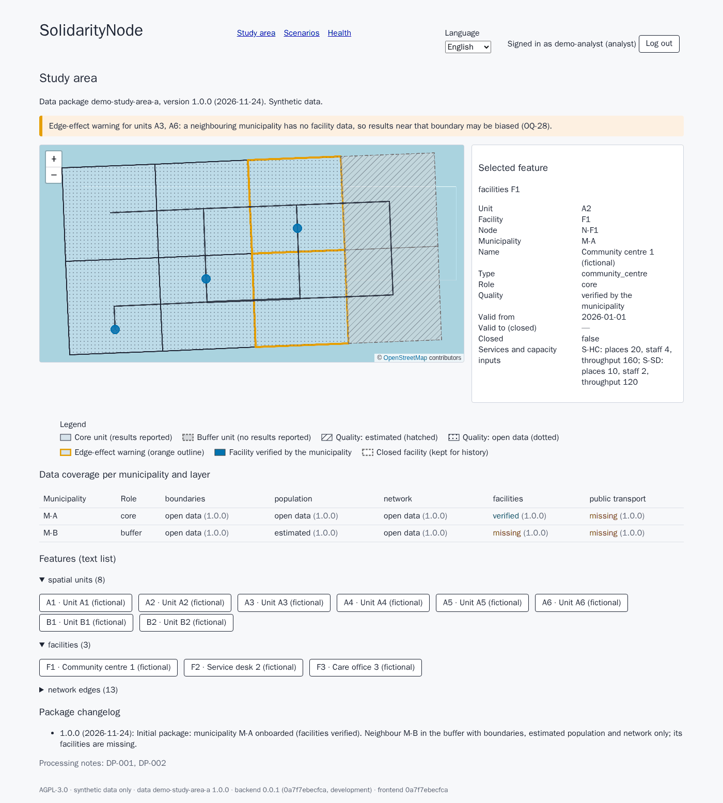
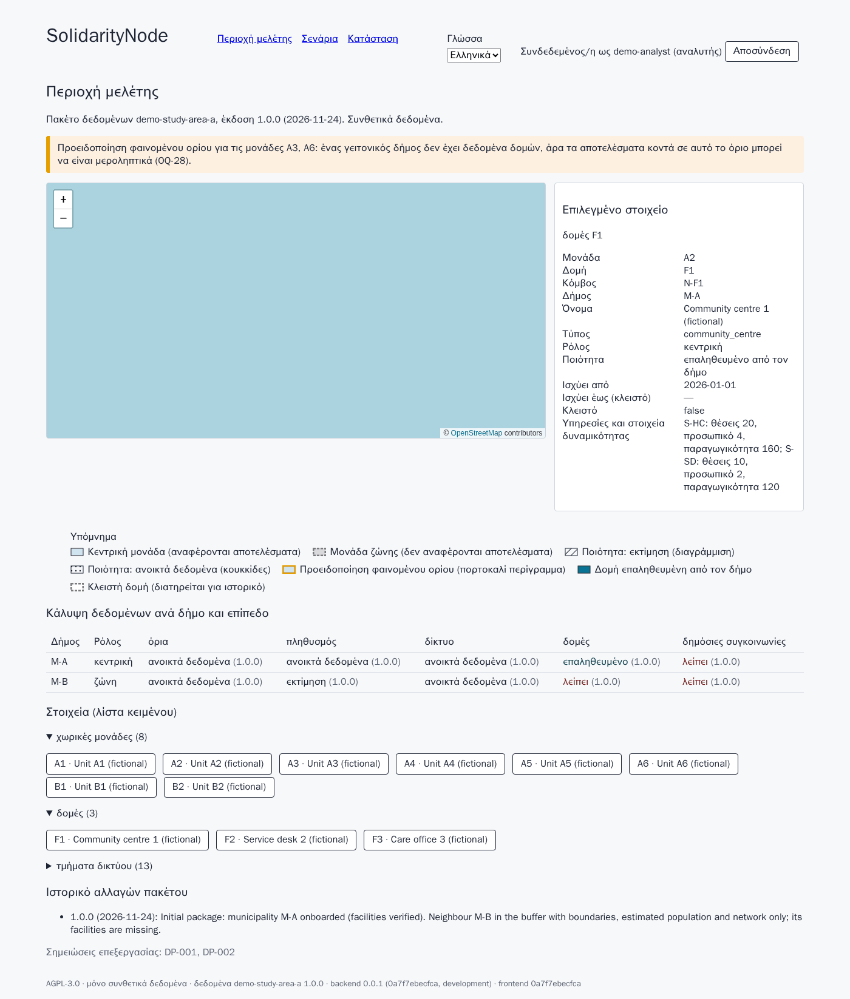
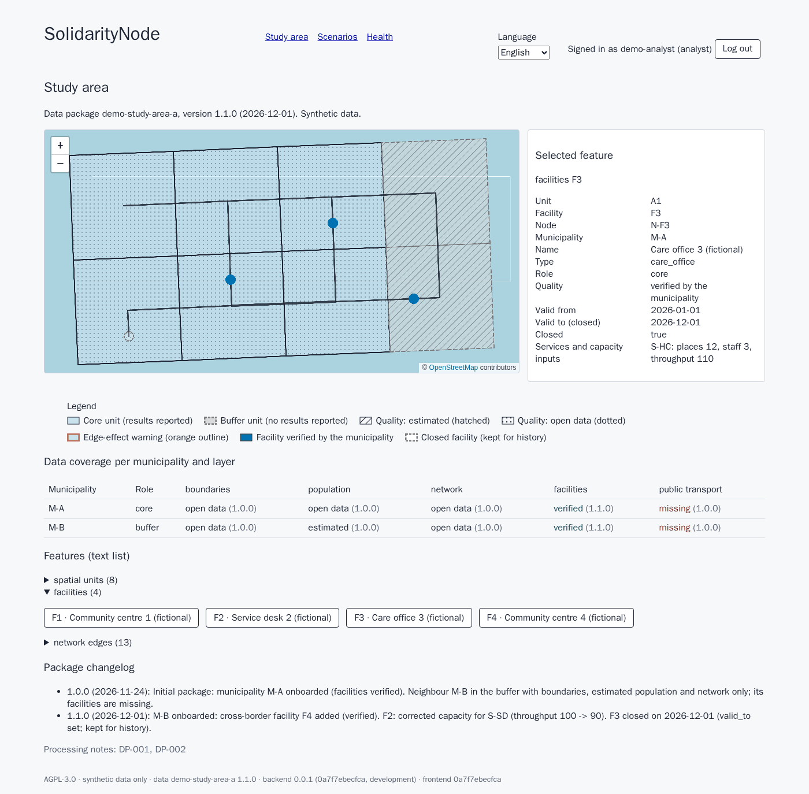

# Study area

> Describes platform version **0.1.0**.

The **Study area** page shows the **active data version** (ενεργή έκδοση δεδομένων): the spatial units, facilities and road network that new scenarios and runs use.

## What you see

- **Header line**: data package, version and date, for example "Data package demo-study-area-a, version 1.0.0 (2026-11-24). Synthetic data."
- **Map**:
    - **core units** (solid outline) belong to your municipality; results are reported for them;
    - **buffer units** (grey, dashed) belong to neighbouring municipalities; they are there so that people served across the boundary are counted, and no results are reported for them;
    - **facilities** (dots) and **network edges** (lines);
    - **quality patterns**: hatched = estimated, dotted = open data, plain = verified by the municipality;
    - **orange outline**: edge-effect warning ([FAQ](faq.md#what-is-the-edge-effect));
    - a closed facility stays on the map, white with a dashed ring, for history.
- **Selected feature**: click a unit, facility or edge on the map (or in **Features (text list)**) to see its details: municipality, role (core or buffer), quality, valid from and to, and for facilities the services with their capacity inputs (places, staff, throughput).
- **Legend**: every symbol in words.
- **Data coverage per municipality and layer**: for each municipality and layer (boundaries, population, network, facilities, public transport) whether data is verified, open data, estimated or **missing**.
- **Package changelog** and the **processing notes** (DP-NNN) behind the data, and **Licences and attribution per layer**.

## Keyboard and language

- Press **Tab** until the map has a blue focus frame, then use the arrow keys and `+` / `-` to pan and zoom.
- Every map item is also in **Features (text list)**, so nothing needs a mouse.
- Ελληνικά: the same page in Greek ("φαινόμενο ορίου" for the edge effect).

## After a data update

When an administrator imports a new data version, this page shows it at once. In the demo, version 1.1.0 adds facility F4 in the neighbouring municipality (so the edge-effect warning disappears) and closes F3.

More: [Data packages and updates](data-updates.md).
